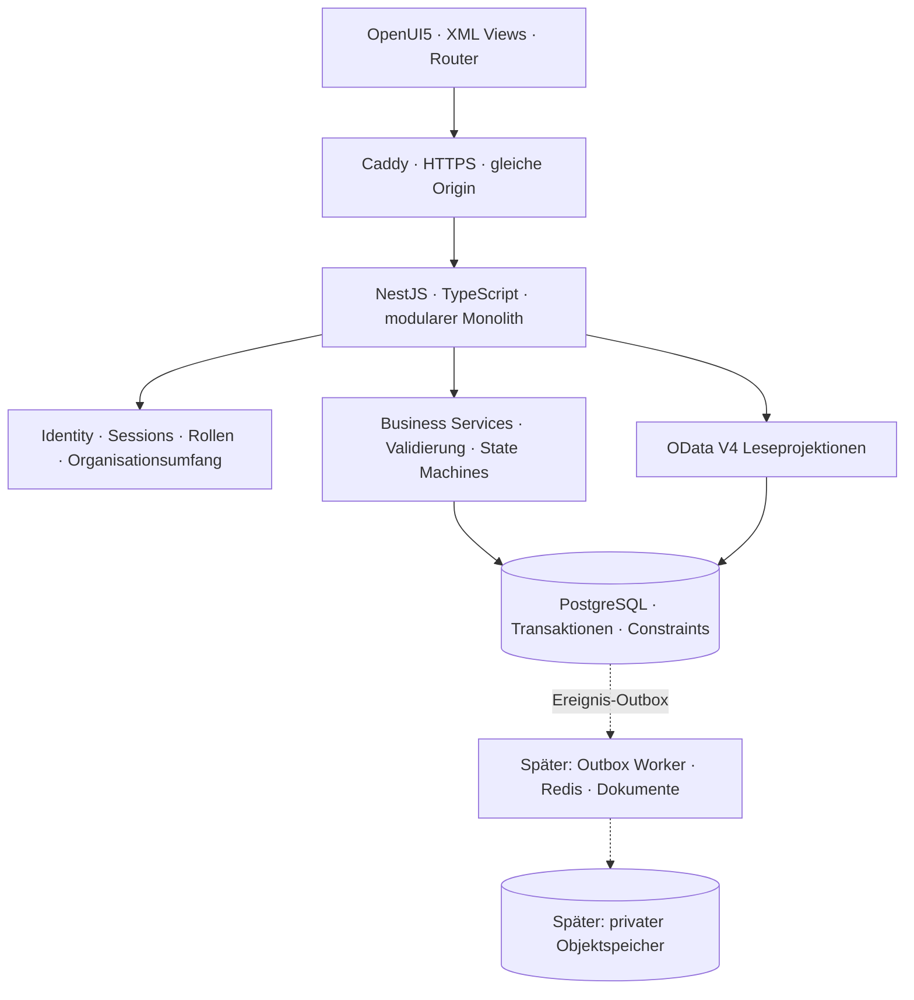

# Enterprise Service ERP – Architekturentscheidung 001

Stand: 22.10.2026. Eigenständige Software, kein SAP-Backend und keine SAP-Markenkennzeichen. Die Screenshots sind Prozess- und Layoutreferenzen. OpenUI5 steht unter Apache-2.0; ausschließlich freie OpenUI5-Bibliotheken werden ausgeliefert.

## Lieferumfang und Abgrenzung

Der aktuelle Stand umfasst Ticket-/Fallbearbeitung, Kunden-/Artikel-/Auftragsfreigabe, Servicebasis/SLA/Einsatzplanung und Auftragsausführung. Das Ticket ist der zentrale Arbeitsbeleg: Arbeits-/Fahrzeit und Pauschalen gehören zu Work Order Tasks; deren Abschluss erzeugt eine SRM im Serviceauftrag mit unveränderter Ticket-Korrelations-ID. Danach folgen Kundenbestätigung, Servicefreigabe, technischer Abschluss und Fakturabereitschaft. Der konkrete Umfang und alle offenen Module stehen in [Implementierungsplan](implementation-plan.md) und [Versionsnotizen](releases/v0.5.0-preview.1.md). Der Buchungskern unterstützt manuelle Journale mit Freigabe, Buchung, Gegenbelegstorno und Salden. Noch keine Rechnungs-/Lagerintegration, keine Produktivfreigabe oder Compliance-Zusage.

## System

Für die Oberfläche sind ausschließlich OpenUI5-Standardcontrols erlaubt. Kein eigenes CSS, keine selbst entwickelten Controls/Renderer, keine nachgebauten UI-Elemente oder eigenen SVG-Logos. Layoutabstände verwenden ausschließlich die Standardklassen von OpenUI5. Das Bootstrap-HTML enthält nur den üblichen ComponentContainer-Einstieg. Standardtheme: SAP Horizon aus OpenUI5.

Node.js 24 LTS, NestJS, PostgreSQL, parametrisierter `pg`-Datenzugriff mit expliziter Transaktionsgrenze. SQL-Migrationen werden versioniert und mit Prüfsummen geprüft. Das ist die gewählte Alternative zu Prisma: genaue Kontrolle über RLS, zusammengesetzte Fremdschlüssel und Sperren. Kein zweites Datenmodell im ORM. Ein späterer Wechsel muss Migrationshistorie und Constraints erhalten.

Der Browser benutzt ein echtes `sap.ui.model.odata.v4.ODataModel` für Listen, ein JSONModel für Session/Formulare und REST-Kommandos für Zustandsänderungen. OpenUI5 benötigt keinen proprietären SAPUI5-Server. Bibliotheken: `sap.ui.core`, `sap.m`, `sap.f`, `sap.ui.layout`, `sap.ui.table`, `sap.uxap`. Kein `sap.ushell`/`sap.suite.ui.commons` als Voraussetzung. Der Belegfluss verwendet ausschließlich `sap.m.Table` und `sap.m.Link`. Ein grafischer ProcessFlow aus proprietären Bibliotheken wird nicht nachgebaut.

Das Startziel nach Anmeldung ist die App-Zentrale. Das separat aufrufbare Service-Cockpit besteht aus `sap.f.DynamicPage`, `sap.f.Card`, `sap.f.cards.NumericHeader`, `sap.m.IconTabHeader`, `sap.m.Table` und `sap.m.ProgressIndicator`. Die App-Zentrale unter `#/apps` enthält Anwendungskacheln. Obere Schnellzugriffe zeigen nur Masken der aktiven Anwendung, keine globale Modulleiste. KPI-Klicks filtern den tatsächlichen Arbeitsvorrat; Zuweisung ist direkt in der Ticketzeile möglich. Neue, unzugewiesene, hoch priorisierte und in Bearbeitung befindliche Tickets sowie die Prioritätsverteilung werden aus autorisierten PostgreSQL-Daten ermittelt. Keine SLA-/Auslastungskennzahlen ohne implementierte Datengrundlage.

## Modulverantwortung

| Modul | Eigene Daten | Abhängigkeiten / Kommandos |
|---|---|---|
| Identity & Access | Benutzer, Rollen, Sessions, Berechtigungen | Organization; sichere Anmeldung und Scope |
| Organization | Mandant, Unternehmen, Buchungskreis, Org-Knoten | Basis für alle Module |
| Business Partner / CRM | Partnerrollen, Adressen, Kontakte, Freigaben | Workflow; aktive Kunden als Operanden |
| Customer Portal | Zugriffsprojektion, externe Referenz | Identity + Partner + ITSM; keine eigene Ticketkopie |
| ITSM | Ticket, Ereignis, technische Priorität | Partner + Organization; eröffnet Servicefall |
| Service Management | Servicefall, Problemkontext, Verknüpfungen | ITSM, Verträge, Assets; trennt kaufmännischen Status |
| Dispatching / Field Service | Techniker, Disposition, Einsatz, Zeit, Bericht | Servicefall, SLA, Materialreservierung |
| Asset Management | technische Objekte, Komponenten, Historie | Partner + Verträge |
| Service Contracts | Vertrag, Deckung, SLA-Policy | Partner + Pricing + Billing |
| Sales / Service Orders | Angebot, Auftrag, eingefrorene Konditionen | Partner + Pricing; eigene Freigaben |
| Pricing | Konditionen, Zugriff/Reihenfolge, Protokoll | Material, Partner, Vertrag; Decimal |
| Material / Inventory / Warehouse | Stamm, Mengen, Reservierung, Bewegungen | Organisation + Bewertung; keine direkten Bestandsänderungen |
| Procurement | BANF, Bestellung, Wareneingang, Rechnungseingang | Bedarf, Workflow, Bestand, Kreditoren |
| Billing | Fakturavorrat, Rechnung, Storno, PDF/E-Rechnung | bestätigte Leistung + Finance; keine Journalhoheit |
| Finance | Konten, Perioden, Journal, offene Posten, Zahlung | unveränderliche Buchungen; Kontierungsregeln |
| Controlling / Reporting | Auswertungsprojektionen | ausschließlich echte fachliche Bewegungen |
| Workflow | versionierte Regeln, Instanzen, Schritte | Berechtigung + Org; Vier-Augen-Prinzip |
| Document Management | Referenzen, Vorlagen, Archivmetadaten | Objektspeicher, Scan, Formulargenerator |
| Integration / Administration | Idempotenz, Outbox, Nummern, Konfiguration | alle Module über definierte Services |

## Konsistenz und Erweiterbarkeit

Ein Business-Kommando besitzt eine DB-Transaktion. Nummer, Ticket, Servicefall, Belegrelation, Idempotenzantwort und Audit werden gemeinsam festgeschrieben. Konkurrenz wird durch eindeutige Idempotenzschlüssel, Zeilensperren und erwartete Versionen kontrolliert. Änderungen erhalten Benutzer, Zeit und Korrelations-ID. Kein späterer Worker darf eine nicht abgeschlossene Transaktion beobachten. Externe E-Mail-/PDF-Effekte werden später über eine transaktionale Outbox mit Zustellversuchen ausgelöst.

Lesen und Schreiben verwenden dieselben serverseitigen Tenant-/Org-/Kundenfilter. Datenbank-RLS ist eine zusätzliche Barriere; Benutzer können Mandant oder Organisation nicht im Request frei wählen. Alle Beziehungen zwischen mandantenabhängigen Tabellen enthalten `tenant_id` im Fremdschlüssel.

## Architekturprüfung

| Prüfpunkt | Entscheidung / Nachweis |
|---|---|
| OpenUI5 | lokale npm-Ressourcen; XML Views; kompatible Komponenten im Browser prüfen |
| OData | V4-Metadaten + EntitySets; Filter/Sortierung/Paging; lesender unterstützter Teilumfang dokumentiert |
| Transaktionen | PostgreSQL statt In-Memory-/JSON-DB; Konkurrenz-/Rollbacktests |
| Deployment | Linux + Compose + Caddy; lokale Entwicklung mit echtem eingebettetem PostgreSQL |
| Sicherheit | DB-Sessions, CSRF, scrypt, serverseitiges RBAC und Mandantenscope |
| Skalierung | zunächst ein API-Prozess; gemeinsame Session-DB; Indizes + Paging; Worker erst bei Bedarf |
| Wartbarkeit | modulare Business Services, migrationsgesichertes Schema, Tests und ausdrückliche Ausbaugrenzen |

Der Nutzer bestätigt einen Ubuntu-Server mit Docker. Das ist grundsätzlich geeignet; CPU/RAM, Domain/DNS, Backup-Ziel und tatsächliche Serverkonfiguration sind dort noch zu prüfen. Entwicklungsfähigkeit dieser Cloud ist kein Nachweis für das Zielhosting.
