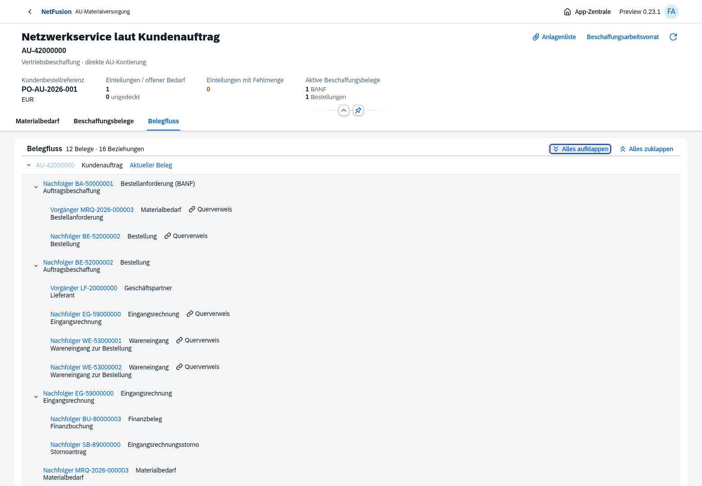
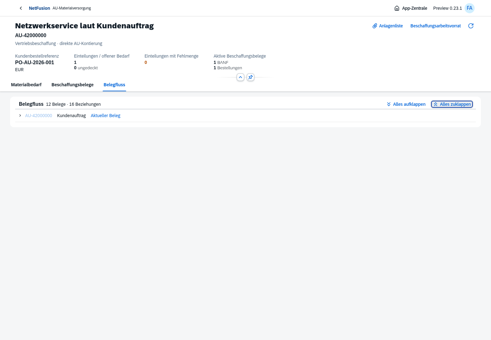
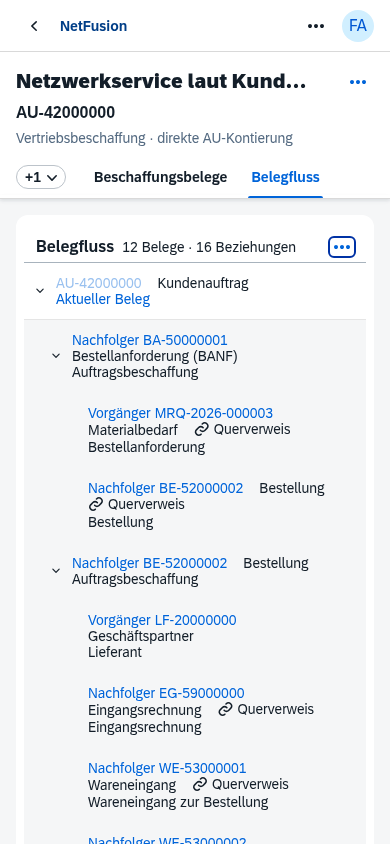

# Aufklappbare Belegflussbäume · Oberflächenstand nach Preview0.23

Alle18 Vorgangsmasken verwenden dieselbe native OpenUI5-Baumansicht. Der aktuelle Beleg ist die markierte Wurzel. Vorgänger, Nachfolger und einzelne Zweige sind auf-/zuklappbar; die Gesamtsteuerung öffnet oder schließt alle Zweige. Echte Beleglinks öffnen die passende Anwendung. Zusammenlaufende Zweige und Zyklen bleiben als endliche Querverweise vollständig erhalten. Ausschließlich OpenUI5 1.152.1 und Standardklassen.

Weitere tatsächliche Masken: [Ausgangsrechnung mit AU/AF/WA/FI](document-flow-invoice.png), [eingeschränkte Kundensicht](document-flow-customer.png), [SRM aus tatsächlichem Ticket/WOT](document-flow-service-report.png).

## Verhalten und Abdeckung

Der Browserdurchlauf öffnet alle18 Maskenimplementierungen: Kostenvoranschlag/Verkaufsangebot, AU, Serviceauftrag, Servicefall, AU-Materialversorgung, AU-Auslieferungsplanung, direkte Warenlieferung, Bedarf/BANF/Bestellung, WE, Service-WA, Finanzbeleg, SRM, Fakturaanforderung, Ausgangsrechnung, Eingangsrechnung, Eingangsrechnungsstorno, Lagerbewegung und Inventur. Gemeinsame Maskenvarianten zählen einmal. Die Ticketmaske behält gemäß Nutzervorgabe keinen Belegflussreiter.

Die Daten stammen aus echten isolierten Fachabläufen: AU-Beschaffung mit BANF/Bestellung und Teil-WE1+2, gebundener Eingangsrechnung/FI und vorbereitetem EG-Storno; direkte Warenlieferung mit unabhängig freigegebener AF und Teilrechnung; tatsächliche SRM aus Ticket/WOT sowie Service-Materialausgabe, physische Einlagerung und Inventureröffnung. Keine künstlichen Graphkanten oder Geschäftsbelege zum Ausschmücken der Screenshots.

Für jede geöffnete Maske wird die vollständig aufgeklappte Anzahl gegen die tatsächlichen API-Beziehungen geprüft. Einzeln auf-/zuklappen, Gesamtsteuerung, native Pfeiltasten und tatsächlicher Belegsprung sind geprüft. Auch nach Rückkehr zur Rechnung bleibt „Alles aufklappen“ maßgeblich: Eine verspätete Standardinitialisierung darf die ausdrückliche Benutzerwahl nicht überschreiben. Zwei zusätzliche Tests sichern diesen Fall und die Einzelverzweigung ab.

Die Kundensicht erhält unverändert den serverseitig bereinigten Graphen ohne interne Beschaffungs-, Aufgaben- oder Finanzbelege. Aus einer Beziehung entstehen keine zusätzlichen Rechte. Auf390px sind Abschnittsnavigation und Baumaktionen über die nativen Überlaufmenüs erreichbar; das aufgeklappte Beispiel bleibt innerhalb der Seitenbreite. Physische mobile Geräteabnahme und vollständige Barrierefreiheitszertifizierung bleiben eigene Backlogpunkte.

## Prüfungen und Installation

[Nachweis aller18 Masken, Belegnummern und Beziehungen](document-flow-tree-proof.json), [Gesamtnachweis](verification.json): **64/64 gezielte Tests**, darunter neun Graph-/Zustandsfälle und die Standardcontrol-Prüfung. Native18-Masken-Prüfung sowie bisherige Angebots-, Service-Einkaufs-, AU-Eingangsrechnungs- und EG-Storno-Browser grün. Der vollständige historische Browser-Suitenlauf wird damit nicht behauptet.

UI5-Build erfolgreich. Keine Datenmigration, keine neuen Abhängigkeiten oder eigenen Controls/Styles. Dieser Stand erweitert den Quellcode nach dem Tag0.23.0-preview.1; er ist kein neuer Docker-Image- oder Release-Tag-Nachweis. Eine bestehende Docker-Installation benötigt den Neubau aus aktuellem `main` mit ihrer bisherigen Hostkonfiguration: [Docker-Anleitung auf8070](../../docker-8070.md).

[Belegflussmodell und Masken](../../document-flow.md), [verbleibender Masterbacklog](../../master-backlog-index.md). MFA/OIDC, weitere Organisationsstrukturen, Varianten/Massenaktionen und übrige Fachpakete bleiben offen.
