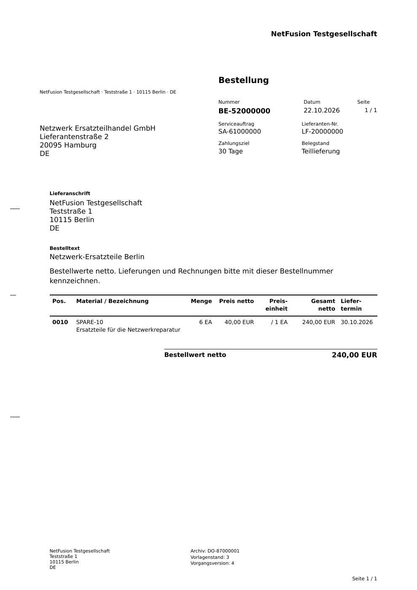
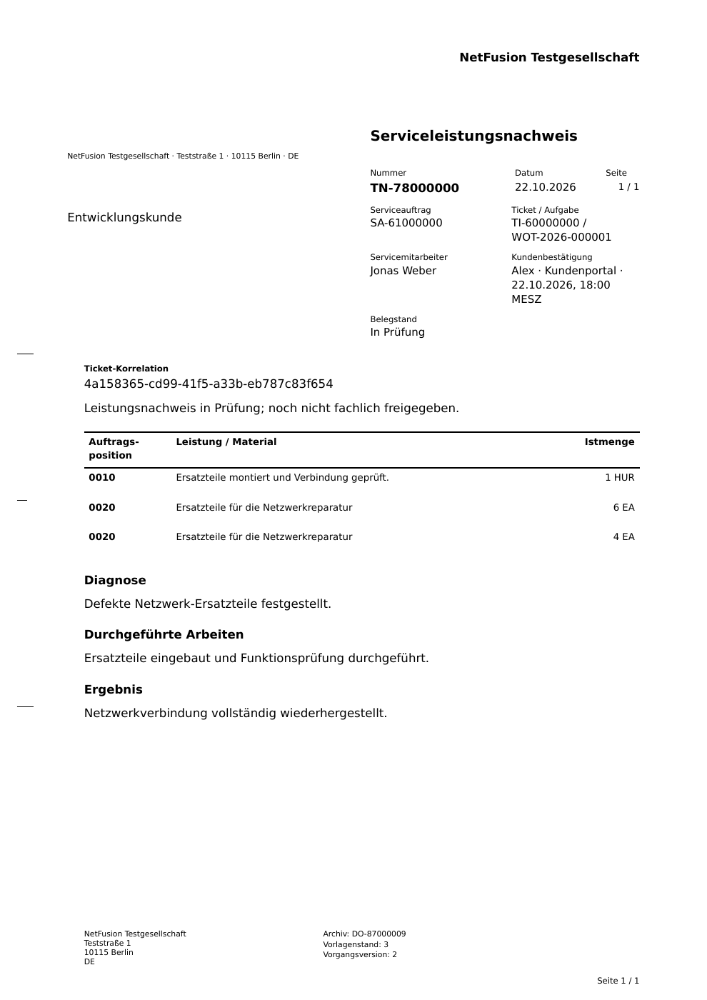

# Preview 0.10.0-preview.2 · Klassische Schwarz-Weiß-Geschäftsformulare

Nutzerreferenz vom22.10.2026 umgesetzt: schwarzer Text auf weißem Papier, rechter Belegkopf mit kleinen Feldtiteln und Nummer/Datum/Seite, Empfänger- und Lieferanschrift links, kräftige horizontale Tabellenlinien, fortlaufende Positionen, rechtsbündige Werte und klassische Firmenfußzeile. DIN-Form-B-Fensteranschrift bleibt erhalten. Keine farbigen Flächen, Karten oder erfundenen Logos/Siegel.

Alle sechs bestehenden Ausgabetypen verwenden dieselbe Formularbasis, Vorlagenstand3. Bestell- und Auftragspositionen zeigen die Artikelnummer aus dem freigegebenen Preis-/Produktstand; die Bestellung nennt Preis je Basiseinheit. Bestehende archivierte Dateien werden nicht ersetzt. Beispiele enthalten ausschließlich fiktive isolierte Testdaten.

## Bestellung

[Original-PDF aus dem Browser](business-purchase-order.pdf). Bestellmenge6, Preis40EUR je1EA, Bestellwert240EUR. Der Teil-WE4 ändert die bestellte Gesamtmenge nicht.

## Weitere Geschäftsbelege auf derselben Formularbasis

| Beleg | Tatsächliches PDF | Gerenderte Ansicht |
| --- | --- | --- |
| Serviceauftragsbestätigung | [PDF](business-order-confirmation.pdf) | [Bild](business-order-confirmation.png) |
| Wareneingang | [PDF](business-goods-receipt.pdf) | [Bild](business-goods-receipt.png) |
| Lieferschein | [PDF](business-delivery-note.pdf) | [Bild](business-delivery-note.png) |
| Serviceleistungsnachweis / SRM | [PDF](business-service-report.pdf) | [Bild](business-service-report.png) |
| Internes Vorgangsblatt | [PDF](business-record.pdf) | [Bild](business-record.png) |

128 automatisierte Prüfungen bestanden; insbesondere tatsächlich gerasterte PDF-Pixel ohne Farbanteil, Adresskoordinaten, Tabellen-/Betragsinhalte, letzte Position und wiederholte Köpfe über mehrere Seiten, historische Bytes, Quarantäne und Berechtigungsgrenzen. Der native Browser-Anlagenablauf wurde nach dem Formularwechsel erneut geprüft. Die übrigen elf Browserketten bestanden im unmittelbar vorherigen Preview; die Fachmasken sind bis auf Versionskennzeichnung unverändert. [Oberflächenbilder des vorherigen Zwischenstands](../v0.10.0-preview.1/README.md).

[Versionsnotizen und Grenzen](../../releases/v0.10.0-preview.2.md). Keine Faktura/Gutschrift, E-Mail-Zustellung oder vollständige Masterprompt-Abdeckung behauptet. Firmenpflichtangaben hängen von den hinterlegten Stammdaten ab; keine unabhängige vollständige DIN-Konformitätsabnahme.
