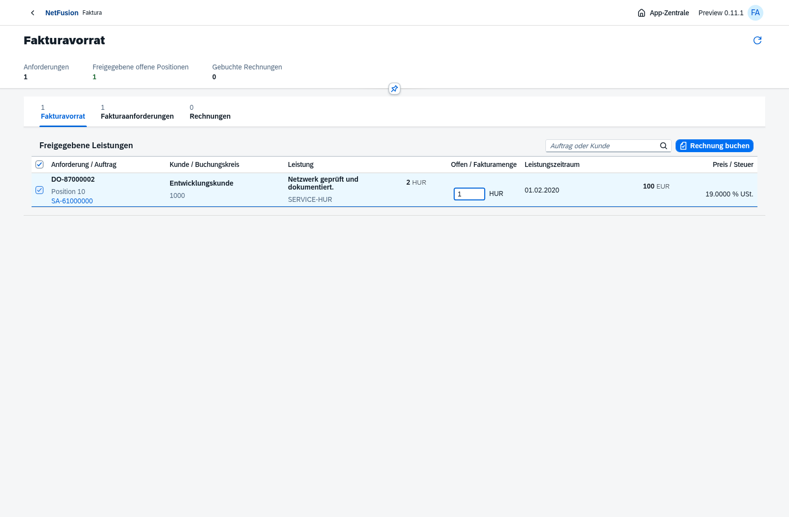
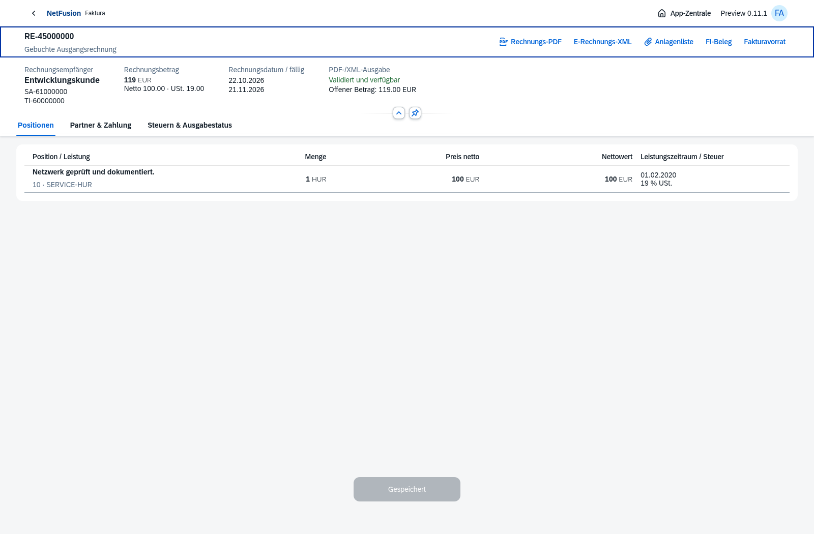
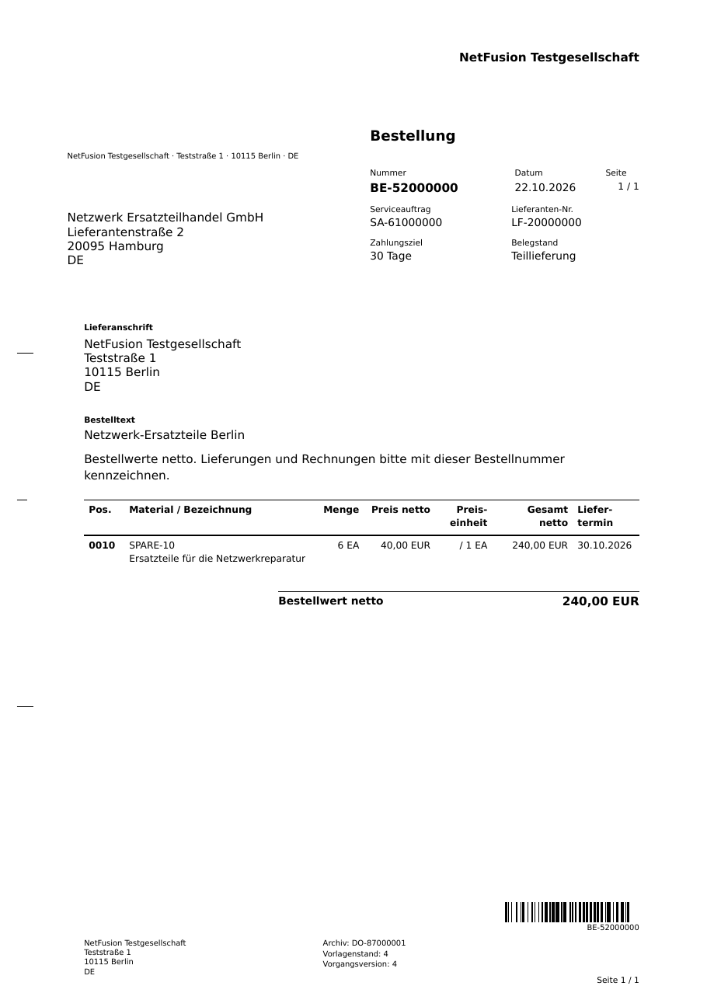
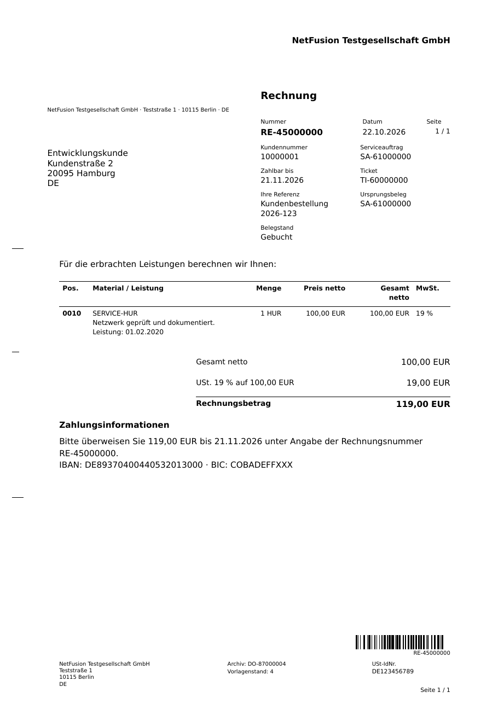

# Preview0.11.0-preview.1 · Faktura, ZUGFeRD und Belegbarcodes

Echte Chromium-Aufnahmen und heruntergeladene PDFs vom22.10.2026, ausschließlich isolierte fiktive Testdaten. Oberfläche vollständig native OpenUI5-Controls, ohne eigene CSS-/HTML-/Renderer-Elemente. Kein vollständiger SAP-Ersatz oder Produktiv-/Compliance-Freigabe.

## Fakturaanforderung → Freigabe → Fakturavorrat → Teilrechnung

[Leistungsquellen](billing-source.png) · [Anforderung in Prüfung](billing-request.png) · [Fakturavorrat](billing-due-list.png) · [Gebuchte Rechnung](billing-invoice.png) · [kleine Anlagenliste](billing-invoice-attachments.png) · [Mobilansicht](billing-invoice-mobile.png).

Die Testquelle enthält zwei freigegebene Iststunden. Unabhängige Anforderungsfreigabe macht diese fakturierbar. Eine Stunde wird mit100EUR netto,19EUR USt. und119EUR Forderung gebucht; eine Stunde bleibt im Vorrat. Tatsächlicher Leistungszeitraum und Ticket-/SRM-Korrelation bleiben erhalten. Fehlgeschlagene PDF/XML-Ausgabe erzeugt keine zweite FI und kann gezielt wiederholt werden.

## Klassische Schwarz-Weiß-Formulare mit Code128

[Bestell-PDF](business-purchase-order.pdf) · [ZUGFeRD-Rechnungs-PDF](zugferd-invoice.pdf) · [unverändertes eingebettetes CII-XML](factur-x.xml) · [tatsächlicher Validatorbericht](zugferd-validation.xml).

Vorlagenstand4 erweitert die gemeinsame Basis für Bestellung, AB, WE, LS, SRM, Vorgangsblatt und neue Ausgangsrechnung. Barcode auf jeder Seite, schwarze Vektorbalken, Ruhezone und lesbare tatsächliche Belegnummer; DIN-Anschriftfeld und Tabellen bleiben frei. Archivierte frühere PDFs werden nicht ersetzt. Fremde Eingangsoriginale werden nicht umgestempelt. Aus gerasterten PDFs unabhängig mit ZXing decodiert, einschließlich Folgeseiten, historischer Nummer und fertiger Hybridrechnung. Reale Drucker-/Handscannerabnahme bleibt offen.

Die Hybridrechnung ist PDF/A-3b mit `factur-x.xml` im CII-/EN16931-Profil. Mustang-CLI2.26.0 prüft die tatsächliche Datei mit PDF/A-, XML-/XSD-/Schematronprüfung; das exportierte Protokoll ist beigefügt. Eine rechnerisch falsche Testrechnung wird blockiert. Das beweist weder XRechnung noch sämtliche deutschen Steuer-/Rechtsformfälle.

## CRM und kaufmännische Freigaben

[Ansprechpartnerfunktionen](crm-contact-functions.png) · [Debitoren-/Kreditorenrollen](crm-financial-roles.png) · [Faktura-/Bankprofil](company-billing-profile.png).

Mehrere Ansprechpartnerfunktionen, Abteilung, Aktivität und Gültigkeit mit Versionsschutz; eigene Adressarten/Standardadresse. Finanzrollen sind getrennte genehmigungspflichtige DO-Vorgänge je Buchungskreis; passende GP-Rolle/Abstimmkonto, Zahlungsziel, Sperren und Kreditlimit werden geprüft. Das ist eine CRM-Teilbasis, keine vollständige Aktivitäten-/Vertriebs-/Beziehungsverwaltung.

## Prüfungen und Grenzen

145 automatisierte Prozess-/Datenbank-/PDF-/Barcode-/E-Rechnungsprüfungen bestanden; Chromium-Prüfung des neuen Faktura-/CRM-Prozesses einschließlich Mobilansicht bestanden. Alle zwölf bestehenden Browserketten bestanden ebenfalls; insgesamt13 Chromium-Prozessketten grün. [Versionsnotizen](../../releases/v0.11.0-preview.1.md). Produktionsabhängigkeiten: npm audit ohne bekannte Schwachstellen. Java21 und geprüftes Werkzeug lokal vorhanden; Lokaler Docker-Start mit PG, Migrationen, Bootstrap, Production-Anmeldung, UI, schreibgeschütztem unprivilegiertem Laufzeitprozess und tatsächlicher E-Rechnungsvalidierung bestanden; [Bericht](docker-smoke.json). Ubuntu-Zielserver und echte HTTPS-/AV-/Restore-/Lastabnahme bleiben offen.

Erster Rechnungsumfang: ein SA je Rechnung, Inland DE, normale positive Umsatzsteuer, gleicher Währungscode mit zwei Nachkommastellen, Auftraggeber=Rechnungsempfänger, Ist-/Festpreis ohne gesplitteten Festpreisplan. Weitere Steuerfälle, eigener AU, mehrere Aufträge in Sammelrechnung, Anzahlungen, periodische Pläne, Rechnungskorrektur/Gutschrift, Zahlungen/Ausgleich und Eingangsrechnungsprüfung bleiben offen. Kleinstmengenrundung kann gesperrt werden, wenn Teilbeträge den freigegebenen Nettowert überschreiten; kein automatischer Rundungskorrekturprozess. Ausgabewiederholung ist gezielt, kein bereits vorhandener autonomer Worker.

[Rechtliche Matrix mit notwendigen Ergänzungen](../../compliance-gap-analysis.md) und [zwölf Eingangsrechnungs-Arbeitspakete](../../requirements/incoming-invoices-barcodes.md). Amtliche Quellenabrufe wurden vom Netzwerkproxy blockiert; Rechtslage zum gewünschten Stichtag nicht abschließend verifiziert. Vollständige Register-/Vertretungs-/Steuer-/Archiv-/Datenschutzfreigaben fehlen weiterhin.

Ergänzung aus der letzten Nutzersteuerung: sichtbare Datumswerte `TT.MM.JJJJ`, einzelner Leistungstag ohne Wiederholung und kurzer Zeitraum auf derselben Druckzeile. Ticketnummern stammen aus den tatsächlich abgerechneten SRM-Quellen und stehen im eingefrorenen Rechnungssnapshot, PDF und CII-Hinweis; Migration014 verhindert falsche Referenzen. Finale Rechnungs-/Datums- und PDF-Koordinatenprüfungen bestanden;13 Browserketten nach gemeinsamer Datumsumstellung erneut grün. Alte Archivbytes bleiben erhalten.

Weitere aktualisierte Formulare mit Code128: [AB](business-order-confirmation.pdf), [WE](business-goods-receipt.pdf), [LS](business-delivery-note.pdf), [SRM](business-service-report.pdf), [Vorgangsblatt](business-record.pdf). Die gerenderten PNGs mit gleichem Dateinamen liegen daneben. [Docker-Nachweis](docker-smoke.json) enthält keine Zugangsdaten und stammt aus vollständig entfernten isolierten Testcontainern.
