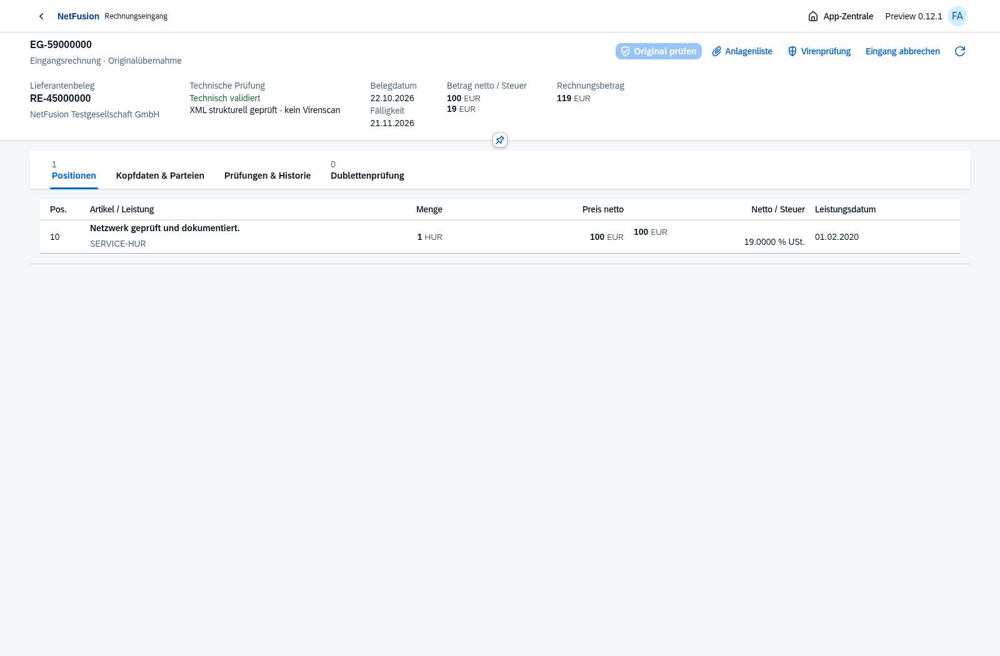
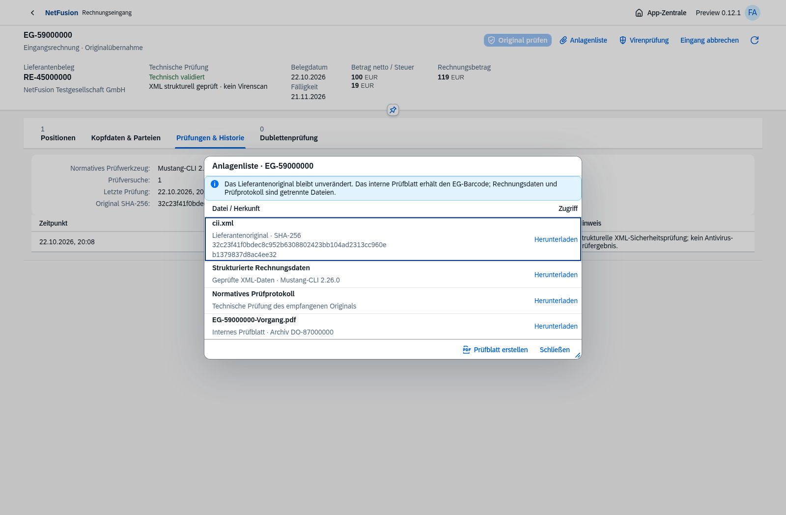
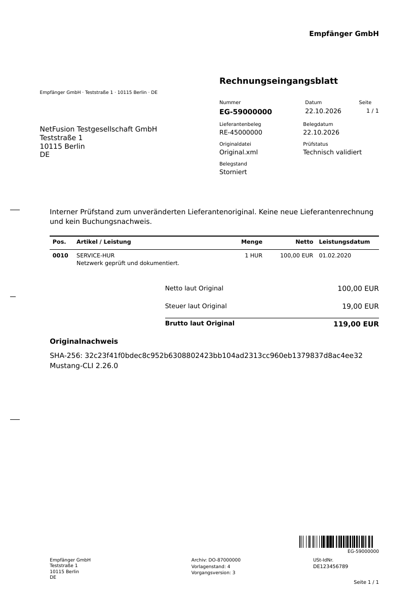

# Preview 0.12.0-preview.1 · Rechnungseingang

Tatsächliche Chromium-Aufnahmen und Original-/Formulardateien vom 22.10.2026 aus isolierten fiktiven Testdaten. Ausschließlich native OpenUI5-Controls und Standardtheme. Technischer Rechnungseingang ist eine Teilumsetzung des ERP-Backlogs.

[Arbeitsliste](incoming-worklist.png) · [Parteien](incoming-invoice-parties.png) · [Prüfungen](incoming-invoice-checks.png) · [Dubletten](incoming-invoice-duplicates.png) · [Mobilansicht](incoming-invoice-mobile.png).

Eine originale CII-Rechnung wird über den nativen FileUploader übernommen, erhält EG-59000000 und wird am gespeicherten Original normativ geprüft. Externe RE-45000000, 100 EUR netto, 19 EUR Steuer, 119 EUR Gesamt und Leistungsdatum 01.02.2020 bleiben separat. Eine unabhängig konvertierte UBL-Datei mit derselben externen Nummer erscheint als möglicher Doppeleingang. Das sind fiktive technische Prüfdaten; eine Übereinstimmung mit Kreditor/Empfänger/Bestellung ist erst im folgenden kaufmännischen Abgleich festzustellen.

[CII-Original](original-cii.xml) · [UBL-Original](original-ubl.xml) · tatsächliche normative Berichte [CII](cii-validation.xml) / [UBL](ubl-validation.xml). Beide Berichte bestätigen den geprüften technischen Umfang. Hinweise auf weitergehende deutsche XRechnung-Regeln sind kein Nachweis einer XRechnung-Zertifizierung.

[Prüfblatt als PDF](incoming-cover.pdf). Dieser Archivtest zeigt ausdrücklich einen abgebrochenen Eingang; seine originale Datei und seine frühere Prüfung bleiben erhalten. Das eigene Prüfblatt erhält einen EG-Barcode. Das fremde Lieferantenoriginal wird weder gestempelt noch ersetzt.

Prüfnachweise: **165 automatisierte Tests** vollständig bestanden, darunter 20 neue Parser-/Eingangsprozessfälle. Echte normative CII-/UBL-/Hybrid-Prüfung, DTD/XXE-/Referenz-/Kodierungs-/Strukturgrenzen, falsche Werte, Konkurrenz/Idempotenz, unveränderliche Quellen, Tenant/Organisation/Rollen, Quarantäne und Widerruf einer Dateifreigabe. Barcode aus tatsächlicher PDF unabhängig mit ZXing gelesen. INSTREAM-Protokolltest mit Simulator; kein Nachweis eines produktiven ClamAV-Diensts. Neuer Chromium-Ablauf samt Mobilansicht und Regression der bestehenden Faktura-/Anlagenlistenabläufe bestanden. npm-Produktionsabhängigkeiten: 0 bekannte Schwachstellen zum Prüfzeitpunkt.

Lokales Produktionsimage tatsächlich mit isoliertem Docker-PG/Migration/Bootstrap/Anmeldung/UI und Ein-/Ausgangsrechnungsvalidierung geprüft: [Bericht mit Image-ID](docker-smoke.json). Unprivilegierter schreibgeschützter Prozess und Abwesenheit der flüchtigen Build-CA direkt geprüft. Testcontainer/-volumes anschließend entfernt. Das belegt keinen Zugriff auf den Ubuntu-Zielserver, keinen echten HTTPS-/AV-/Restore-/Lasttest und keine Produktivfreigabe.

[Funktionsumfang und Grenzen](../../incoming-invoices.md) · [Versionsnotizen](../../releases/v0.12.0-preview.1.md). Nächste offene AP-Schritte: Kreditor-/SA-/Bestellzuordnung, Drei-Wege-/Teil-WE-Abgleich, unabhängige sachliche/steuerliche Freigabe, WE/RE-/Vorsteuer-/Kreditorenbuchung und OP, Korrektur/Storno, Zahlung/Ausgleich. Die technische Prüfung erzeugt noch kein Journal und keine Verbindlichkeit. Archiv-/Datenschutz-/Rechtsform- und übriger Masterbacklog bleiben offen.
