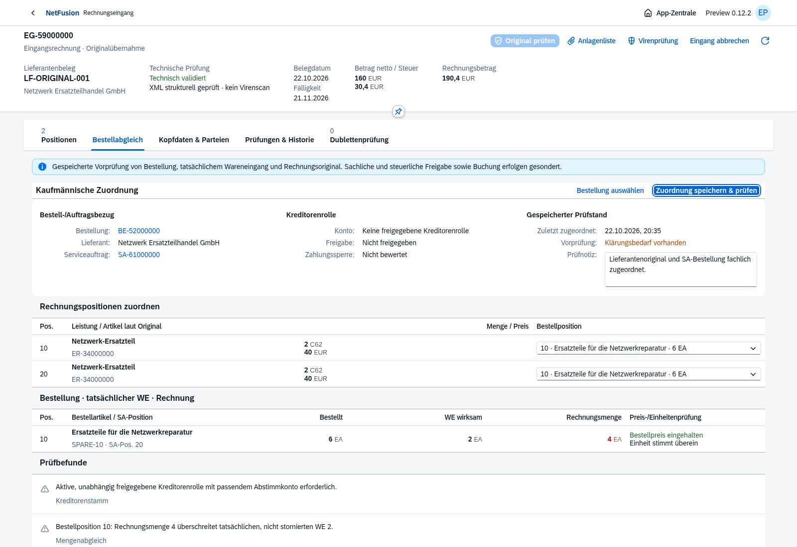
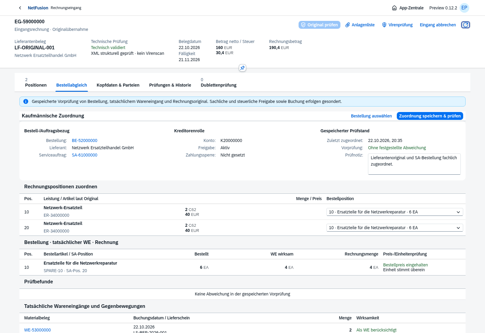

# Preview 0.12.0-preview.2 · Bestell-/Teil-WE-Vorprüfung

Echte OpenUI5-/Chromium-Aufnahmen vom 22.10.2026, isolierte fiktive Testdaten. Der Einkäufer wählt eine freigegebene Bestellung des Serviceauftrags und ordnet die unveränderten Originalpositionen zu.

Zwei Originalpositionen mit jeweils2 Stück ergeben gemeinsam4. Bei erst2 tatsächlich eingegangenen Teilen bleibt ein Mengenbefund bestehen. Ein zweiter echter Teil-WE über2 und eine unabhängig freigegebene Kreditorenrolle beseitigen diese Befunde beim erneuten Prüfen.

[Einzelne Materialbelege](incoming-three-way-receipts.png) · [Mobilansicht](incoming-three-way-mobile.png) · [kompakte deutsche Leistungsdaten](incoming-invoice-items.png) · [gegliederte Originalparteien](incoming-invoice-parties.png).

Die API-Tests prüfen zusätzlich WE-Storno, zusammengefasste Mengen, Preis-/Einheiten-/Währungs-/Parteienabweichung trotz technisch gültigem XML, Kreditorendubletten, Konkurrenz/Version, falsche Bestellpositionen und unveränderliche abgeschlossene Zuordnung. Ein Entwurfsabgleich erzeugt keine Lagerbewegung, keine Rechnungsbuchung und keinen offenen Posten.

**172 automatisierte Tests** im vollständigen Lauf bestanden. Nach der abschließenden Formular-/Mobiloptimierung bestehen die Standardcontrol-Prüfung und beide Eingangsrechnungs-Browserabläufe erneut, einschließlich nativem Tabüberlauf und bytegleichem Originaldownload. Kein eigener CSS-/HTML-/Renderer-Ersatz. Hauptdatenbank ohne künstliche Rechnungen, Buchungskreise oder Fakturen;16 Migrationen und Readiness/Anmeldung/leerem Rechnungseingang geprüft.

Das ist eine gespeicherte Vorprüfung. Verbindliche WE-Verrechnung mit bereits gebuchten Rechnungen, unabhängige sachliche/steuerliche Freigabe, WE/RE-/Vorsteuer-/Kreditorenbuchung, OP, Korrektur und Zahlung folgen gesondert. [Funktionsgrenzen](../../incoming-invoices.md) · [Versionsnotizen](../../releases/v0.12.0-preview.2.md).

Der [Docker-Image-Nachweis von v0.12.0-preview.1](../v0.12.0-preview.1/docker-smoke.json) gehört exakt zu jenem Image. Für0.12.2 wird kein neuer isolierter Image-Smoke-Test behauptet. Zielserver-/HTTPS-/AV-/Restore-/Last- sowie rechtliche/steuerliche Freigabe bleiben getrennt offen.
