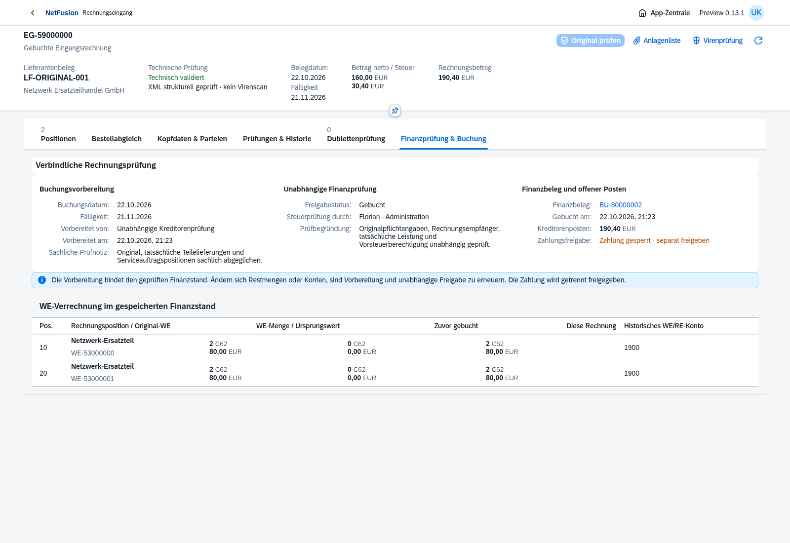
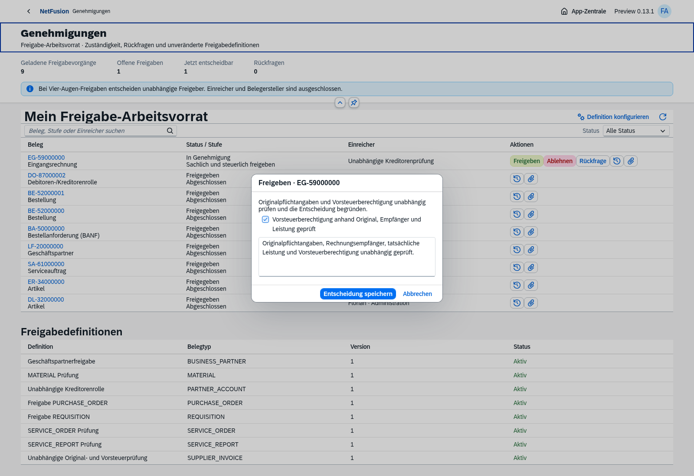
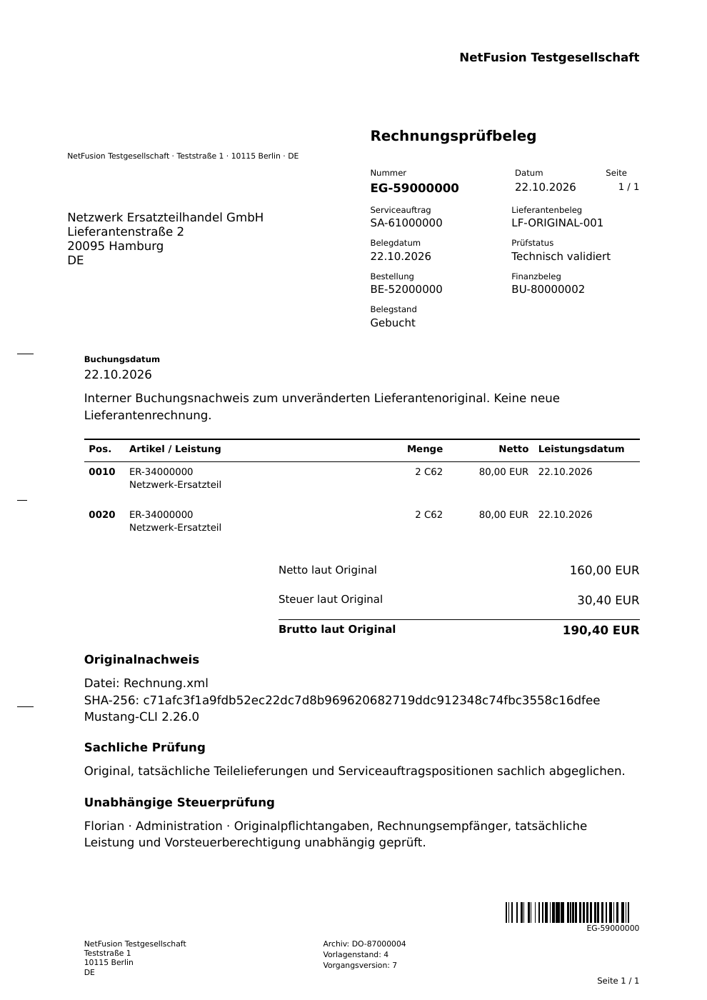

# Preview 0.13.0-preview.1 · Eingangsrechnungsprüfung und Kreditorenbuchung

Tatsächliche OpenUI5-/Chromium-Aufnahmen vom22.10.2026 mit isolierten fiktiven Testbelegen.

Der gespeicherte Finanzstand bindet Originalhash, Kreditor, Steuerkontierung sowie noch nicht verrechnete WE-Mengen und historische Konten. Importeur, Zuordner und Vorbereiter sind von der eigenen Freigabe ausgeschlossen.

[Vorbereitung](supplier-invoice-prepared.png) · [In Genehmigung](supplier-invoice-in-review.png) · [Tatsächlicher Finanzbeleg](supplier-invoice-journal.png) · [Kleine Anlagenliste](supplier-invoice-files.png) · [Mobilansicht](supplier-invoice-posted-mobile.png).

[Tatsächlich heruntergeladenes Prüf-PDF](posted-supplier-invoice-proof.pdf). Das Lieferantenoriginal bleibt bytegleich; der interne Prüfbeleg stellt keine neue Lieferantenrechnung dar.

**182/182 Tests bestanden.** Fünf relevante Browserabläufe erneut grün: AP-Buchung einschließlich unabhängiger Freigabe/Journal/PDF/Mobil, Workflow, Ausgangsfaktura, Originalannahme und Bestell-/WE-Abgleich. Tests prüfen auch Konkurrenz/Idempotenz, Vier-Augen-Schutz, geschlossene Periode und Rücknahme, historische Konten, Centwerte, unveränderliche Quellen, Mengenverbrauch und WE-Stornoschutz. Das vollständige historische Paket umfasst16 Browserketten; für diesen Tag werden nur die fünf genannten Wiederholungen behauptet.

[Docker-Smoke-Nachweis](docker-smoke.json) für Image `sha256:fe3aee6f98db78b6d1656a2980d2a2e3cc7ad4ed7e3f28b47d287d9b3713d4ee`: PostgreSQL/Migrationen/Bootstrap, Readiness/Anmeldung/UI, leere Faktura-/Eingangsvorräte, tatsächliche normative Ein-/Ausgangsprüfung mit Mustang2.26.0. Unprivilegierter schreibgeschützter Prozess, Build-CA im Laufzeitcontainer abwesend; Testcontainer/Volumes anschließend entfernt. Kein Nachweis für Zielserver/HTTPS/AV/Restore/Last oder alle AP-Buchungsfälle im Container.

[Hauptumgebung](main-readiness.json):17 Migrationen, Readiness/Anmeldung200, keine künstlichen Rechnungen oder Buchungskreise. Laufzeit-Audit am22.10.2026 ohne gemeldete Schwachstellen. [Versionsnotizen](../../releases/v0.13.0-preview.1.md) · [Umfang und offene Fälle](../../incoming-invoices.md). Der gesamte ERP-/Compliance-Backlog bleibt in Bearbeitung.
