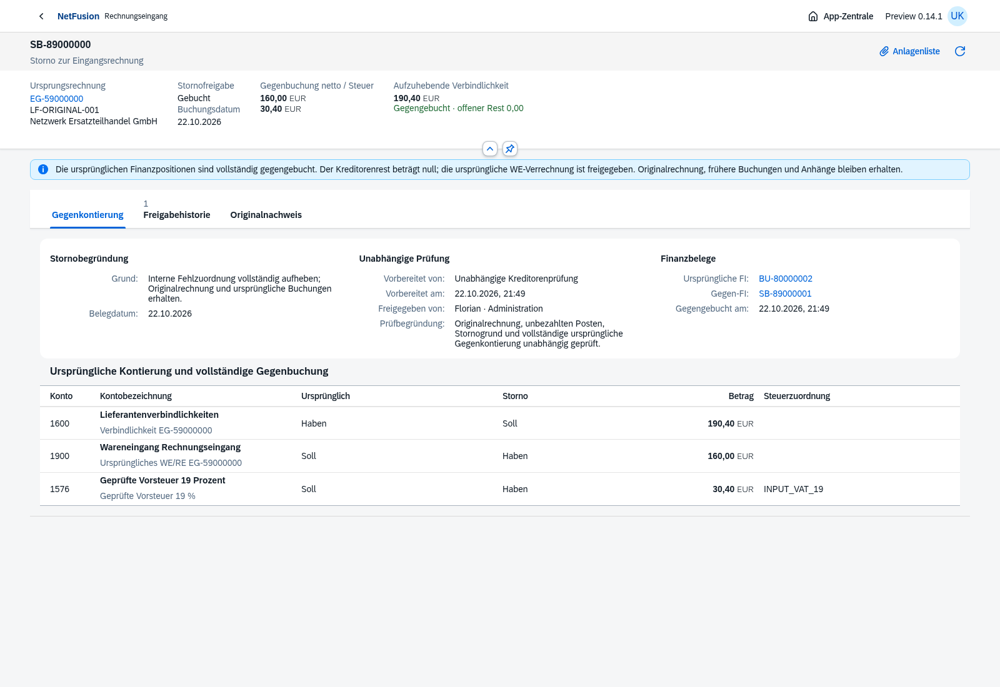
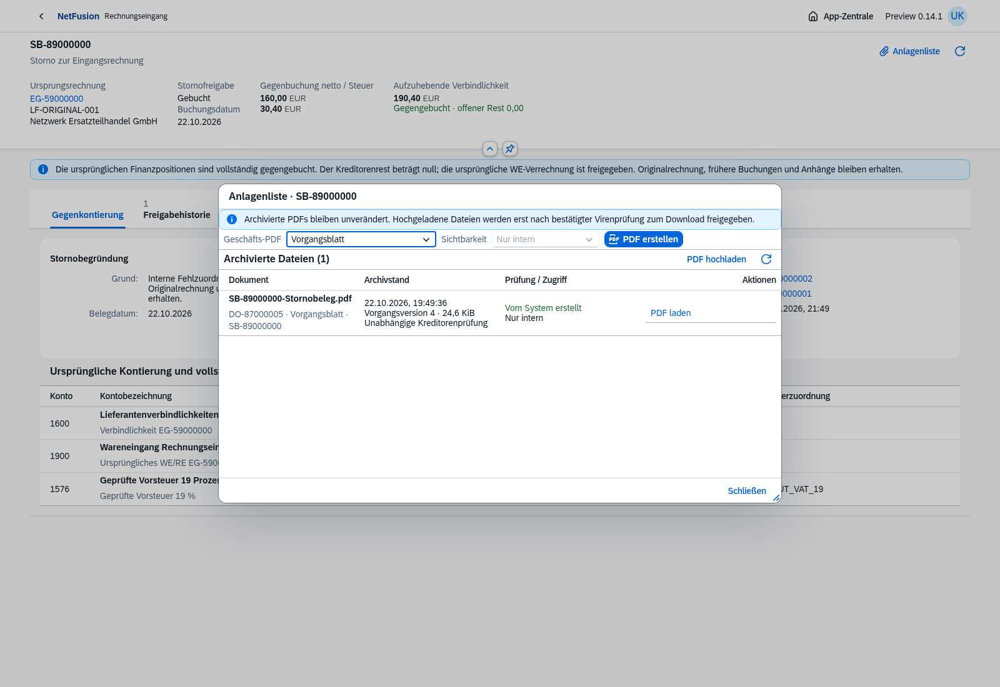
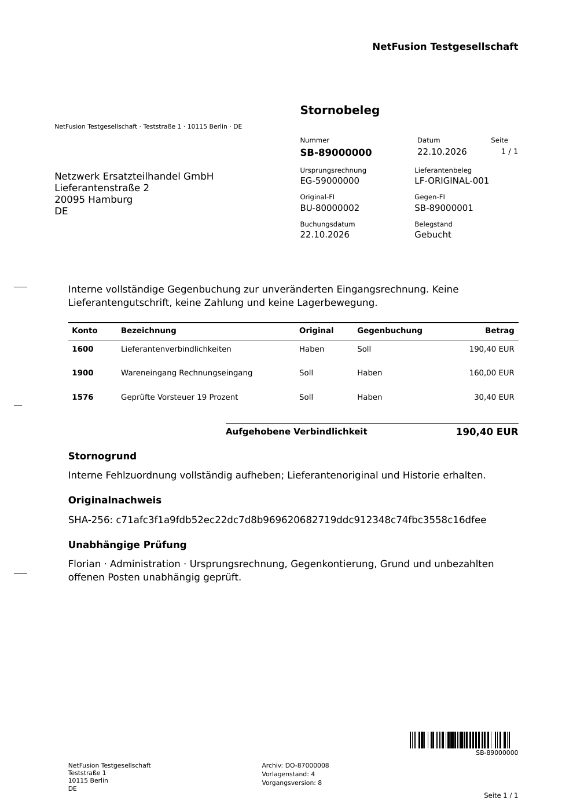

# Preview 0.14.0-preview.1 · Eingangsrechnungsstorno mit Gegenbeleg

Echte OpenUI5-/Chromium-Aufnahmen vom22.10.2026, ausschließlich isolierte fiktive Testbelege.

Der Storno bindet Originalrechnung, ursprünglichen Finanzhash, jede Kontierungszeile, Grund und Buchungsperiode. Ein Entwurf ändert weder OP noch WE-Verrechnung. Erst unabhängige Freigabe und tatsächliche Buchung erzeugen die exakte Gegen-FI und geben die ursprünglichen Rechnungsmengen frei. Alte Originale, Posten und Archive bleiben erhalten.

[Vorbereitung](supplier-reversal-prepared.png) · [In Prüfung](supplier-reversal-in-review.png) · [Originalnachweis](supplier-reversal-original-proof.png) · [Unabhängige Freigabe](supplier-reversal-approval.png) · [Tatsächlicher Finanzbeleg](supplier-reversal-journal.png) · [Ursprungsrechnung nach Storno](supplier-invoice-after-reversal.png) · [Mobilansicht mit nativen Detailzeilen](supplier-reversal-posted-mobile.png).

[Tatsächlich heruntergeladenes PDF](supplier-reversal-proof.pdf) · [Unabhängiger Barcode-Nachweis](supplier-reversal-barcode.json): ZXing liest aus dem bei150dpi gerasterten PDF exakt `SB-89000000` als Code128.

**190/190 automatisierte Tests bestanden.** Acht neue Stornofälle prüfen gleichzeitige Anträge, Unabhängigkeit/Prüfstand, Rücknahme mit Historie, gesperrte Periode und Rollback, parallele/idempotente Gegenbuchung, unveränderte Quellen, freigegebene Mengen und erneute Rechnung, danach zulässige physische WE-Gegenbewegung, RLS/SQL-Umgehungsschutz sowie tatsächliches PDF. Auch der Originalmonat bleibt bei einer Gegenbuchung in der nächsten offenen Periode geschlossen.

Fünf relevante Browserketten auf0.14 erneut bestanden: SB-Antrag/Freigabe/Gegen-FI/OP/PDF/Mobil; Eingangsrechnungsbuchung; Workflow; Wareneingang/Lagerstorno; Anlagenlisten. Nach letzter nativer Mobiloptimierung Storno-Kette und Standardcontrol-Prüfung erneut grün. Kein vollständiger Wiederholungslauf aller17 historischen Browserketten behauptet.

[Docker-Nachweis](docker-smoke.json) für Image `sha256:bd3462d67f1f1685eec985d07ecbc368c41e47995f7b3200669e55bc615703d7`: isoliertes PostgreSQL, Migrationen/Bootstrap/Readiness, Anmeldung, UI und leere Vorräte, tatsächliche normative Ein-/Ausgangsvalidierung, unprivilegierter schreibgeschützter Laufzeitprozess ohne Build-CA. Testcontainer und Volumes entfernt. Der Smoke-Test ersetzt keine vollständige AP-/SB-Prozessprüfung im Container oder Zielserver-/HTTPS-/AV-/Restore-/Lastabnahme. Das Speicherlimit durch zwei lokale VFS-Builds wurde mit exakt abgegrenztem eigenem Cache/ersetztem Zwischenimage behoben; der vollständige190er-Lauf wurde danach erfolgreich neu ausgeführt.

[Hauptumgebung](main-readiness.json):18 Migrationen und echte Anmeldung/Readiness, ohne künstliche Rechnungen, Stornobelege oder Buchungskreise. [Versionsnotizen](../../releases/v0.14.0-preview.1.md) · [Funktionsumfang und Grenzen](../../incoming-invoices.md). Externe Gutschriften/Teilkorrekturen/Wiederbuchung und Zahlungen sowie weitere Mastermodule bleiben offen.
