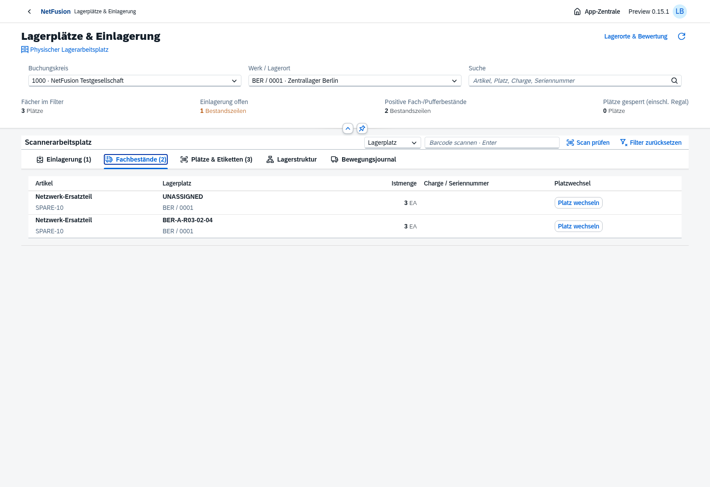
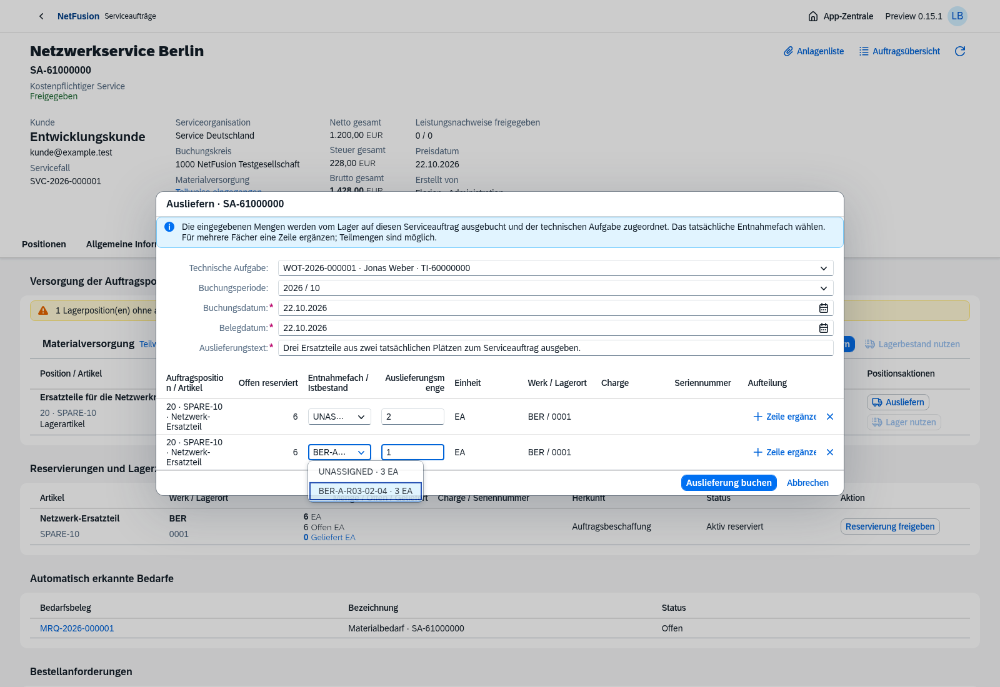
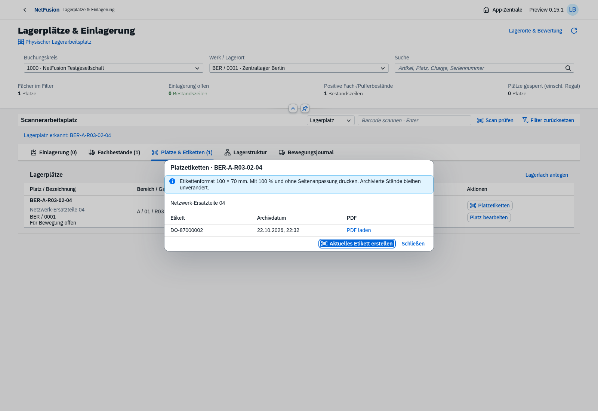
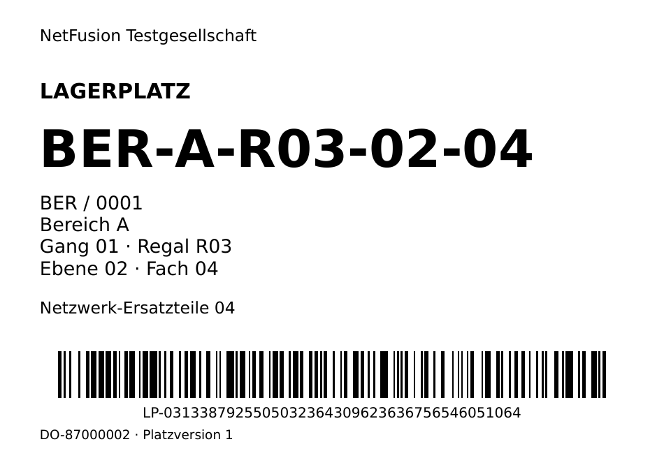

# Preview0.15 · Lagerarbeitsplatz und tatsächliche Fachmengen

Echte OpenUI5-/Chromium-Aufnahmen vom22.10.2026 mit isolierten fiktiven Testbelegen.

Eigenständige Anwendung aus der App-Zentrale: [Eingangspuffer](warehouse-buffer.png), [Bereiche und Regale](warehouse-structure.png), [Teilmenge/Zielfach mit tatsächlicher LP-Scanprüfung](warehouse-putaway-dialog.png), [gebuchter UL](warehouse-putaway-posted.png), [kleine Anlagenliste](warehouse-transfer-attachments.png).

[Ausgabe mit Originalfächern](warehouse-issue-bins.png) · [Rücknahme in dieselben Fächer](warehouse-issue-return.png) · [genaue Gegenbewegung der Einlagerung](warehouse-putaway-reversed.png). Die Browserprüfung endet wieder mit den ursprünglichen sechs Teilen im Puffer; die fachlichen Belege bleiben erhalten. [Maschinenlesbarer Prozessnachweis](warehouse-browser-proof.json).

[Etiketten-PDF](warehouse-label-browser.pdf) · [klassisches UL-Geschäftsformular](warehouse-transfer.pdf) · [Formularansicht](warehouse-transfer.png) · [unabhängiger Barcode-Nachweis](warehouse-barcodes.json). ZXing liest aus den tatsächlichen PDFs bei150dpi die volle LP-Identität bzw. exakt `UL-55000000`. Ein Hardware-/Druckernachweis wird daraus nicht abgeleitet.

[Smartphone-Fachbestände mit nativen Detailzeilen](warehouse-mobile-stock.png) · [Smartphone-Bewegungsbeleg](warehouse-mobile-movement.png).390px-Viewport ohne horizontalen Seitenüberlauf. USB-/Bluetooth-Tastaturscan mit Enter ist umgesetzt; Kamera/Offline und reale Geräteabnahme bleiben offen.

**204/204 Tests bestanden**, darunter14 neue Lagerfälle einschließlich tatsächlicher Mengen, Bewertungserhalt, konkurrierender Buchung, splitbarer Reservierung, Serienidentität, Chargenregeln, Historie/PDF, Zugriffsschutz und Upgrade18→19. [Konkreter Verifikationsstand](verification.json). Fünf Browserketten erneut bestanden: Lager, Ticket/WOT→Auslieferung→SRM, WE/Storno, Anlagen und Eingangsrechnungsstorno. Keine vollständige Wiederholung aller historischen Browserketten behauptet.

[Docker-Smoke](docker-smoke.json): finales Image `sha256:f72b958447594c7cac114c7896f9a47b4359d79dec196c1257728f7a0d82a04f`, isoliertes PG/Migration/Bootstrap/Anmeldung, echter Lagerstruktur-/Scan-/Etikettenpfad, normative Ein-/Ausgangsprüfung, unprivilegierter schreibgeschützter Betrieb ohne Build-CA. Keine vollständige Mengenbuchungskette im Container behauptet. Testdaten entfernt. Beim VFS-Build nur das ungenutzte eigene0.13-Image und die per Vorher-Baseline/Buildzeit abgegrenzten eigenen Cache-IDs entfernt; finales0.14 und0.15 erhalten.

[Hauptumgebung](main-readiness.json) mit19 Migrationen, Anmeldung/Readiness200 und ohne künstliche Lager-/Rechnungsbelege. [Versionsnotizen](../../releases/v0.15.0-preview.1.md) · [Fachlicher Umfang/Grenzen](../../warehouse.md) · [weiter verbindlicher Masterbacklog](../../master-backlog-index.md).
