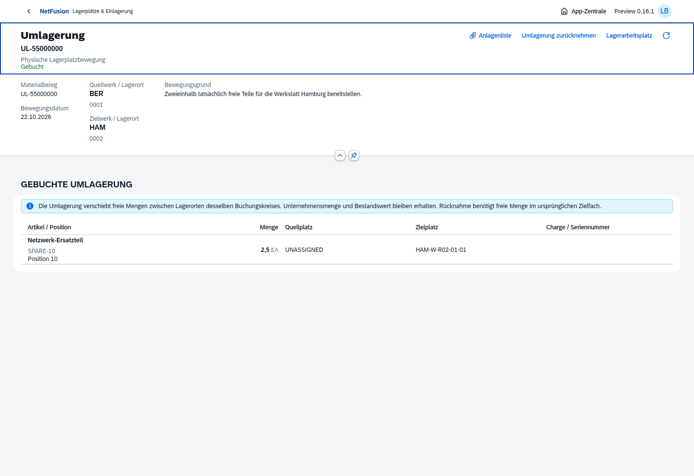
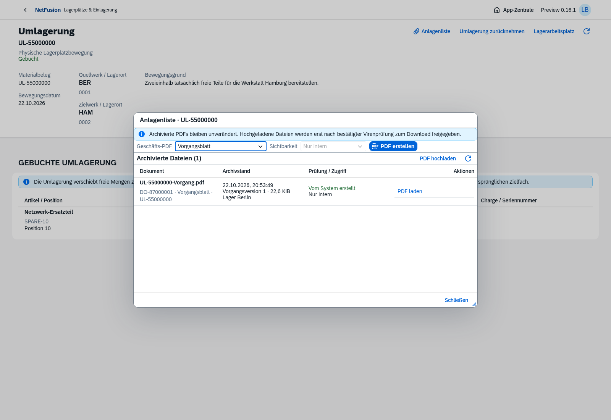
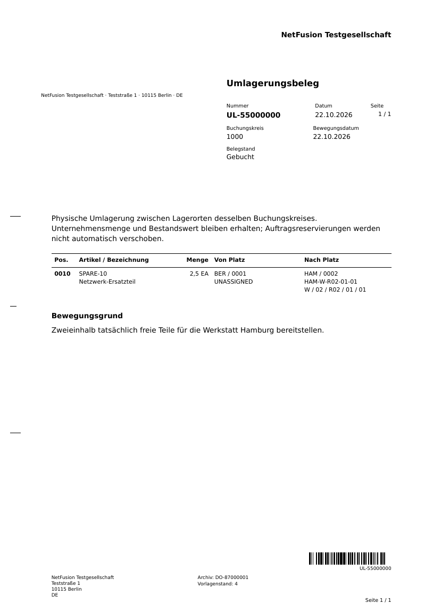

# Preview0.16 · Tatsächliche Umlagerung zwischen Lagerorten

Echte OpenUI5-/Chromium-Aufnahmen vom22.10.2026, ausschließlich isolierte fiktive Testbelege.

[Dialog mit deutscher Teilmenge und tatsächlich geprüftem Zielfach-Scan](location-transfer-dialog.png) · [gefilterter Zielbestand](location-transfer-destination.png) · [genaue SB-Gegenbewegung](location-transfer-reversed.png) · [Smartphone ohne horizontalen Seitenüberlauf](location-transfer-mobile.png).

Die Browserkette verschiebt2,5 Teile von BER/0001 nach HAM/0002 und legt dieselbe Menge anschließend in den ursprünglichen Puffer zurück. Unternehmensmenge6 und Wert240 bleiben erhalten. [Konkreter Prozessnachweis](location-transfer-browser-proof.json). Auftragsreservierungen wurden vorher ausdrücklich am SA freigegeben; die Umlagerung verändert sie nicht automatisch. Separate Tests prüfen Zielreservierung und SA-Ausgabe als Rücknahmesperren.

[Heruntergeladenes PDF](location-transfer.pdf) · [unabhängiger Code128-Nachweis](location-transfer-barcode.json): ZXing liest aus dem tatsächlichen PDF bei150dpi exakt `UL-55000000`. Das Formular verwendet eingefrorene Firmen-/Artikel-/Platzstände und die gemeinsame Vorlage4.

**211/211 automatisierte Tests bestanden**, darunter sieben neue Umlagerungs-/Snapshotfälle. [Verifikationsstand](verification.json). Fünf relevante Browserketten auf0.16 bestanden; Umlagerung und Lagerkette nach letzter Lesekonsistenzänderung erneut geprüft. Native Desktop-/390px-Mobilansicht; keine vollständige Wiederholung aller historischen Browserketten behauptet.

[Hauptumgebung](main-readiness.json):20 Migrationen, Readiness und echte Anmeldung200, keine künstlichen Lager-/Rechnungsbelege. [Versionsnotizen](../../releases/v0.16.0-preview.1.md) · [Funktionsumfang/Grenzen](../../warehouse.md) · [weiterer Masterbacklog](../../master-backlog-index.md).

[Docker-Smoke](docker-smoke.json): finales Image `sha256:f3ef3376a0ab830c534b8356b83d538a6f5702d6f7433f6a2e30e74c8a1c170d` mit isoliertem PG/Migration020/Bootstrap/Anmeldung/UI, tatsächlichem Struktur-/Scan-/Etikettenpfad und normativer Ein-/Ausgangsvalidierung. Unprivilegierter schreibgeschützter Betrieb ohne Build-CA; Testcontainer/-volumes entfernt. Dies ist kein vollständiger Umlagerungs-Mengenprozess im Container und keine Zielserverabnahme. Für den VFS-Build wurde nur das eindeutig ungenutzte eigene0.14-Image entfernt;0.15/0.16 blieben erhalten. Neuer eigener Build-Cache wurde anhand Vorher-Baseline/Buildzeit über exakte IDs eingegrenzt bereinigt.
