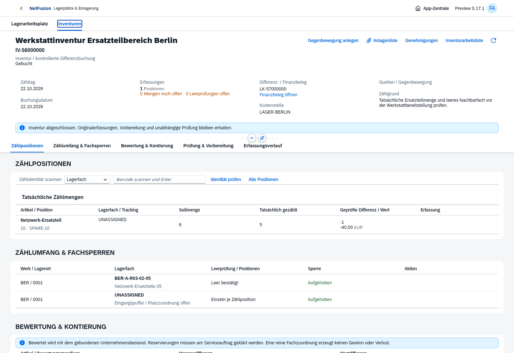
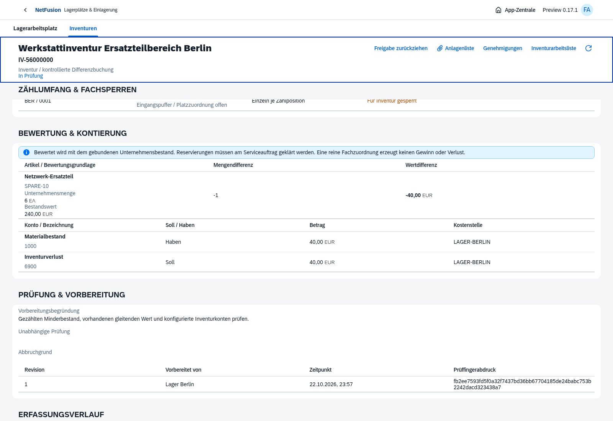
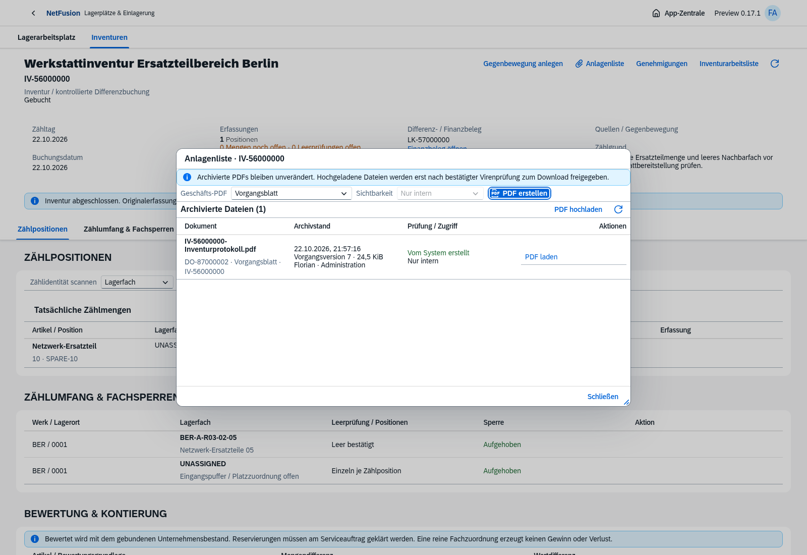
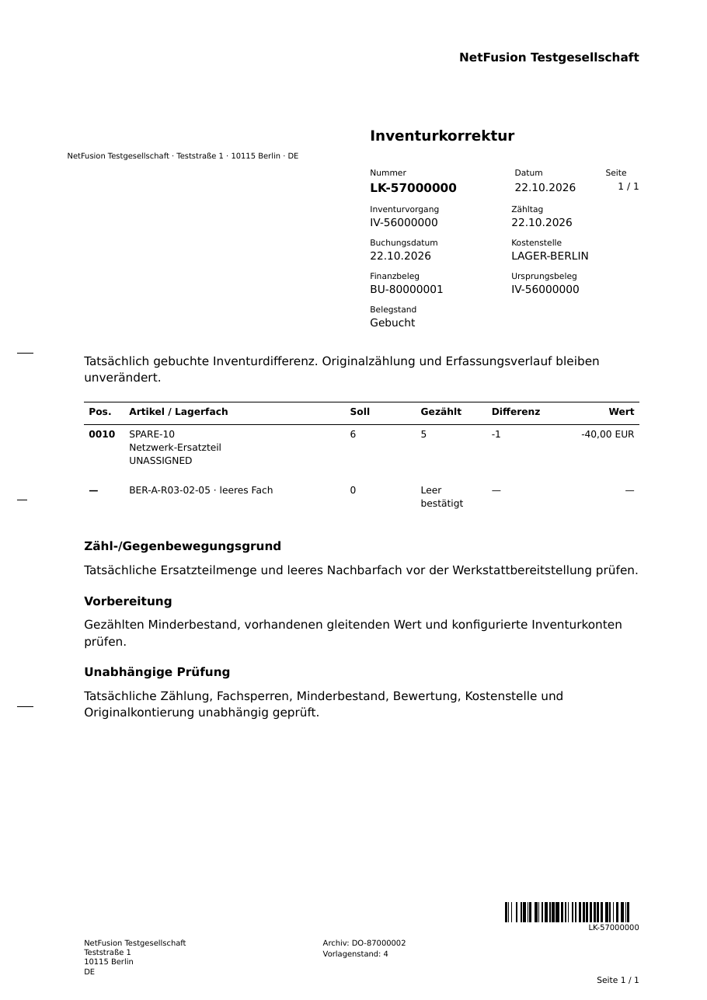

# Preview0.17 · Tatsächliche Inventur und Differenzbuchung

Echte OpenUI5-/Chromium-Aufnahmen vom22.10.2026, ausschließlich isolierte fiktive Testbelege.

[Zählbeginn mit realen Fächern](inventory-count-start.png) · [ausdrückliche Mengenerfassung](inventory-count-capture.png) · [offene Mengen sind noch nicht gezählt](inventory-count-open.png) · [gebundene Vorbereitung](inventory-count-prepare.png) · [in Prüfung](inventory-count-in-review.png).

[Freigabedialog](inventory-count-approval.png) · [gebundener Gegenbewegungsantrag](inventory-count-counter-request.png) · [390px-Smartphone ohne horizontalen Seitenüberlauf](inventory-count-mobile.png).

Die reale Browserkette zählt5 statt6 Teile, bestätigt ein leeres Nachbarfach, bindet die vorhandene Bewertung und bucht nach unabhängiger Prüfung eine tatsächliche Differenz von−1/−40EUR. [Konkreter Prozessnachweis](inventory-count-browser-proof.json). Weitere API-/SQL-Tests prüfen die exakte Gegenbuchung nach verändertem Durchschnitt, den wertfreien Originalfall nach bewerteten Zugängen sowie mengen-/wertneutrale Fachkorrektur und Abschluss ohne Abweichung.

[Heruntergeladenes PDF](inventory-count.pdf) · [unabhängiger Code128-Nachweis](inventory-count-barcode.json): ZXing liest aus dem tatsächlichen PDF bei150dpi exakt `LK-57000000`. Der IV-Quellvorgang bleibt referenziert. Gemeinsame klassische Formularvorlage4, deutsche Daten/Mengen, keine Veränderung bestehender Archivbytes.

**235/235 vollständige automatisierte Tests bestanden**, darunter24 neue Inventurfälle. [Verifikationsstand](verification.json). Vier relevante Browserketten bestanden; Inventur nach letzter Originalwertkorrektur erneut geprüft. Nicht alle historischen Browserketten erneut ausgeführt.

[Hauptumgebung](main-readiness.json):21 Migrationen, Readiness und echte Anmeldung200, keine künstlichen Geschäftsvorgänge. [Docker-Smoke](docker-smoke.json): finales Image mit isoliertem PostgreSQL, tatsächlicher Lagerstruktur/Scan/Etikett und Inventurerfassung/Abbruch sowie normativer Ein-/Ausgangsvalidierung; schreibgeschützt, nicht root, keine Build-CA. Container/-volumes entfernt. Keine vollständige wertwirksame Inventurbuchung im Container oder Zielserverabnahme behauptet.

[Versionsnotizen](../../releases/v0.17.0-preview.1.md) · [Lagerprozess/Grenzen](../../warehouse.md) · [verbindlicher Restumfang](../../master-backlog-index.md).
