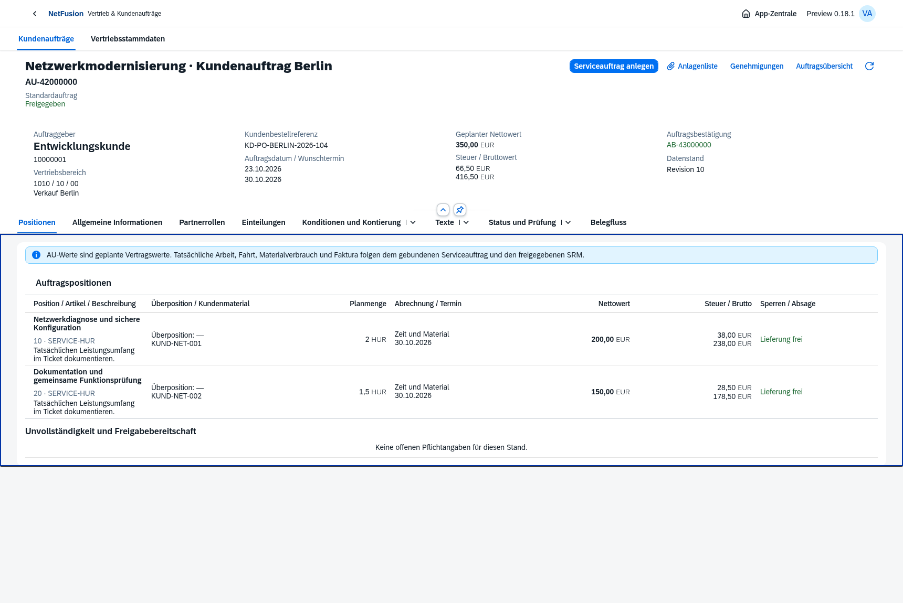

# Preview0.18 · Kundenauftrag und gebundene Serviceausführung

Tatsächliche OpenUI5-Aufnahmen aus dem isolierten Browserprozess. Ausschließlich native Standardcontrols und Standardtheme. Konkrete Prüfbelege: AU-42000000 → AB-43000000 → SA-61000000. Zwei tatsächliche Planpositionen, drei Einteilungen, vier ausdrücklich zugeordnete Partnerrollen,350,00 EUR netto. Dieser Bildschirmprozess erzeugt keine tatsächliche Lager- oder Finanzbuchung aus Planmengen.

- [Partnerrollen mit konkreter Werkstattanschrift](sales-order-partners.png)
- [Gebundene Konditionsquellen und Kontierung](sales-order-pricing.png)
- [Native Mengen-/Terminaufteilung](sales-order-split.png), [gespeicherte Einteilungen](sales-order-schedules.png)
- [Unabhängige Prüfung](sales-order-review.png)
- [Kleines Anlagenmodal](sales-order-files.png)
- [Tatsächlicher AU-Belegfluss](sales-order-flow.png)
- [Separat freizugebender Quellen-SA](sales-order-source-service.png)
- [Vertriebsstämme in der Lesesicht des Vertriebs](sales-configuration.png)
- [390px-Smartphone mit lesbaren nativen Popin-Zeilen](sales-order-mobile.png)

[Browsernachweis](sales-order-browser-proof.json): Kopf/Bedingungen, vier Rollen, Mengen einschließlich1,5, Teileinteilung0,5+1,5, ausdrückliche Preisaktualisierung, unabhängige Freigabe, echtes AB-PDF, SA-Übernahme und eigener SA-Prüfprozess. Keine Browser-/Netzfehler. Bestehender Ticket/WOT→Teil-WA→Rücknahme→WA→korrelierte SRM→Kundenbestätigung→unabhängige Freigabe→Fakturabereitschaft separat im Browser geprüft.

[Heruntergeladenes AB-PDF](sales-order-confirmation.pdf), [vollständige Formularseite](ab-form-page-1.png). Klassisches Schwarz-Weiß-Formular, DIN5008 FormB, neue Vorlagenrevision5. Vollständige Kundenbestellreferenz und zusammenhängender Netto-/Steuer-/Bruttoblock. Das vollständige Beispiel bleibt mit Kopftext vor den Positionen und gemeinsamem Summenblock auf einer A4-Seite. Sein tatsächlicher Code128-Barcode wurde aus150dpi-Raster unabhängig als AB-43000000 gelesen: [PDF-Nachweis](sales-order-pdf-proof.json). Bereits archivierte Vorlagenrevisionen und Lieferantenoriginale bleiben unverändert.

Zusätzlich prüfen echte API-/DB-Ketten den Quellen-AU bis zum bewerteten WA/LS und dessen Originalgegenbewegung sowie Ticket-Istzeit/WOT→SRM→Fakturaanforderung→RE mit akzeptierter Rechnungsanschrift, AU-/Kundenbestellreferenz, tatsächlichem Leistungsdatum, gültigem ZUGFeRD, FI und offenem Debitorenposten. Diese tatsächlichen Folgebuchungen werden nicht den Planwerten des abgebildeten Browserbelegs gleichgesetzt.

Umfang und verbleibende SD-Lücken stehen in den [Versionsnotizen](../../releases/v0.18.0-preview.1.md) und der [AU-Spezifikation](../../requirements/sales-order-execution.md). 255/255 Tests bestanden; [Hauptumgebungsnachweis](main-018-proof.json) mit22 Migrationen und erfolgreicher Anmeldung. [Prüfzusammenfassung](verification.json), [isolierter Docker-Smoke](docker-smoke.json). Der Container prüft tatsächlich neue SD-Konfiguration und Kontext, jedoch keine vollständige AU-Waren-/Fakturabuchungskette.
