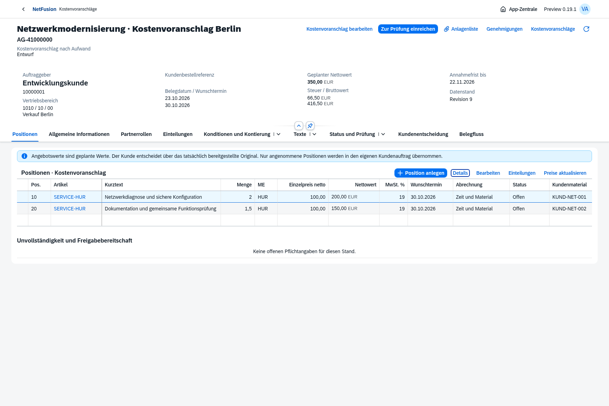

# Preview0.19 · Kostenvoranschläge, Verkaufsangebote und native Positionsraster

Tatsächliche native OpenUI5-Aufnahmen aus isolierten Prüfprozessen. Service verwendet Kostenvoranschläge; Verkaufsangebote sind eine eigene App. Keine globalen App-Tabreiter. Die sichtbaren Register gehören ausschließlich zu Abschnitten des geöffneten Vorgangs.

- [Konkrete Partnerrollen/Anschriften](quote-partners.png), [Konditionsherkunft/Kontierung](quote-pricing.png)
- [Kleiner Positionsdialog mit tatsächlichen Langtexten](quote-position-details.png), [Teileinteilungen](quote-schedules.png)
- [Unabhängige Prüfung](quote-review.png), [tatsächlich bereitgestelltes Original](quote-published.png), [kleine Anlagenliste](quote-files.png)
- [Eigene Kundensicht](quote-customer.png), [selektive Kundenentscheidung](quote-customer-decision.png), [gespeicherte Annahme/Absage](quote-customer-accepted.png)
- [Quellengebundener AU](quote-source-order.png), [390px-Smartphone](quote-mobile.png)
- [Aktualisiertes AU-Positionsraster](sales-order-positions.png), [AU auf390px](sales-order-mobile.png)

Der [Browsernachweis](quote-browser-proof.json) bindet AG-41000000 mit350,00EUR angebotenem Nettowert und zwei Positionen an eine tatsächlich angenommene Position und AU-42000000 mit200,00EUR und zwei Einteilungen. Der AU durchläuft seine eigene unabhängige Prüfung. Der berechtigte Belegfluss öffnet den ursprünglichen KVA; anschließend lässt sich der wirkliche AU wieder öffnen. Keine Browser-/Netzfehler. Diese Planwerte sind keine Istlieferung oder Rechnung.

[Heruntergeladenes KVA-Original](service-quote-browser.pdf), [vollständige Formularseite](quote-form-page-1.png), [PDF-/Code128-Prüfung](quote-pdf-proof.json). DIN5008 FormB, Schwarz-Weiß, Formularrevision5, eine A4-Seite. Code128 aus150dpi unabhängig als AG-41000000 gelesen; SHA-256 gilt für die hier verlinkten tatsächlichen Originalbytes.

Zusätzliche echte API-/DB-Prozessprüfung: angenommener Originalpreis150,00EUR bleibt trotz späterem200,00EUR-Katalogpreis und geänderter Kundenpreisgruppe erhalten. Eigene AU-/SA-Freigabe, tatsächliche1,5 Ticketstunden, korrelierte SRM, Fakturaanforderung/Freigabe/Vorrat und valide ZUGFeRD-Rechnung ergeben225,00EUR netto,42,75EUR Steuer und267,75EUR brutto, mit echter FI/Forderung und AU-/Kundenbestell-/Ticketreferenz. Dies ist ein anderer isolierter Prüfvorgang als der abgebildete Browserplan.

**283/283 Tests bestanden.** [Prüfzusammenfassung](verification.json), [Hauptumgebung mit23 Migrationen](main-019-proof.json), [Produktionsimage-Smoke](docker-smoke.json), [automatische HTTPS-Erstinstallation auf8070 und Neustart](docker-install-8070.json). Der Installationscheck prüft tatsächlich Caddy/TLS mit CA-Prüfung, sichere Sitzungscookies, Login und den Erhalt eines geänderten Administratorpassworts nach vollständiger Containerneuanlage mit erhaltenen Volumes. Er verändert ausschließlich eigene Testvolumes.

[Umfang und Grenzen](../../releases/v0.19.0-preview.1.md), [Installation](../../docker-8070.md), [verbleibender Backlog](../../master-backlog-index.md). Direkte AU-Liefer-/Fakturaausführung, Berichtsmodul und weitere Masteranforderungen sind weiterhin offen. Keine Ubuntu-Zielserver- oder Produktivabnahme.
