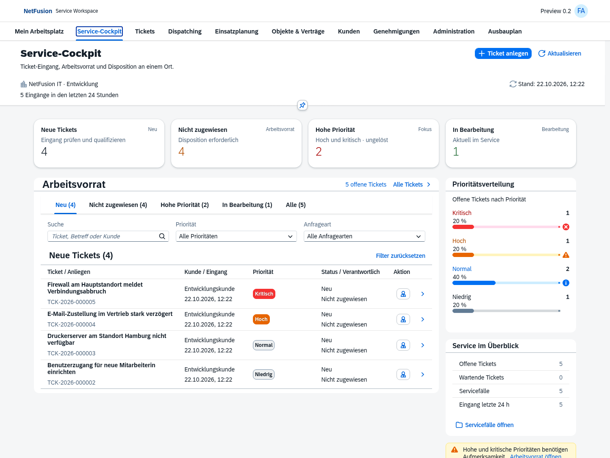
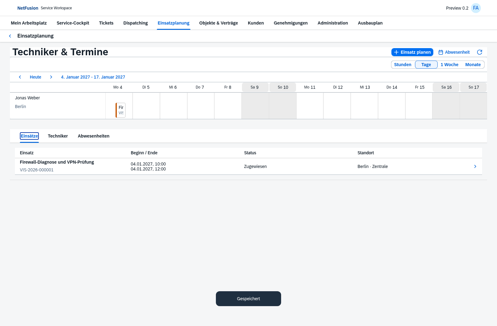
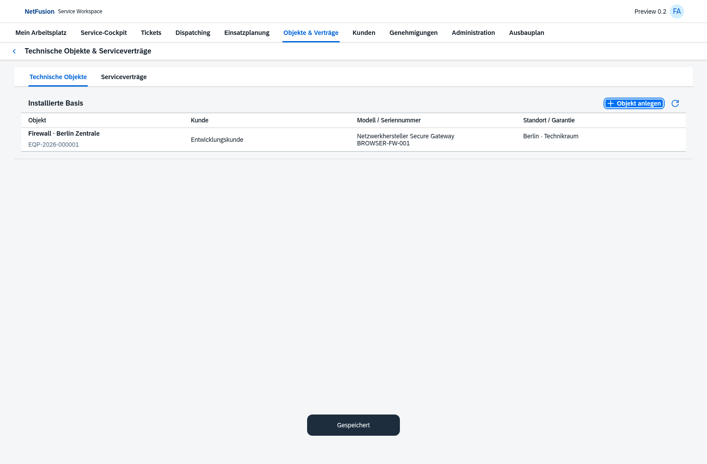
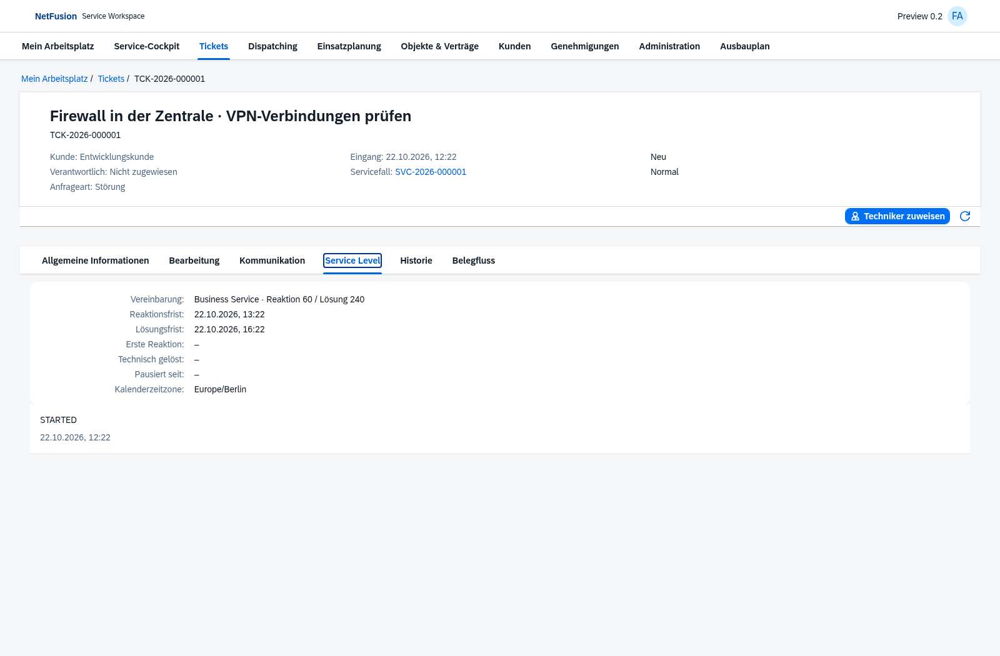
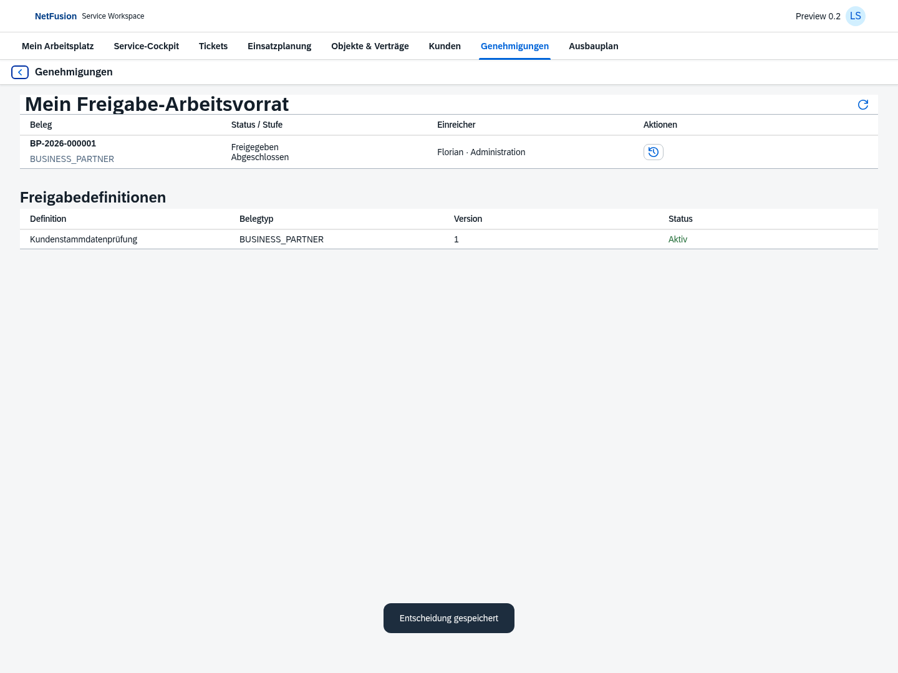

# Preview 0.2 · echte OpenUI5-Oberflächen

Die Bilder stammen aus bestandenen Chromium-Durchläufen dieses Preview-Stands. Angezeigte Personen, Kunden und Geschäftsbelege sind isolierte Testdaten. Keine Produktivdaten oder Zugangsdaten.

## Service-Cockpit

[Mobile Ansicht](cockpit-mobile.png)

## Einsatzplanung

[Mobile Ansicht](planning-mobile.png)

## Servicebasis und SLA

## Kundenfreigabe

[Versionsumfang und offene Punkte](../../releases/v0.2.0-preview.1.md)
