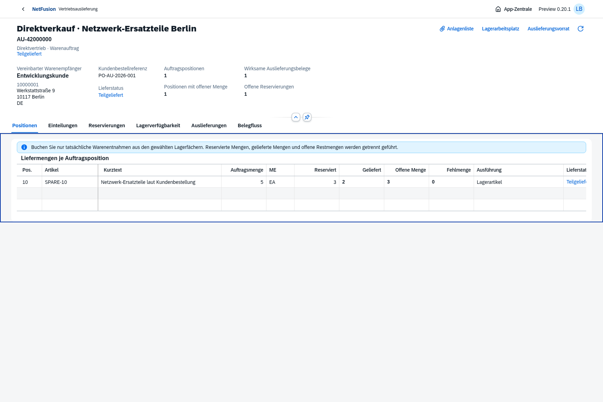

# Preview0.20 · Direktvertrieb aus dem wirklichen Lager

Tatsächliche native OpenUI5-Aufnahmen aus isolierten Prüfprozessen. Eigene App über die App-Zentrale; die sichtbaren Abschnitte gehören zum geöffneten Vorgang. Keine globalen App-Tabreiter, eigene Controls oder eigenes CSS.

- [AU-Anlage mit ausdrücklich gewähltem Ausführungsweg](direct-sales-create.png), [geprüfter Kundenauftrag](direct-sales-order.png)
- [Eigener Lager-Arbeitsvorrat](direct-sales-worklist.png), [wirklichen freien Bestand reservieren](direct-sales-reserve.png)
- [Restlieferung aus zwei tatsächlichen Fächern](direct-sales-split-pick.png), [vollständig ausgelieferte Menge](direct-sales-complete.png)
- [Genaue Originalrücknahme](direct-sales-reversal.png), [kleine Anlagenliste](direct-sales-files.png)
- [Eigene Kundensicht](direct-sales-customer.png), [390px-Smartphone](direct-sales-mobile.png)

Der [Browsernachweis](direct-sales-browser-proof.json) bindet den tatsächlich in der Oberfläche angelegten und anschließend unabhängig geprüften Direktvertriebs-AU an5 Stück, Reservierung5, erste Auslieferung2 und zweite Auslieferung3 aus zwei Fächern. Die Originalrücknahme der ersten2 stellt2 offene Stück wieder her;3 bleiben wirksam geliefert. Der Vergleich der technischen Dokumentzahlen bestätigt: Diese Kette erzeugt keine zusätzlichen Tickets, SA, WOT oder SRM. Sie erzeugt noch keine direkte Rechnung.

[Im Browser heruntergeladenes LS-Original](direct-sales-browser-delivery.pdf), [vollständige Schwarz-Weiß-Formularseite](direct-sales-form-page-1.png), [PDF-/Code128-Prüfung](direct-sales-pdf-proof.json). DIN5008 FormB, gemeinsame Formularrevision5, eine A4-Seite. Tatsächliches Lieferdatum23.10.2026, tatsächliche Teilmenge2EA, vereinbarter Warenempfänger, AU-42000000 und PO-AU-2026-001. Keine technische Ticketreferenz. Der SHA-256-Nachweis gehört genau zu den verlinkten PDF-Bytes.

**295/295 Tests bestanden.** [Prüfzusammenfassung](verification.json), [Hauptumgebung/Migration024](main-020-proof.json), [Produktionsimage](docker-smoke.json), [HTTPS8070-Erstinstallation und Passworterhalt](docker-install-8070.json). Zusätzlich wurden die bestehenden AU-, KVA- und Serviceauslieferungs-Browserketten geprüft. Native Kundensicht auf390px; keine Browser-/Netzfehler. Dies behauptet keine vollständige historische Browserabnahme oder fachliche Produktivreife.

[Umfang und Grenzen](../../releases/v0.20.0-preview.1.md), [Installation](../../docker-8070.md), [verbleibender Backlog](../../master-backlog-index.md). Direkte Faktura und AU-Beschaffung werden als Nächstes umgesetzt. Reports, weitere Direktvertriebsarten und restliche Masteranforderungen bleiben offen.
