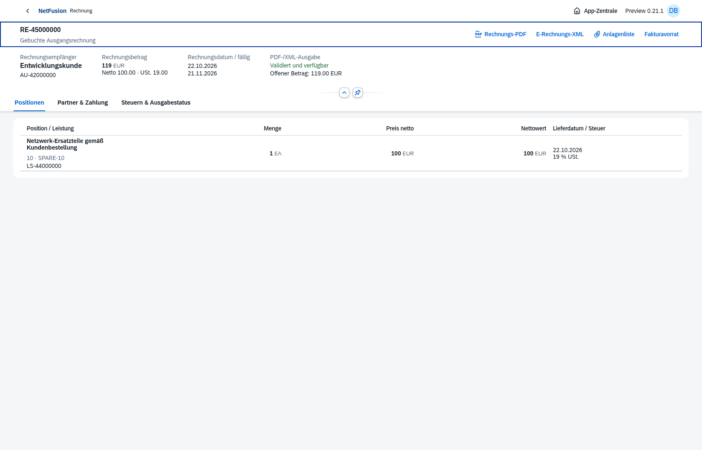

# Preview0.21 · Direktvertriebsfaktura ohne technische Ersatzbelege

Native OpenUI5-Oberflächen aus echten isolierten Browserprozessen:

- [Tatsächliche Lieferquelle und gebundenes Lieferdatum](direct-sales-billing-source.png)
- [Unabhängige Freigabe der Fakturaanforderung](direct-sales-billing-review.png)
- [Fakturavorrat und deutsche Teilmengeneingabe1,0](direct-sales-billing-due.png)
- [Kleine Anlagenliste mit wirklichem Original](direct-sales-billing-files.png)
- [Eigene Kundensicht auf390px](direct-sales-billing-mobile-before-actions.png), [natives PDF-Aktionsmenü](direct-sales-billing-mobile.png)

[Browsernachweis](direct-sales-billing-browser-proof.json): AU-42000000, wirkliche Lieferung2, AF2, unabhängige Freigabe und Rechnung über1 Stück.100,00EUR netto,19,00EUR Steuer,119,00EUR brutto;1 Stück bleibt freigegeben im Vorrat. Kein neuer Ticket-/SA-/WOT-/SRM-Beleg, keine Ticketreferenz. Die Warenrücknahme ist nach AF-Bindung gesperrt.

[Heruntergeladenes Original-PDF](direct-sales-billing-browser.pdf), [eingebettetes CII](direct-sales-billing-browser.xml), [vollständige Schwarz-Weiß-Formularseite](direct-sales-billing-form-page-1.png), [unabhängiges Validierungsprotokoll](direct-sales-billing-validation.xml), [Hash-/Code128-Nachweis](direct-sales-billing-pdf-proof.json). Eine A4-Seite, Formularrevision5, tatsächliches Lieferdatum22.10.2026, echte AU-/PO-/LS-Referenzen und Code128 RE-45000000. Exakt diese heruntergeladenen PDF-Bytes wurden mit Mustang-CLI2.26.0 nochmals validiert. Das vollständige Protokoll enthält einen Hinweis auf das leere Header-Lieferelement; der Gesamtstatus bleibt „valid“. Eine Peppol-Konformität wird damit nicht behauptet.

Der separate [API-/DB-Nachweis](direct-sales-billing-proof.json) umfasst5 gelieferte Stück, zwei Anforderungen und drei Rechnungen mit zusammen500,00EUR netto/95,00EUR Steuer/595,00EUR brutto. Keine Vermischung mit den Werten des abgebildeten Browserbeispiels.

**307/307 Tests grün**, danach20/20 gezielte finale Anlagen-/Faktura-/UI-Prüfungen. [Prüfzusammenfassung](verification.json), [Hauptumgebung](main-021-proof.json), [Produktionsimage](docker-smoke.json), [HTTPS8070-Erstinstallation mit Passworterhalt](docker-install-8070.json).

[Versionsnotizen und Grenzen](../../releases/v0.21.0-preview.1.md), [Installationsbefehl](../../docker-8070.md), [verbleibender Backlog](../../master-backlog-index.md). AU-Beschaffung/Teil-WE, fakturierte Retoure/Korrektur und vollständige Reports bleiben offen.
