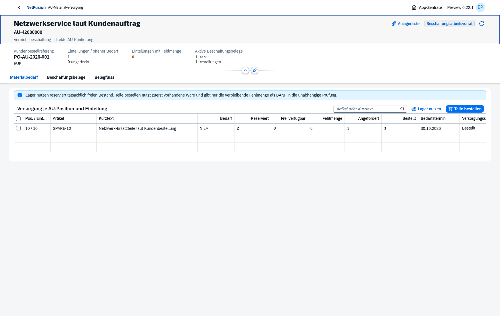

# Preview0.22 · Direkte AU-Beschaffung

Eigene native OpenUI5-App aus echten isolierten Browserprozessen:

- [Fünf Stück Bedarf, zwei frei und drei fehlend](direct-procurement-before.png)
- [Nur drei Stück als BANF in unabhängiger Prüfung](direct-procurement-request.png)
- [Tatsächlich freigegebene Bestellung3 ×40,00EUR](direct-procurement-purchase.png)
- [Kleine Anlagenliste mit Original-PDF](direct-procurement-files.png)
- [Mengen-/Statusübersicht nach Freigabe](direct-procurement-ordered.png)
- [Native Smartphoneansicht auf390px](direct-procurement-mobile.png)

[Browsernachweis](direct-procurement-browser-proof.json): AU-42000000, tatsächlicher Bedarf5, Reservierung2, BANF3, unabhängige BANF- und Bestellfreigabe. BestellungBE-52000002 über3 Stück zu40,00EUR, insgesamt120,00EUR netto. Kein zusätzlicher Ticket-/SA-/WOT-/SRM-Beleg.

[Heruntergeladenes Original](direct-procurement-browser.pdf), [vollständige Schwarz-Weiß-Formularseite](direct-procurement-form-page-1.png), [unabhängiger PDF-/Code128-/Hash-Nachweis](direct-procurement-pdf-proof.json): eine A4-Seite, Formularrevision5, AU-Ursprung, Lieferdatum30.10.2026 und tatsächlich dekodierter Code128BE-52000002 aus150dpi. Diese Bytes stammen aus dem Browserdownload.

Der separate [API-/DB-Prozess](direct-procurement-proof.json) prüft denselben Mengenbedarf mit zwei unabhängig freigegebenen Teilbestellungen1+2, konkurrierender Restbestellung sowie Entwurfsstorno/Ersatz. Der Browser bildet eine eigene Bestellung über3 ab.

**320/320 Tests grün**, darunter13 Beschaffungsfälle; anschließend31/31 gezielte Prüfungen nach finaler Restmengenanzeige. [Prüfzusammenfassung](verification.json), [Hauptumgebung mit26 geprüften Migrationen](main-022-proof.json), [Produktionsimage](docker-smoke.json), [HTTPS8070-Erstinstallation mit Passworterhalt](docker-install-8070.json). Neue native Beschaffung und drei betroffene ältere Browserketten bestanden; kein vollständiger historischer Browser-Suitenlauf.

**AU-Teil-WE und Rechnungseingang sind der nächste offene Schritt.** AU-Wareneingang wird in dieser Preview kontrolliert gesperrt; eine freigegebene Bestellung ist kein Bestand oder Finanzbeleg. [Versionsnotizen und Grenzen](../../releases/v0.22.0-preview.1.md), [Installation](../../docker-8070.md), [Restbacklog](../../master-backlog-index.md).
