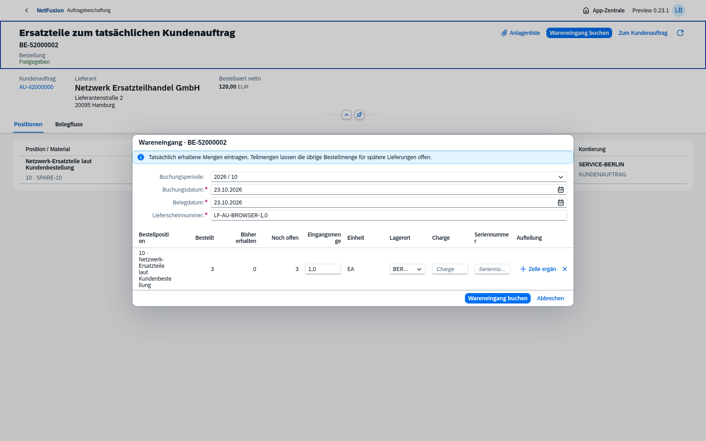
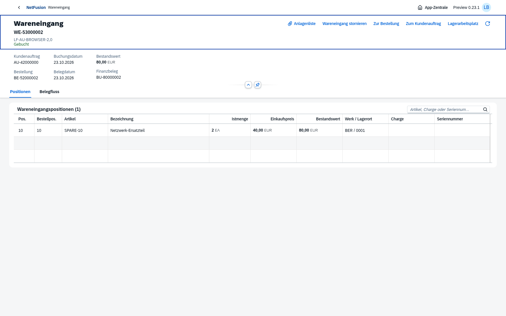
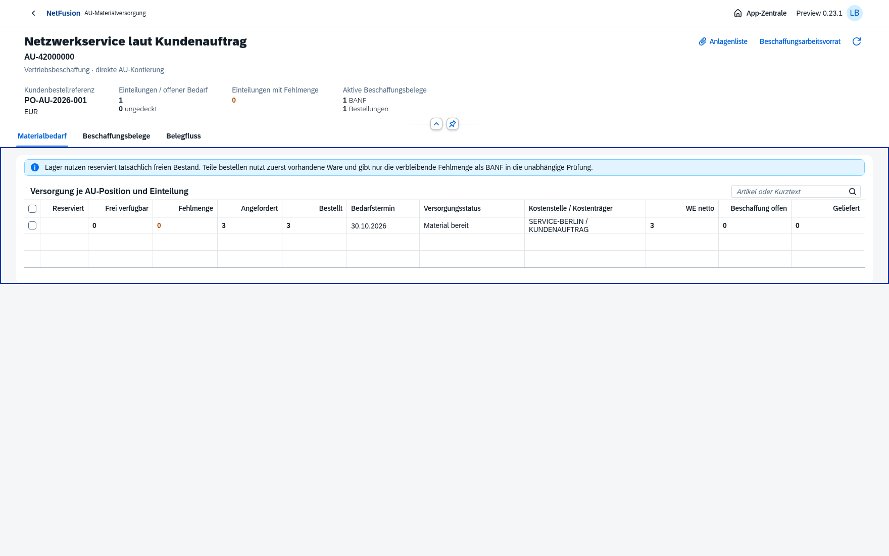
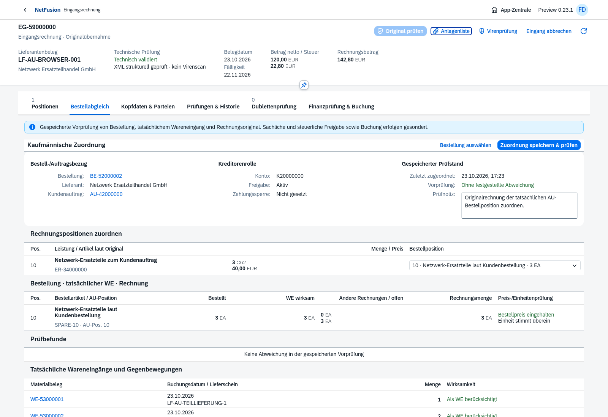
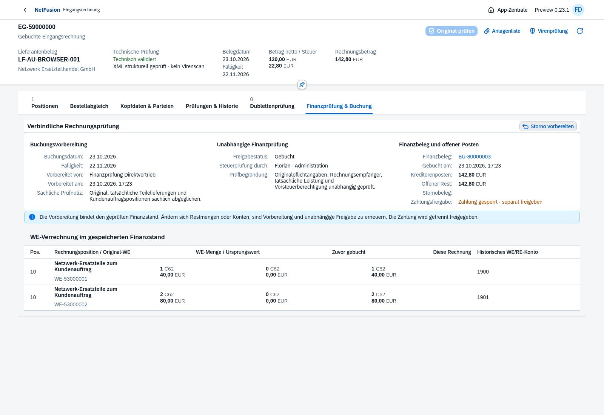
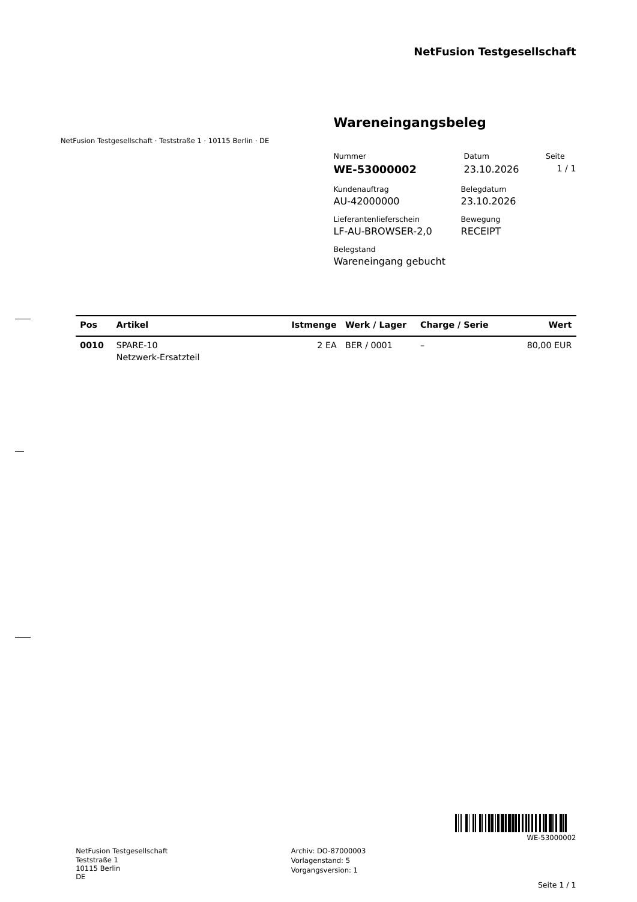
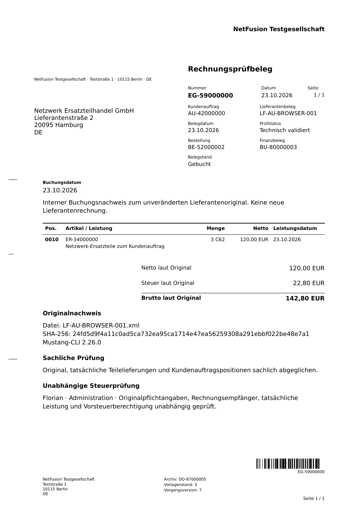

# Preview0.23 · AU-Teilwareneingang und Rechnungseingang

Tatsächliche Bestellung3 aus AU-Bedarf5 und vorhandener Reservierung2: native Eingänge1+2, daraus echte AU-Reservierung5 und anschließend gebundene Lieferantenrechnung. Einstieg über App-Zentrale, ausschließlich OpenUI5 1.152.1. [Versionsnotizen](../../releases/v0.23.0-preview.1.md), [fachlicher Umfang und Grenzen](../../requirements/direct-sales-receipts-payables.md), [Restbacklog](../../master-backlog-index.md).

## Tatsächliche Teilmengen und Materialversorgung

Weitere echte Masken: [erster Eingang](direct-receipt-partial.png), [zweite Mengeneingabe](direct-receipt-complete-input.png), [Materialbedarf](direct-receipts-supply.png), [Anlagenliste](direct-receipt-files.png), [exakte WE-Gegenbewegung](direct-receipt-reversal.png), [WE auf390px](direct-receipt-mobile.png), [AU-Bedarf auf390px](direct-receipts-supply-mobile.png).

Browserprozess: zwei tatsächliche WE1+2, Gesamt3/Reservierung5, Originaldownload des **zweiten WE2 mit80,00EUR**, danach genaue Rücknahme dieses zweiten Eingangs: Netto-WE1, Reservierung3, offene Beschaffung2. [Browsernachweis](direct-receipts-browser-proof.json). Separater [API-/DB-Nachweis](direct-receipts-proof.json) prüft zusätzlich verwendete Quellen, WA-Gegenbewegung, Ersatz-WE und konkurrierende Restmengen; sein erstes API-PDF ist ein anderer isolierter WE1 mit40EUR und wird nicht als Browserdownload ausgegeben.

## Rechnungseingang mit tatsächlichen WE-Quellen

Weitere echte Masken: [Vorbereitung](direct-payables-prepared.png), [in Prüfung](direct-payables-in-review.png), [unabhängige Steuerprüfung](direct-payables-tax-approval.png), [kleine Anlagenliste](direct-payables-files.png), [Journal mit historischen WE/RE-Konten](direct-payables-journal.png), [gebuchte Rechnung auf390px](direct-payables-posted-mobile.png).

Separater isolierter Browserprozess: WE1 zu40EUR auf1900, Kontierungsänderung, WE2 zu80EUR auf1901; Original120EUR netto /22,80EUR Steuer /142,80EUR brutto. Unabhängige Vorsteuerfreigabe, einmalige Buchung, FI-/OP-Verweis und Originaldownload. [Browsernachweis](direct-payables-browser-proof.json), [eingefrorener Finanzsnapshot](direct-payables-browser-snapshot.json), [Original-XML](direct-payables-browser-original.xml). [API-/DB-Prozess](direct-payables-proof.json) prüft zusätzlich unabhängigen vollständigen EG-Storno/OP-Ausgleich und anschließenden WE-Storno. Keine weiteren technischen Servicebelege entstehen.

## Unveränderte Geschäftsformulare

| Tatsächlicher Browserdownload | Sichtbarer Inhalt | Prüfung |
| --- | --- | --- |
| [Wareneingangsbeleg](direct-receipt-browser.pdf) | WE-53000002, AU-42000000, Istmenge2, Wert80,00EUR, Datum23.10.2026 | [A4, Revision5, Hash, unabhängig gelesener Code128](direct-receipt-pdf-proof.json) |
| [Interner Rechnungsprüfbeleg](direct-payables-browser.pdf) | EG-59000000, AU-/BE-/FI-Bezug, Original120,00/22,80/142,80EUR, Leistungsdatum23.10.2026 | [A4, Revision5, Hash, unabhängig gelesener Code128](direct-payables-pdf-proof.json) |

Formularbilder sind mit Poppler gerasterte Original-PDFs. Keine erfundenen Rechnungs-/Servicequellen. Prüfblatt ist interner Buchungsnachweis, keine neue Lieferantenrechnung. Die tatsächlichen Originalbytes bleiben archiviert.

## Prüfstand und weitere Arbeit

[Gesamtnachweis](verification.json):338/338 vollständige Tests, danach13/13 gezielte UI-/Anlagen-/PDF-Tests; zwei neue native Browserketten und betroffene Service-Einkaufs-/Lager-/EG-Storno-/Direktlieferungs-/Direktfaktura-Browser grün. Keine vollständige historische Browser-Suite. [Hauptumgebung](main-027-proof.json):27 Prüfsummen/Migrationen, Readiness/Anmeldung200, leere Geschäftsdaten. [Echtes Backup vor027](main-backup-proof.json) mit geprüftem Katalog, kein Restore behauptet.

[Produktionscontainer](docker-smoke.json) und [echte HTTPS8070-Erstinstallation/Neuanlage/Passworterhalt](docker-install-8070.json) mit Image `sha256:689f686670aea456991450febf1d8ce3d9edd3fa70be504242b039901336691f`. [Installationsbefehl](../../docker-8070.md). Vollständiger neuer Fachprozess wurde nicht zusätzlich innerhalb des Docker-Smoke-Tests wiederholt. Kein Ubuntu-Zielserverdeployment und kein Registry-Push.

Nächste offene Pakete: fakturierte AU-Retoure/Gutschrift, quellengebundene Umsatz-/Kosten-/Deckungsbeitragsberichte und restlicher [Masterbacklog](../../master-backlog-index.md). Qualität/Sperrbestand, Nichtlager/Fremdleistung, FX/Intercompany, Lieferantenretoure, Teilkorrekturen, Zahlungsverkehr und manuelle MR11-Kontenpflege bleiben offen. Gelesene [SAP-Fachkapitel](../../requirements/sap-reference-log.md) dienen der Prozessorientierung; technische Prüfung ersetzt keine Rechts-/Steuerabnahme.
