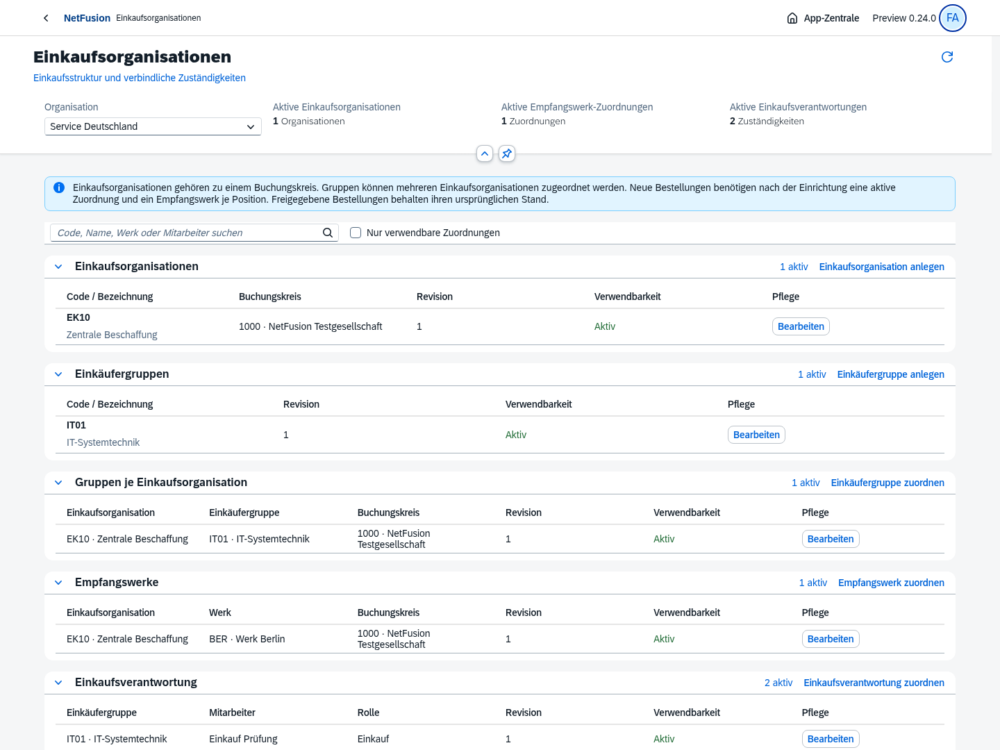
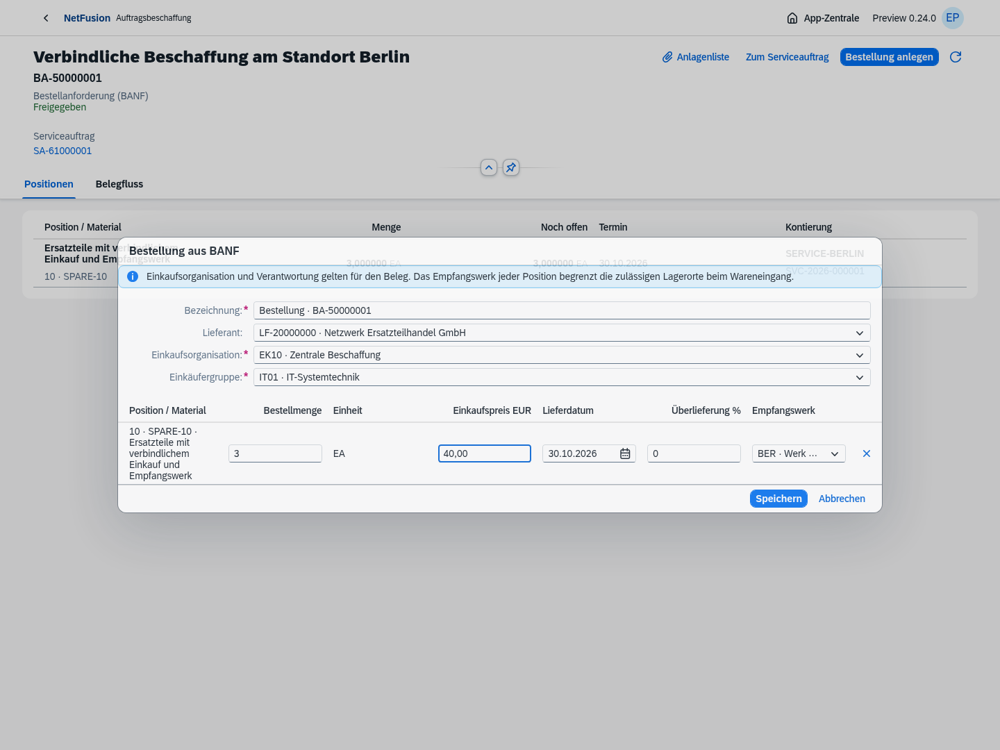
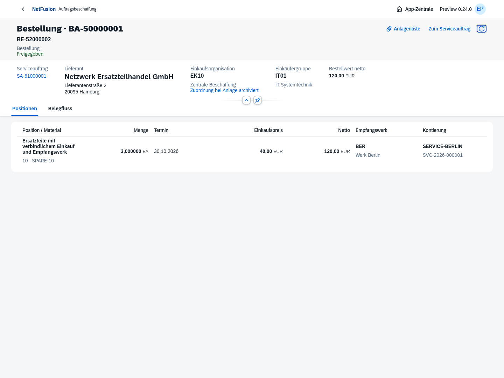
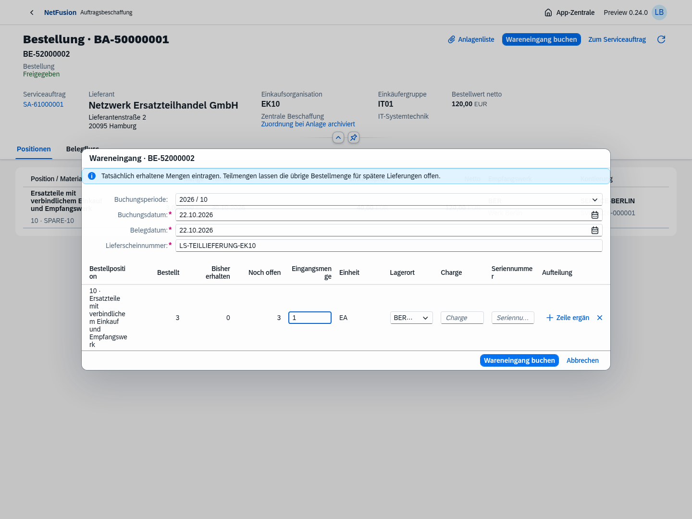
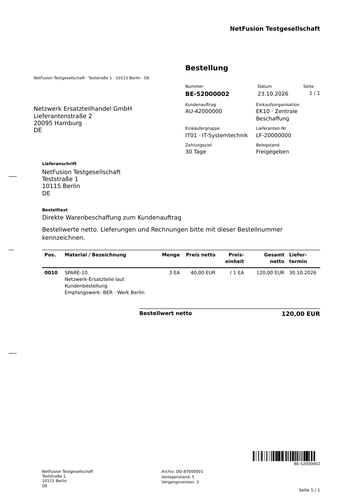

# Preview0.24 · Einkaufsorganisationen und Verantwortung

Tatsächliche, getrennte Prüfabläufe in isolierten Datenbanken mit synthetischen Geschäftspartnern und Belegen. Die Hauptumgebung wurde ohne künstliche Geschäftsbelege auf Migration028 aktualisiert. Native OpenUI5-Version1.152.1; keine eigenen visuellen Controls oder globalen Anwendungsreiter.

## Oberflächen

Die Einkaufsstruktur wurde über die echte App angelegt: Buchungskreis, Einkaufsorganisation, Gruppe, Gruppen-/Werkzuordnung und zwei aktive Verantwortliche. Anschließend erzeugte der Einkäufer eine wirkliche Bestellung aus der freigegebenen Service-BANF. Die Einkaufsleitung gab sie unabhängig frei; das Lager buchte eine tatsächliche Teilmenge1 von3 im bestellten Werk.

[Mobile Einkaufsstruktur](05-einkaufsstruktur-mobil.png), [mobile Bestellung](06-bestellung-mobil.png). Beide390px-Ansichten ohne horizontalen Seitenüberlauf. Dies ist Browseremulation und keine Abnahme physischer Mobilgeräte. [Browsernachweis](browser-verification.json).

## Bestellformular aus Direktvertrieb

Der separate tatsächliche AU-Prüfprozess erzeugte eine freigegebene Bestellung über3EA zu40,00EUR netto. Das archivierte Formular zeigt echten AU-Ursprung, EinkaufsorganisationEK10, GruppeIT01, EmpfangswerkBER und Lieferdatum30.10.2026. Eine A4-Seite, Schwarz-Weiß, gemeinsame Formularrevision5. Code128 wurde unabhängig aus dem150dpi-Raster alsBE-52000002 dekodiert.

[Original-PDF](bestellung-direktvertrieb.pdf), [unveränderlicher Formularstand](formularstand-direktvertrieb.json), [Hash und Barcode-Nachweis](pdf-verification.json).

## Prüfstand

- **357/357 vollständige Tests**, einschließlich10 neuer Einkaufsorganisations-/Direktvertriebsfälle. Danach der unveränderte Direktvertriebsprozess zusätzlich mit Archiv-/PDF-/Code128-Nachweis ausgeführt:1/1.
- Neue native Einkaufsapp: Stammpflege, Suche, Revision, Bestellung, unabhängige Freigabe, Teil-WE und390px grün. Zusätzlich bestehende Einkaufs-, Lager-/WE- und AU-Teil-WE-Browser grün. Kein vollständiger historischer Browser-Suitenlauf behauptet.
- Tatsächlicher mehrstufiger API-/SQL-Prozess mit zwei Empfangswerken in derselben Bestellung, geschützten Originalstornos, Fremdorganisation/Buchungskreis, Gruppenverantwortung, Idempotenz/Revision/Audit und Tenant-RLS.
- [Produktionsimage-Prüfung](docker-smoke.json): echte Migration/Anmeldung, Einkaufsstruktur/-zuordnungen, unprivilegierter schreibgeschützter Prozess, Mustang2.26.0 und Prüfung eines E-Rechnungsoriginals.
- [HTTPS8070-Installation](docker-install-8070.json): tatsächliches Caddy-TLS mit Zertifikatsprüfung, Secure-Cookie, automatische Migrationen/Bootstrap, Containerneuanlage sowie Erhalt des geänderten Administratorpassworts.
- [Hauptumgebung](main-environment.json):28 Migrationen mit geprüften Einzelprüfsummen, Readiness/ADMIN-Konfiguration200, keine künstlichen SA/AU/BE/WE. [Backupnachweis](backup-verification.json): echtes privates PostgreSQL-Archiv vor028,899885Bytes,0600, Katalog geprüft; kein Restorelauf behauptet und kein Archivinhalt eingecheckt.

Image `netfusion-erp:0.24.0-preview.1`, ID `sha256:5b972cec8e21deb0d0ac50f8dd47874fe732c0e02f39f68c0a04ce9545a0d856`. Das lokal gebaute und geprüfte Image ist kein Registry-Push und kein Deployment auf dem Ubuntu-Zielserver. Nach einem Speicherengpass wurden ausschließlich das eigene ersetzte0.22-Image und präzise zugehörige beziehungsweise neue ungeteilte Build-Caches entfernt; geprüfte0.23 und0.24 bleiben erhalten. Betroffene Browserprüfungen wurden nach Freigabe des Speichers erfolgreich wiederholt.

[Umfang und Grenzen](../../requirements/purchasing-organization.md), [SAP-Handbuchabgleich](../../requirements/sap-reference-log.md), [verbleibender Masterbacklog](../../master-backlog-index.md), [Installation auf8070](../../docker-8070.md). Buchungskreisübergreifender/Referenzeinkauf, Geschäftsbereiche/Profitcenter, vollständige Security-Policies/SoD, Varianten/Massenbearbeitung und weitere Fachprozesse bleiben offen. Kein vollständiger SAP-Ersatz oder rechtliche Produktivfreigabe.
