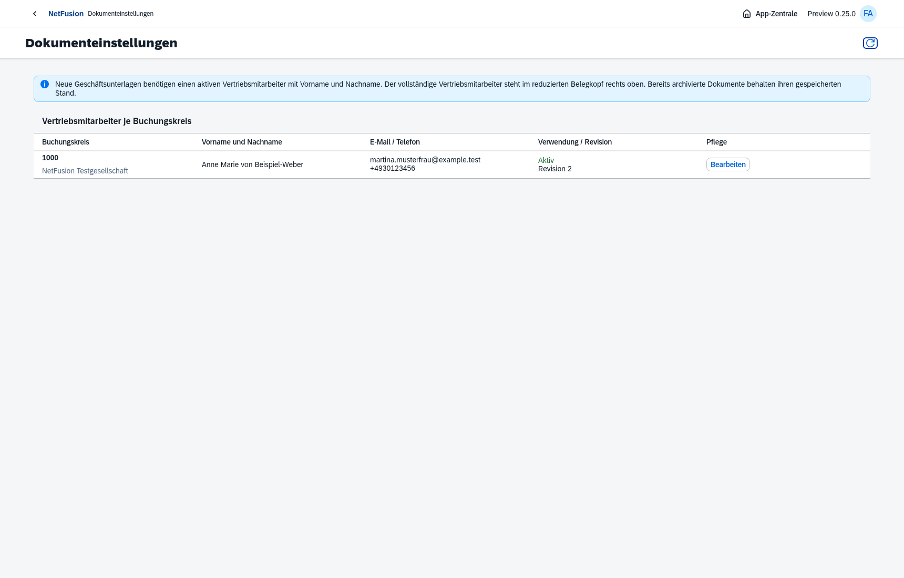
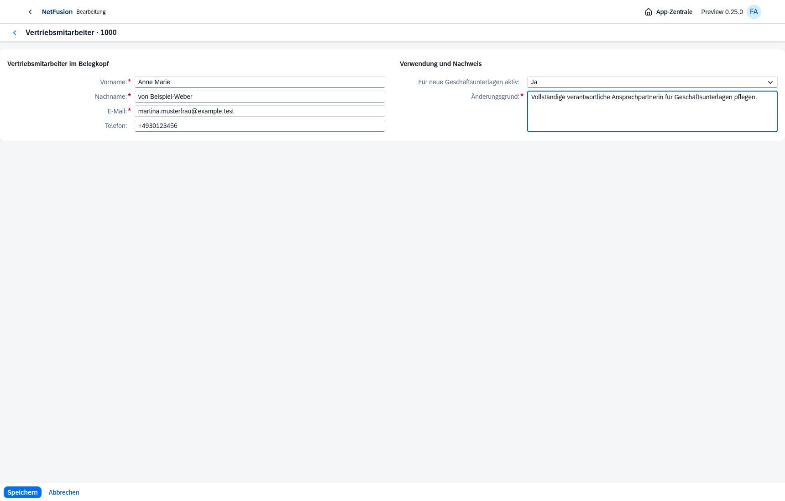
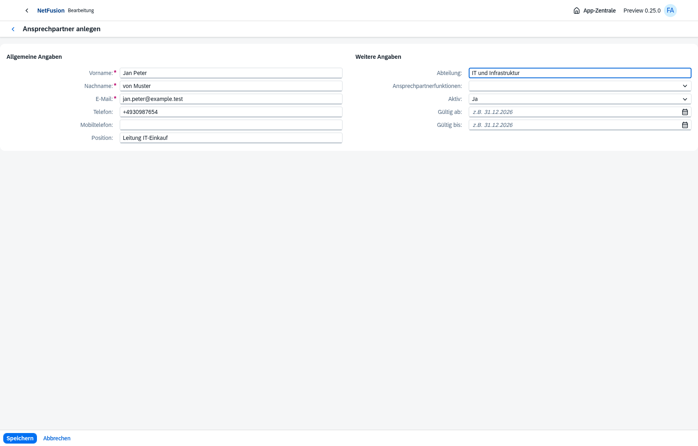
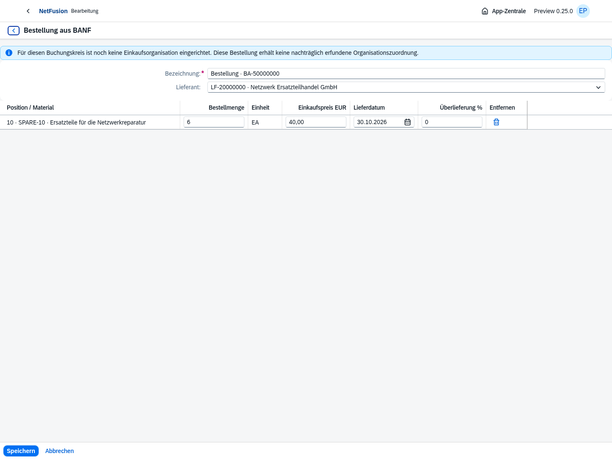
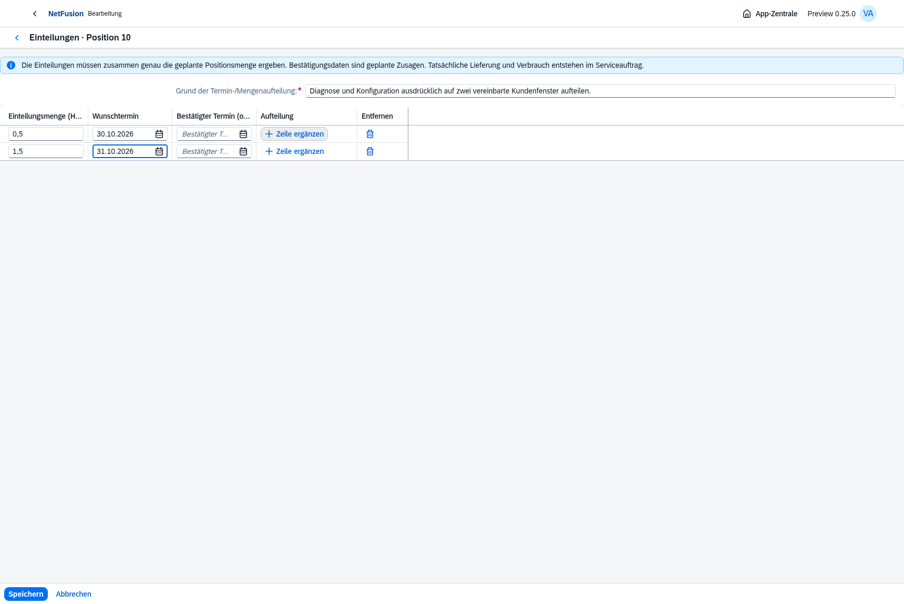
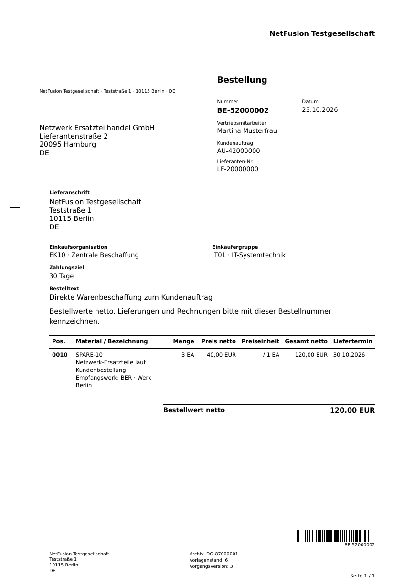

# Preview0.25 · größere Arbeitsseiten und vollständige Ansprechpartner

Die letzte Dokumentkorrektur ist umgesetzt: **keine zusätzliche Infobox und keine Anschriftentabelle.** Die Anschrift bleibt normal links. Rechts oben stehen Nummer, Datum, der vollständige Name unter **Vertriebsmitarbeiter** und wichtige Kunden-/Lieferanten-/Bestellreferenzen. Weitere Daten stehen im Beleginhalt. Alle gezeigten Masken und Dokumente stammen aus tatsächlichen Prüfabläufen mit synthetischen Testdaten.

## Arbeitsseiten

Umfangreiche Bearbeitungen öffnen eine native OpenUI5-Seite. Desktopformulare verteilen die Angaben auf zwei Gruppen; mehrzeilige Belege verwenden ein natives Positionsraster mit eigenen Spaltenbreiten und horizontaler Bewegung innerhalb der Tabelle. Auf dem Telefon verwendet die Erfassung native Pop-ins. Kleine Entscheidungen und die Anlagenliste bleiben Dialoge.

[Benutzerpflege](06-benutzer-arbeitsseite.png), [mobile Arbeitsseite mit390px](07-arbeitsseite-mobil.png). Speichern, Abbrechen, abgeschlossene Bearbeitung, Passwortmaskierung, vollständiger Benutzer-/Kontaktname und fehlender mobiler Seitenüberlauf sind tatsächlich geprüft. [Arbeitsseitennachweis](workspaces-verification.json). Keine physische Geräteabnahme behauptet.

Der Servicefolgeauftrag fragt Material-/Beschaffungsdaten mit dem tatsächlichen Service-Leserecht ab. Ein Vertriebsnutzer kann seinen geschützten abgeleiteten SA vollständig öffnen, ohne dass seine separate AU-Beschaffungsberechtigung unzulässige Serviceanfragen auslöst.

## Geschäftsformular

Die freigegebene Direktvertriebsbestellung über3EA zu40,00EUR netto enthält tatsächliche AU- und Lieferantenreferenz, gepflegten vollständigen Ansprechpartner, deutsche Daten, Einkaufsorganisation/-gruppe im Beleginhalt und Code128. Eine A4-Seite, Schwarz-Weiß, Vorlagenstand6. Der Barcode wurde unabhängig aus dem Raster dekodiert; der PDF-Hash ist gegen die archivierten Bytes geprüft.

[Original-PDF](bestellung-direktvertrieb.pdf), [Formularstand](formularstand-direktvertrieb.json), [Hash-/Barcode-Nachweis](pdf-verification.json).

## Prüfung und Betrieb

- **364/364 vollständige Tests**, anschließend **90/90 gezielte Prüfungen des endgültigen Dokumentlayouts und seiner Belegprozesse**. Einschließlich tatsächlicher ZUGFeRD-/PDF/A-Prüfung mit Mustang, archivierter Originale und geschützter Gegenbuchungen. [Testnachweis](test-verification.json).
- **30/30 native Browser-Prüfabläufe**, in zwei isolierten Gruppen und gezielten Wiederholungen nach Korrekturen. Angebot/AU, Positionsdetails und Teileinteilungen, SA, Beschaffung, Teil-WE, Lager, Inventur, Faktura, CRM, Anlagen, Belegfluss und mobile Ansichten. [Browsernachweis](browser-verification.json). Kein einzelner ununterbrochener Matrixlauf behauptet.
- [Hauptumgebung](main-environment.json):29 angewandte Migrationen, jede Prüfsumme geprüft, Readiness und authentifizierte Dokumentkonfiguration200; keine künstlichen Geschäftsbelege oder Ansprechpartner angelegt.001–029 bleiben unverändert, nächste Migration030.
- [Sicherung vor029](backup-verification.json): echter privater PostgreSQL-Dump,937471Bytes,0600, Katalog und Hash geprüft. Kein Restorelauf behauptet; keine Archivdaten im Git.
- Produktionsimage und tatsächliche HTTPS8070-Installation werden durch [Image-Nachweis](docker-smoke.json) und [Installationsnachweis](docker-install-smoke.json) dokumentiert. Die Nachweise gelten für den dort genannten lokalen Image-Hash. Kein Registry-Push und kein Deployment auf den vorgesehenen Ubuntu-Zielserver.

Vor neuen Geschäftsunterlagen den tatsächlichen Ansprechpartner in der eigenen App **Dokumenteinstellungen** pflegen. Alte unstrukturierte Personennamen müssen mit den wirklichen Komponenten vervollständigt werden; keine automatische Namenszerlegung. Archivierte PDFs werden nicht verändert. Bereits vor029 angelegte Rechnungsausgabeaufträge behalten ihren Vorlagenstand5; neue verwenden6. Die Browserseiten speichern Entwürfe im Arbeitsspeicher; Neuladen beendet die Bearbeitung.

[Fachumfang und Grenzen](../../requirements/workspaces-document-contacts.md), [Restbacklog](../../master-backlog-index.md), [Installation auf8070](../../docker-8070.md). Vollständige CRM-/SAP-/DIN-/Rechts-/Security-/Produktionsabnahme bleibt offen. Das Git-Preview erhält einen annotierten Tag; eine separate GitHub-Releaseseite ist in dieser Umgebung wegen gesperrtem GitHub-API-Zugriff weiterhin nicht erstellt.

## Nachtrag: Vertriebsmitarbeiter rechts oben

Nach der letzten Nutzerpräzisierung tragen neue Ausgaben die Bezeichnung **Vertriebsmitarbeiter** beim gepflegten vollständigen Namen im rechten Kopf. Die Anschrift links bleibt normaler Text. Die Druckbezeichnung wird im neuen Formular- bzw. Rechnungssnapshot festgehalten; alte Archivbytes und wartende alte Rechnungsausgaben behalten ihre vorhandene Bezeichnung. Die Pflege in Dokumenteinstellungen nennt die Rolle ebenfalls ausdrücklich. [24/24 zusätzliche Prüfungen und native Arbeitsseitenprüfung](sales-contact-verification.json). PDF und Ansprechpartner-Screenshots oben zeigen diesen Nachtrag.

Die Docker-/HTTPS-Nachweise beziehen sich auf das davor erzeugte Code-Preview-Image08da8ee…; für diesen nachfolgenden Druckbezeichnungs-Nachtrag wurde kein neues Image oder erneuter HTTPS-Installationsnachweis behauptet. Die aktuelle Quelle auf main wird mit dem dokumentierten Dockerbefehl neu gebaut. Der veröffentlichte Git-Tag bleibt unverändert.
