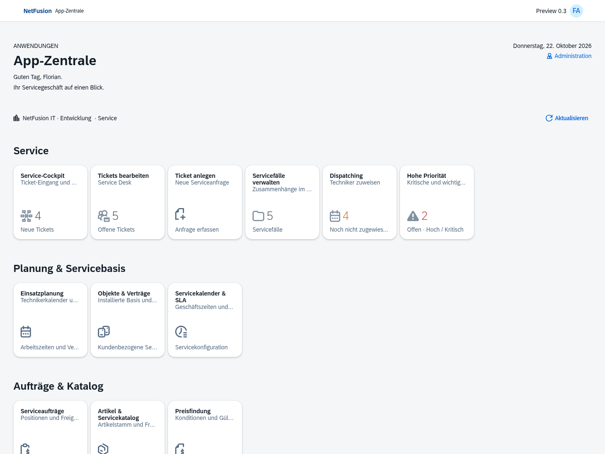
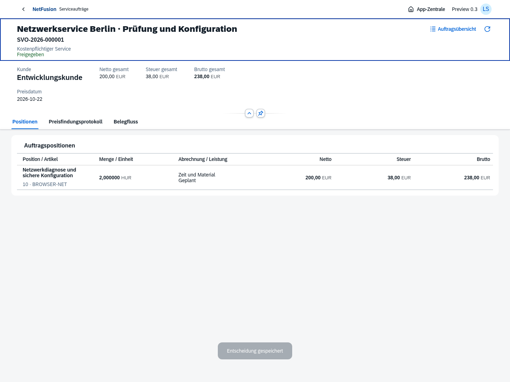
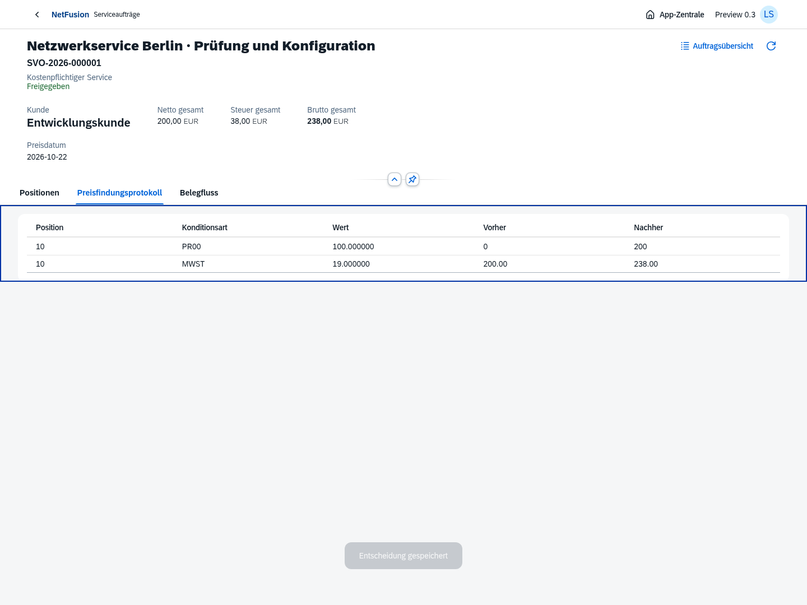

# Preview 0.3 · Artikel, Preisfindung und Serviceauftrag

Echte Standard-OpenUI5-Oberflächen aus dem isolierten Chromium-Testprozess. Angezeigte Belege und Personen sind Testdaten. Der Auftrag ist freigegeben, die geplante Leistung noch nicht ausgeführt oder fakturiert.

[Funktionsumfang, Preisregeln und offene Punkte](../../releases/v0.3.0-preview.1.md) · [Service-Cockpit und Einsatzplanung aus Preview 0.2](../v0.2.0-preview.1/README.md)
