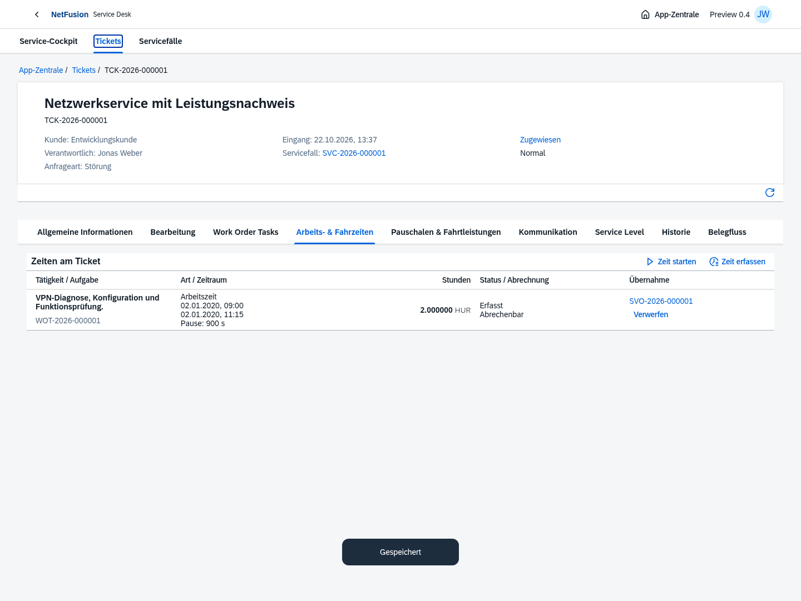
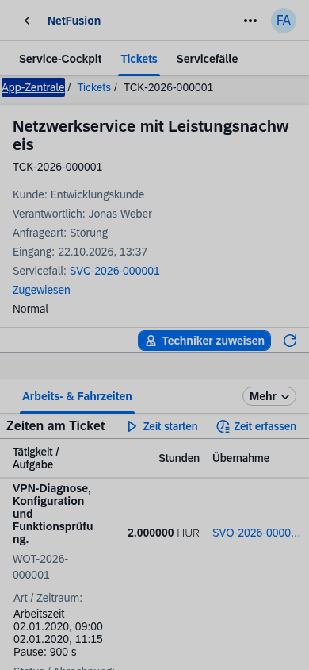
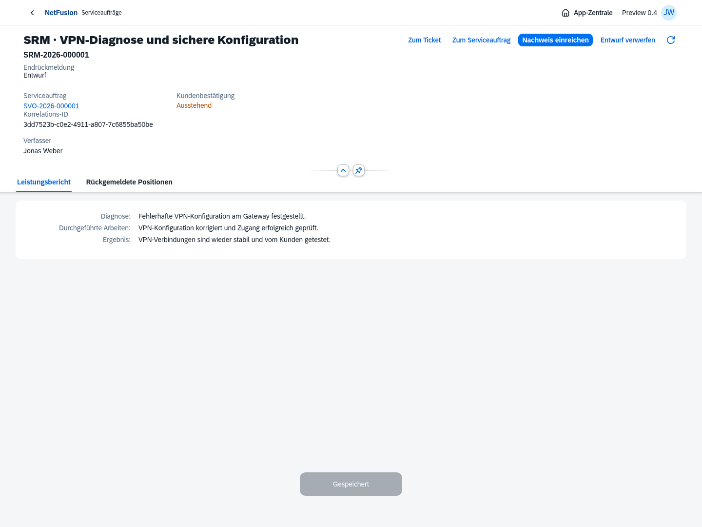
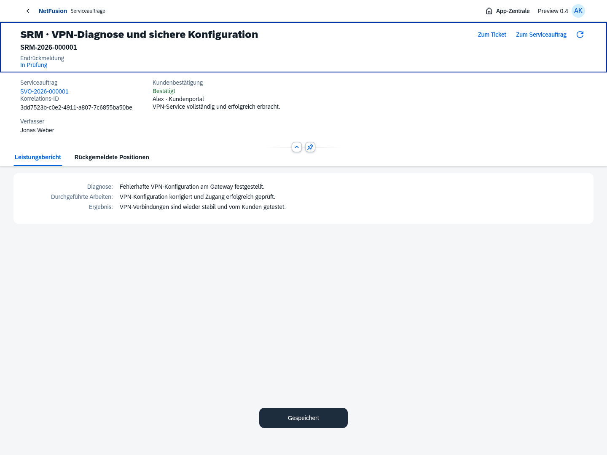
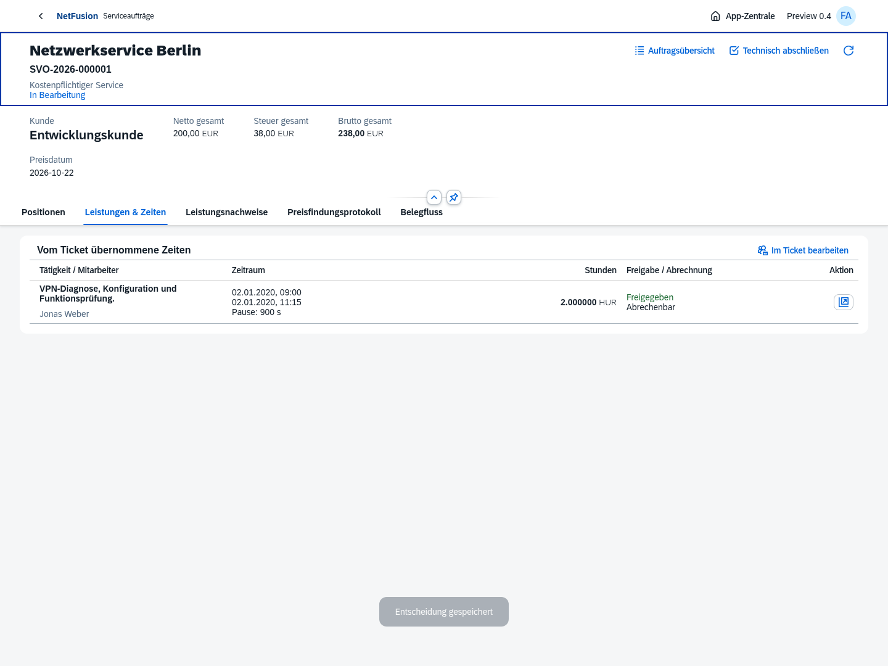
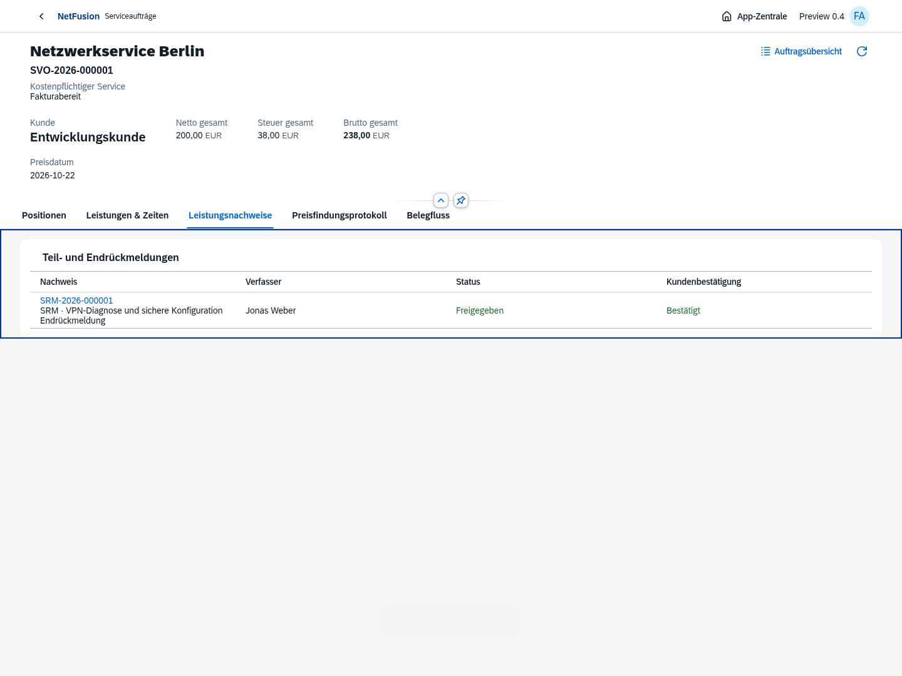
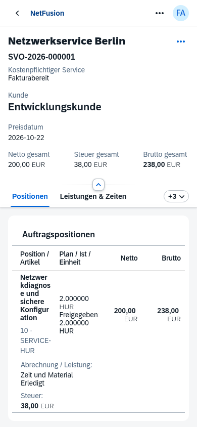

# Preview 0.4 · Ticket → Work Order Task → SRM

Echte OpenUI5-Oberflächen aus dem isolierten Chromium-Testprozess. Alle angezeigten Belege, Personen, Zeiten und Kennzahlen sind Testdaten. Die Entwicklungsdatenbank wird durch diese Prozesse nicht befüllt.

## Zeiterfassung am Ticket

Arbeits-/Fahrzeit, Timer/Pausen, Aufgabenbezug und ausdrückliche Übergabe an die passende Auftragsposition. Die Erfassung funktioniert bereits vor der Anlage des Serviceauftrags.

## Automatische SRM beim Aufgabenabschluss

Die Work Order Task erzeugt einen eigenen SRM-Beleg mit den tatsächlichen Leistungen und unveränderter Ticket-Korrelations-ID. Die SRM bleibt mit Ticket, Aufgabe und Auftrag verknüpft.

## Kaufmännische Weiterbearbeitung

Der Serviceauftrag zeigt die übergebenen Leistungen. Technischer Abschluss und Fakturabereitschaft folgen nach Kundenbestätigung, Servicefreigabe und vollständiger Endrückmeldung. Noch keine Rechnung oder Finanzbuchung.

[Versionsumfang und offene Punkte](../../releases/v0.4.0-preview.1.md) · [Verbindlicher Ticket-/SRM-Prozess](../../requirements/ticket-execution.md) · [App-Zentrale und Preisfindung aus Preview 0.3](../v0.3.0-preview.1/README.md)
