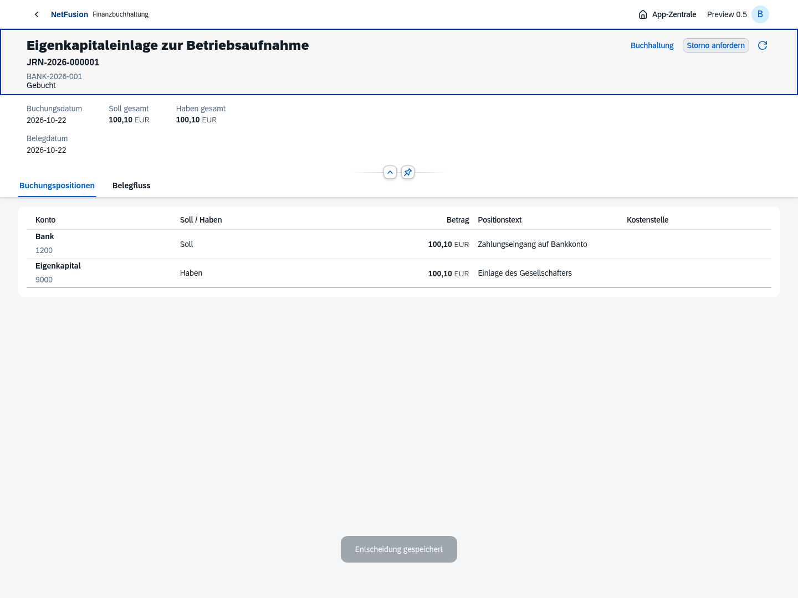
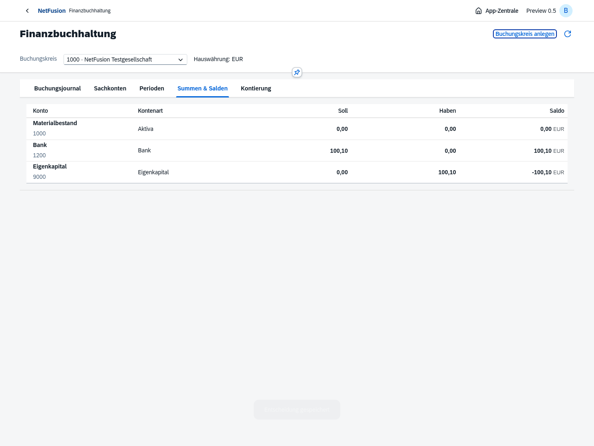
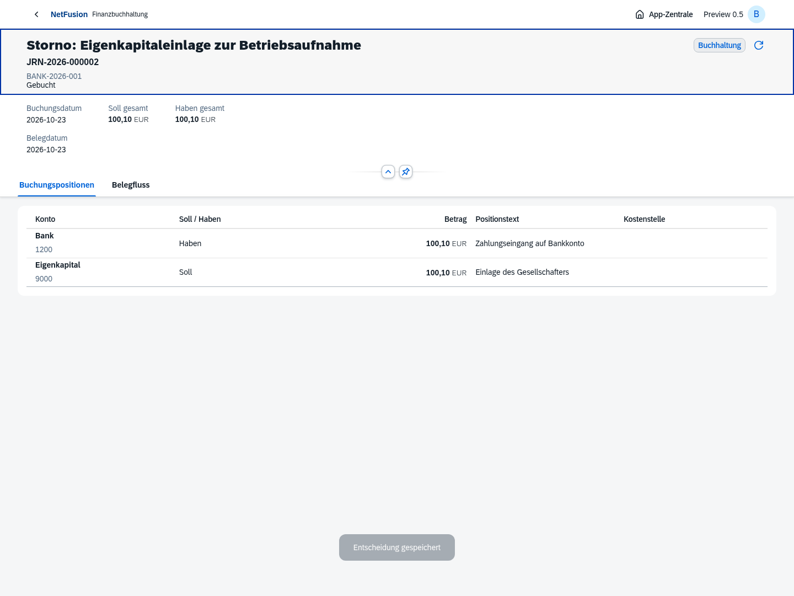
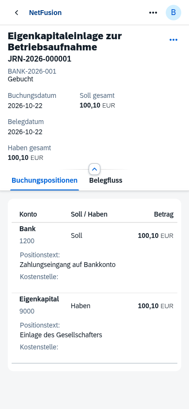
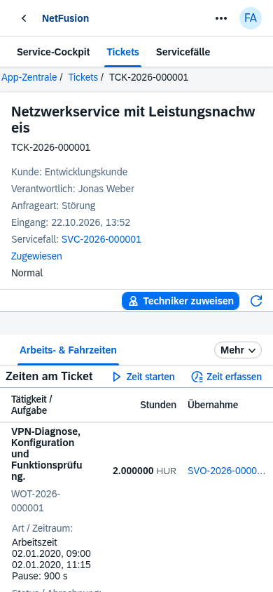

# Preview 0.5 · Buchungskern

Echte Standard-OpenUI5-Oberflächen aus isolierten Chromium-Prozessen. Die abgebildeten Firmen, Konten, Beträge und Buchungen sind Testdaten. Die Entwicklungsdatenbank enthält keine künstlichen Journalbelege.

[Versionsumfang und offene Punkte](../../releases/v0.5.0-preview.1.md) · [Ticket → Work Order Task → SRM aus Preview 0.4](../v0.4.0-preview.1/README.md)
