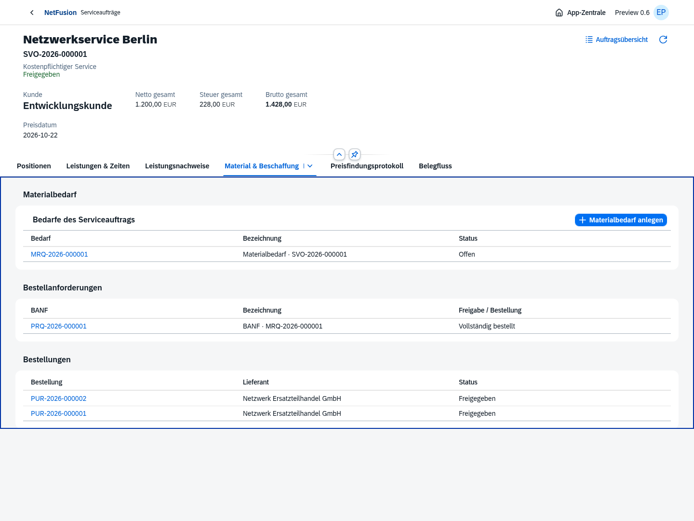
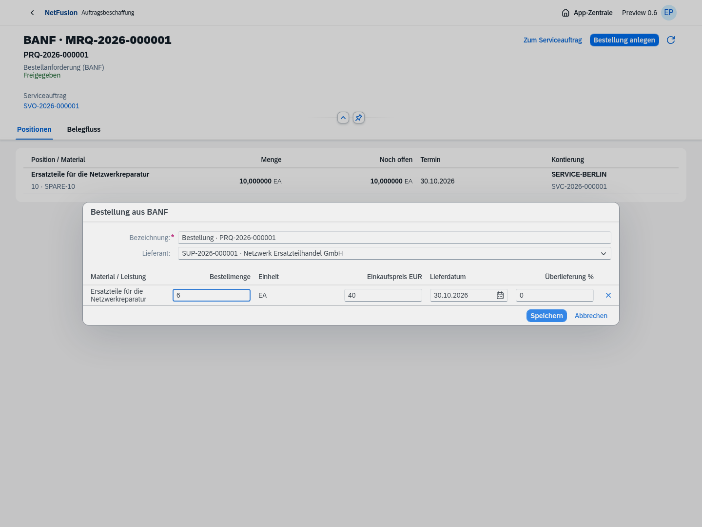
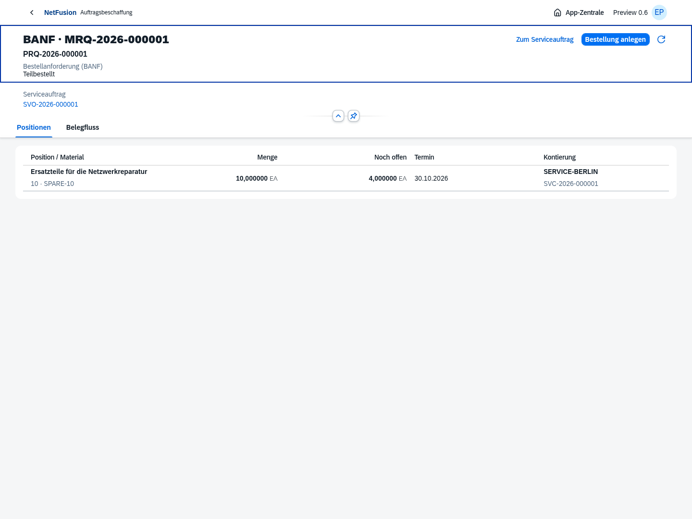
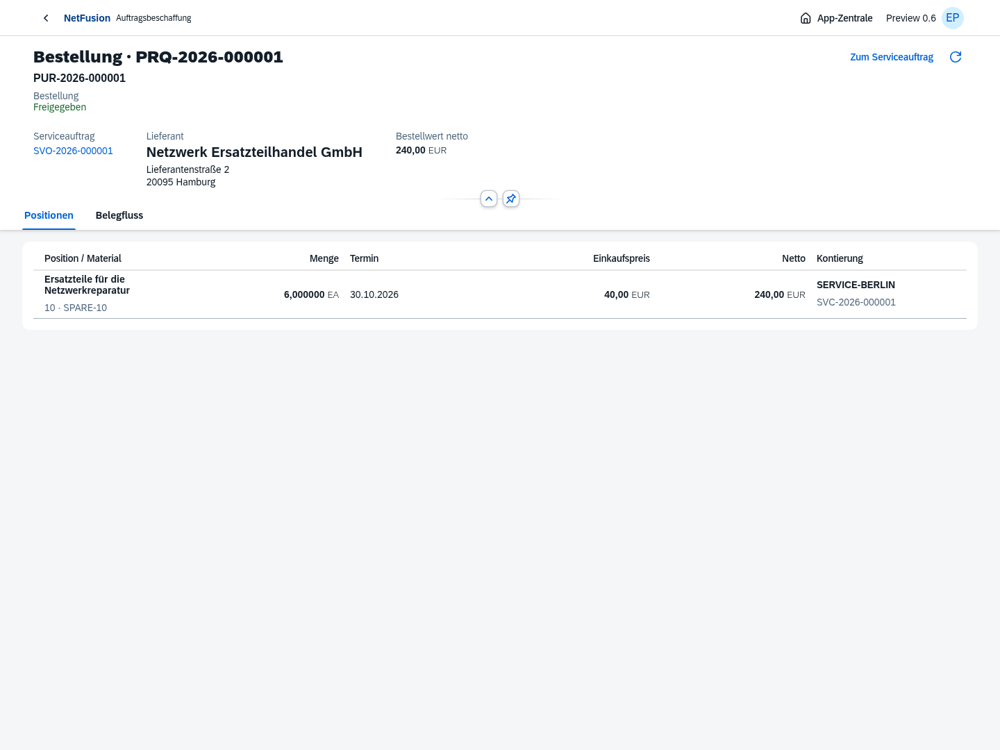
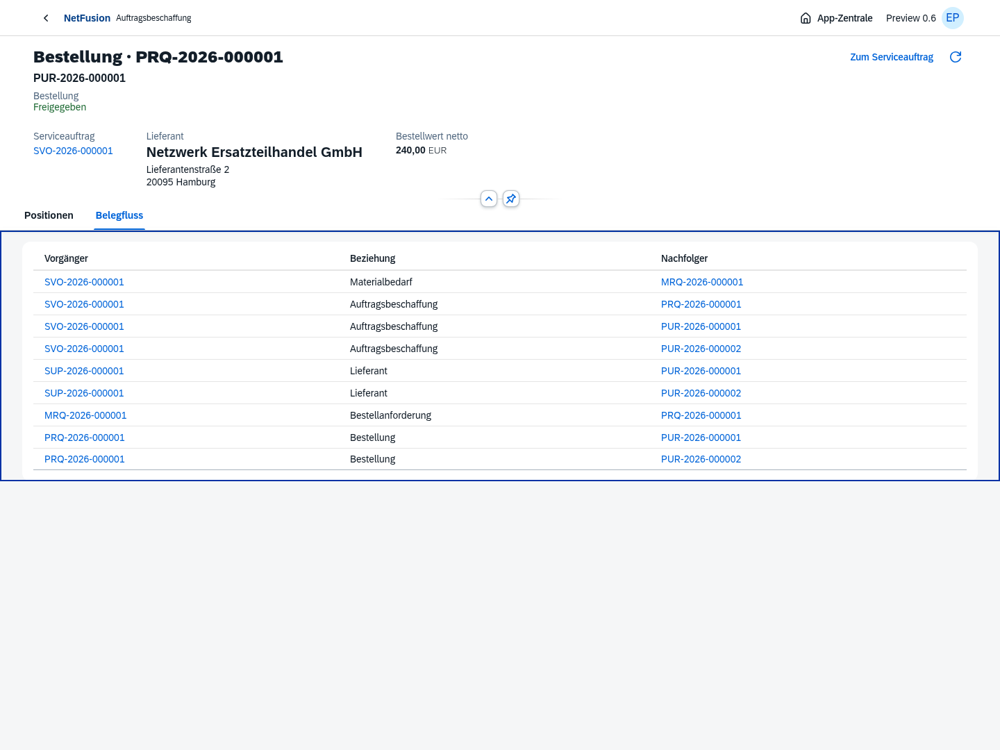
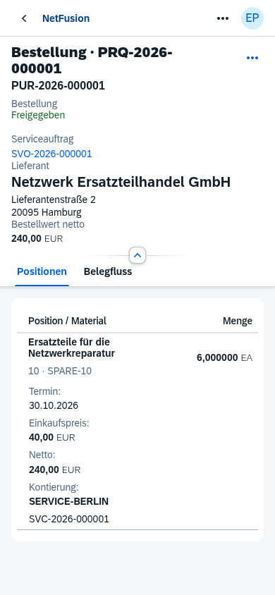

# Preview 0.6 · Beschaffung aus dem Serviceauftrag

Echte Chromium-Aufnahmen mit OpenUI5 1.153.0, PostgreSQL und ausschließlich isolierten Testdaten. Kein manuell nachgebautes UI. 87 Fach-/Integrations-/Sicherheitstests und sieben Browserprozesse bestanden. [Versionsnotizen und offene Funktionen](../../releases/v0.6.0-preview.1.md).

Der Auftrag führt Bedarf/BANF/Bestellungen. Das Ticket erfasst weiterhin Arbeits-/Fahrzeiten und Pauschalen; WOT-Abschluss erzeugt eine korrelierte SRM. Beschaffungsbelege sind noch keine Lagerbewegungen oder Rechnungen.

## Serviceauftrag mit Bedarf, BANF und Teilbestellungen

## Bestellung aus freigegebener BANF

## BANF nach erster freigegebener Teilbestellung

10 angefordert, 6 bestellt, 4 noch ungebunden.

## Freigegebene Bestellung mit Lieferant, Kontierung und Ursprungsauftrag

## Vollständiger autorisierter Belegfluss

## Smartphone

