# Preview 0.7 · Automatische Materialversorgung und bewertetes Lager

Echte Chromium-Aufnahmen vom 22.10.2026 mit OpenUI5 1.153.0 und isolierten PostgreSQL-Testdaten. 103 automatisierte Prüfungen und neun Browserprozesse bestanden. [Versionsnotizen und Grenzen](../../releases/v0.7.0-preview.1.md).

Der Versorgungsfall zeigt Bedarf10, Bestand6, Reservierung6 und Fehlmengen-BANF4. Nach Bestellung/WE4 sind zehn Stück für die Lagerposition reserviert. Zwei weitere Nichtlager-/Fremdleistungspositionen bleiben ungedeckt; deshalb meldet der gesamte Auftrag weiterhin fehlende Versorgung. Reservierung ist noch kein Verbrauch.

Der separate Bewertungsfall zeigt Bestellung6/WE4+2 zum Preis40 und Bestellung4/WE4 zum Preis60: Menge10, Wert480, Durchschnitt48. Storno der letzten Lieferung nimmt Menge4 und Wert240 über Material- und FI-Gegenbeleg zurück.

## Automatisch erkannter Bedarf und Lagerverfügbarkeit

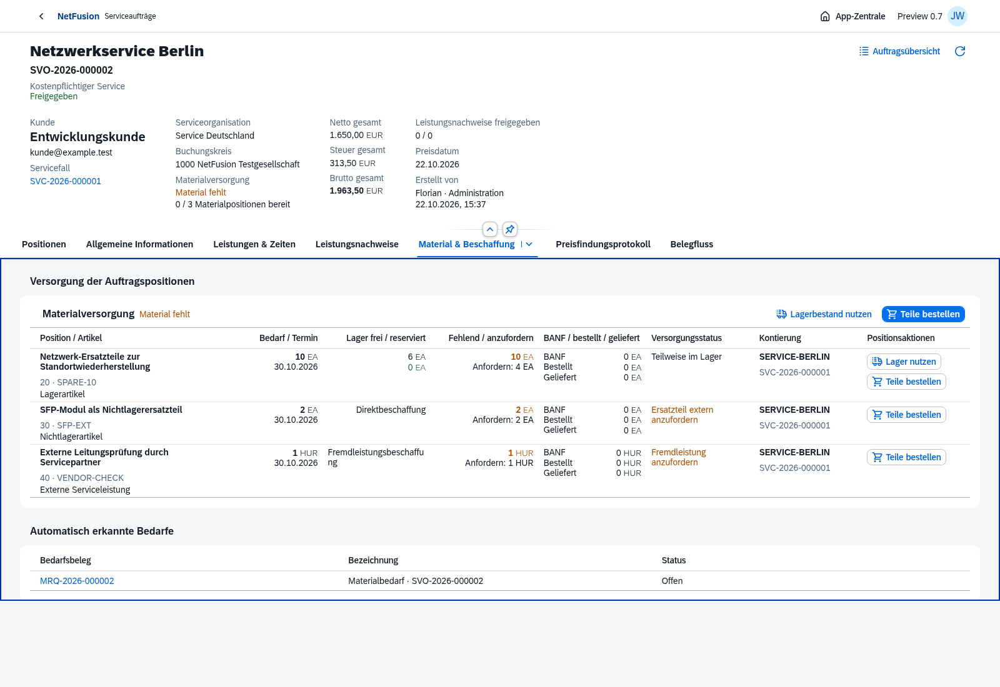

## Sechs Stück aus vorhandenem Lager reserviert

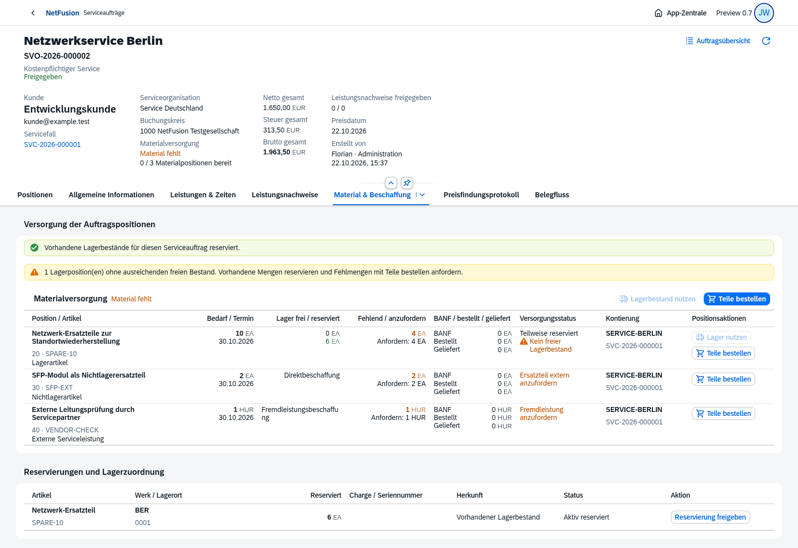

## Nur vier fehlende Stück per BANF in Prüfung

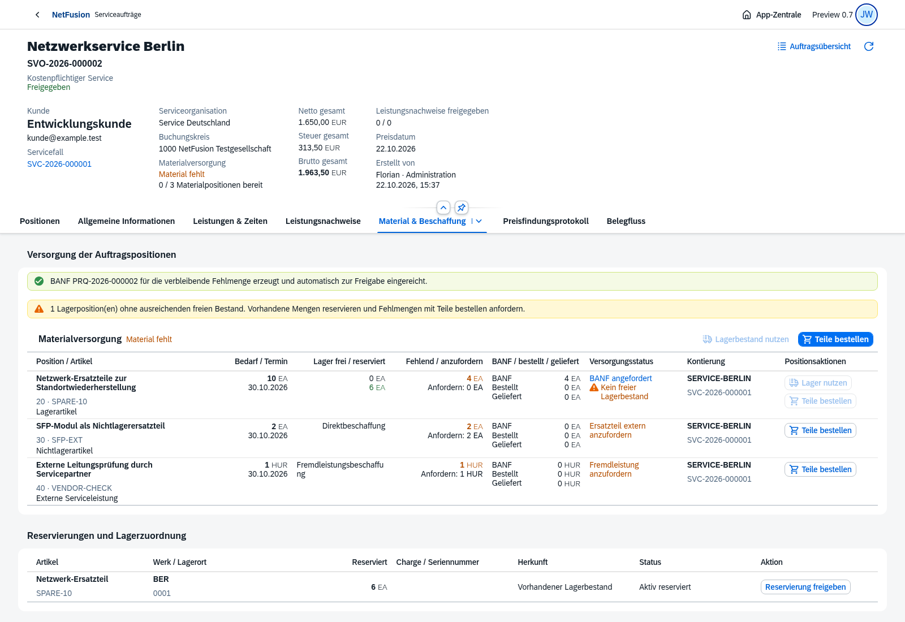

## Wareneingang ergänzt die Reservierung auf zehn Stück

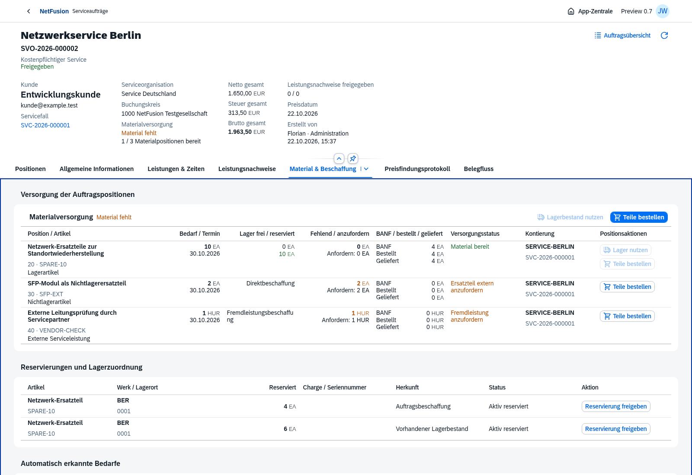

## Materialversorgung im mobilen Browser

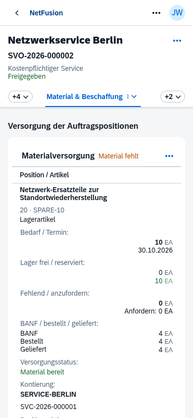

## Auftragskopf und freigegebene Positionen

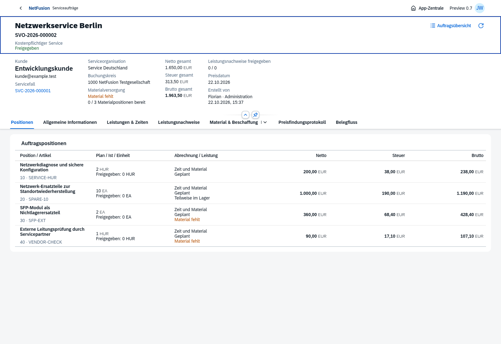

## Kunde, Fall, Organisation und Ursprung

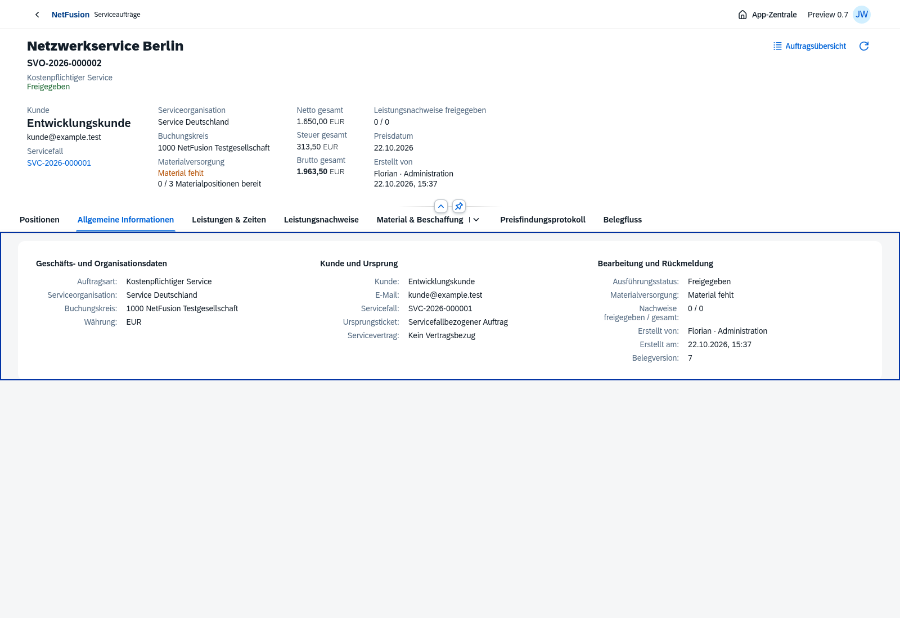

## Werke und Lagerorte

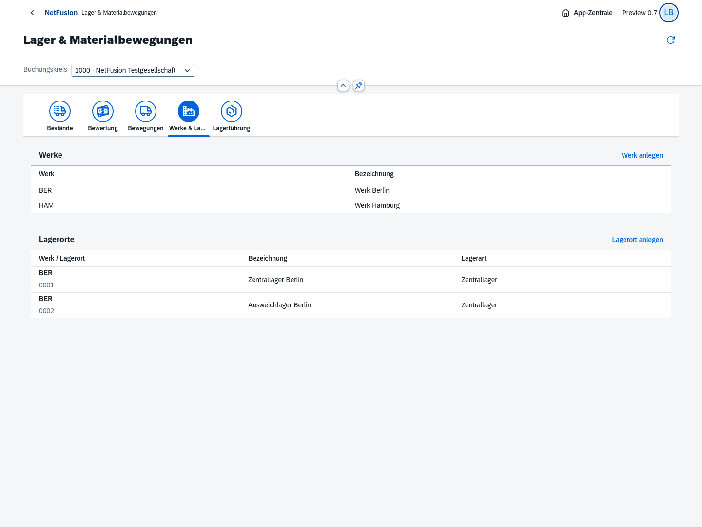

## Zehn Stück mit Wert480 und Durchschnitt48

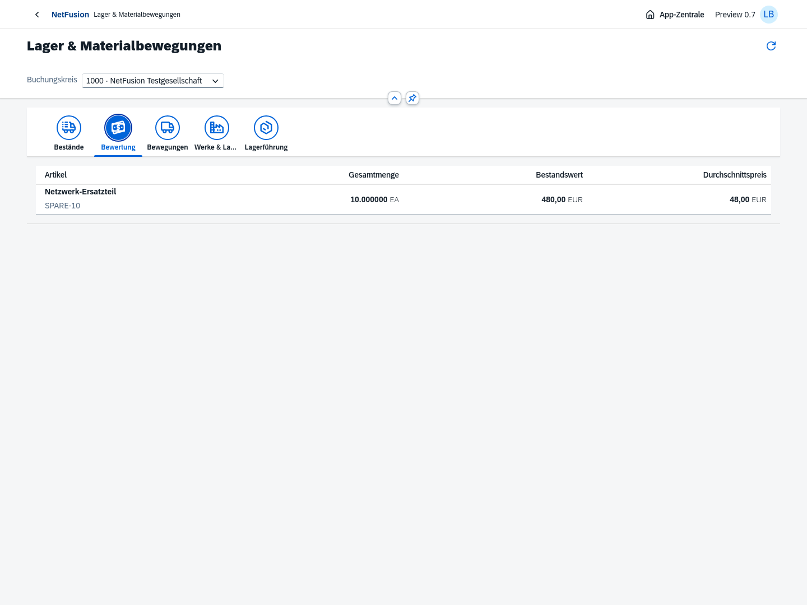

## Bewerteter Teilwareneingang zur Bestellung

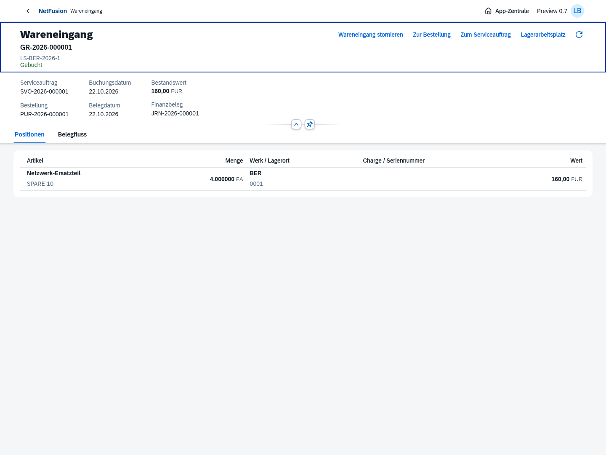

## Gegenbewegung mit Originalbezug

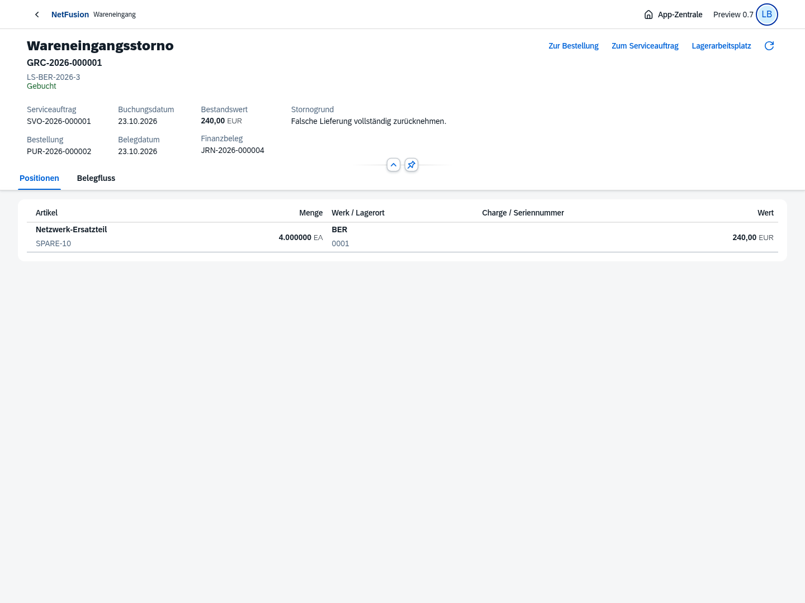

## Automatische ausgeglichene Finanzbuchung

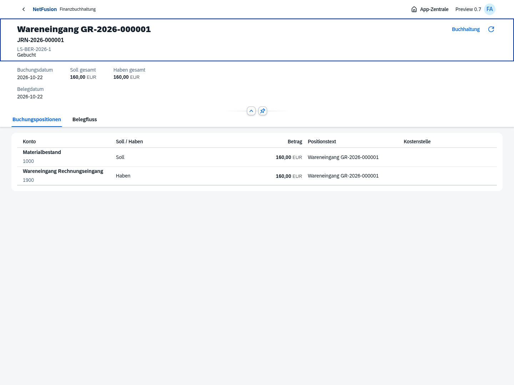

## Materialbeleg auf dem Smartphone

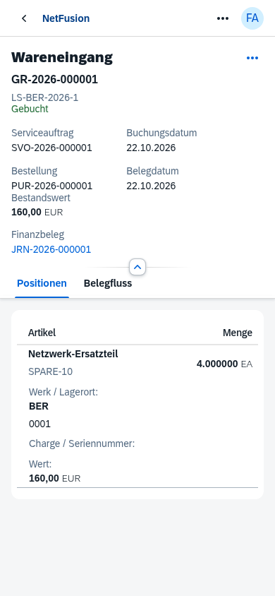

