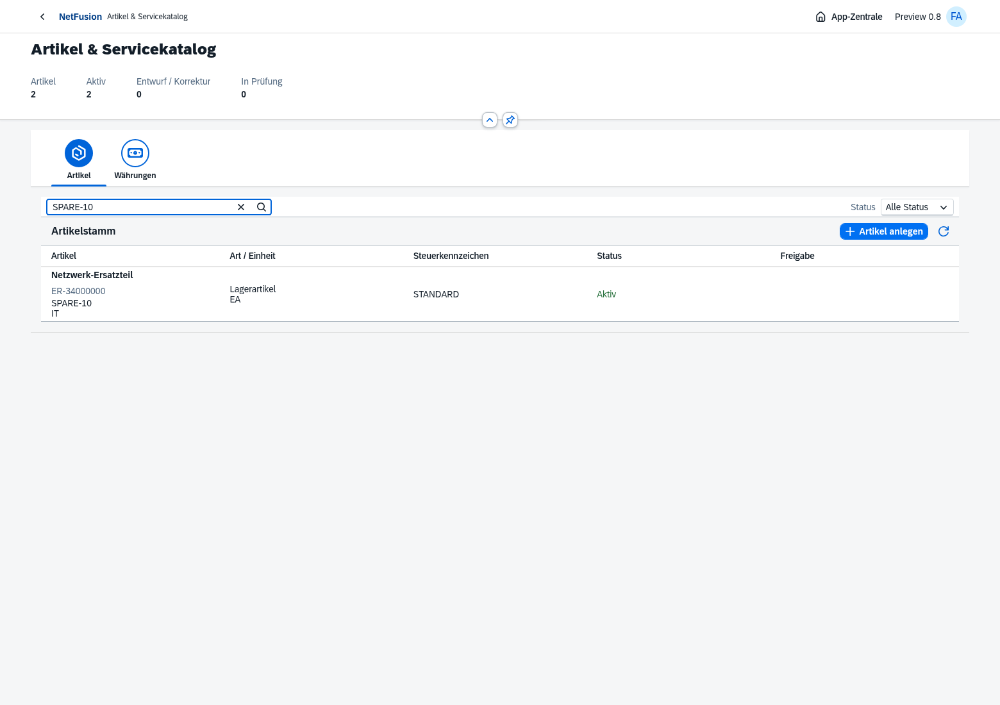
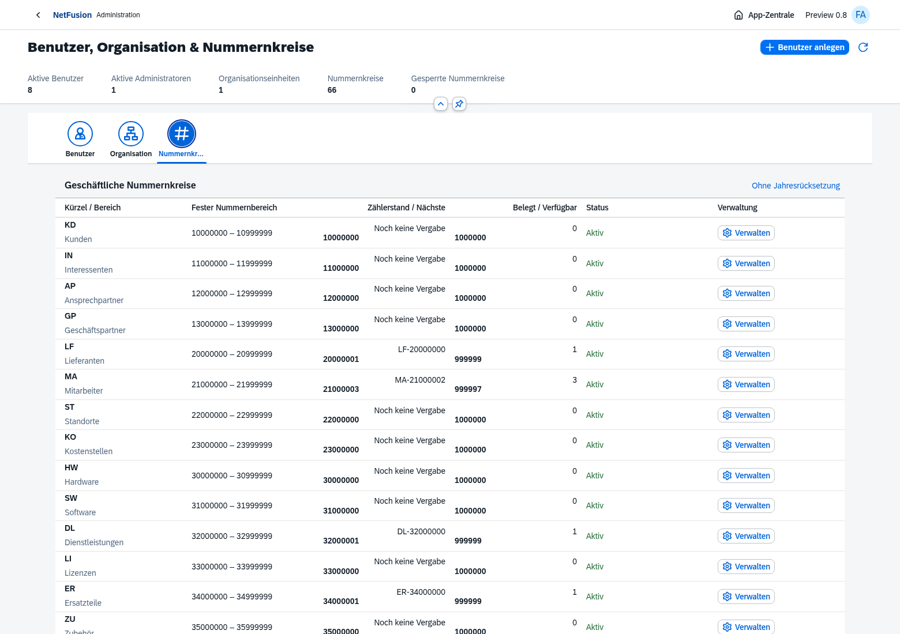
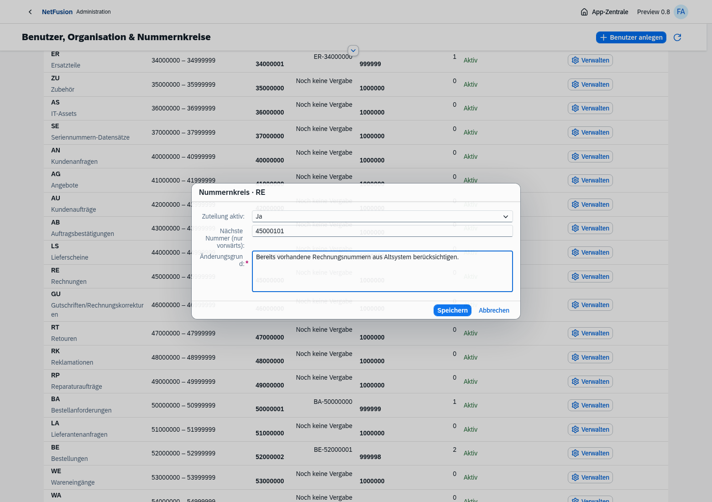
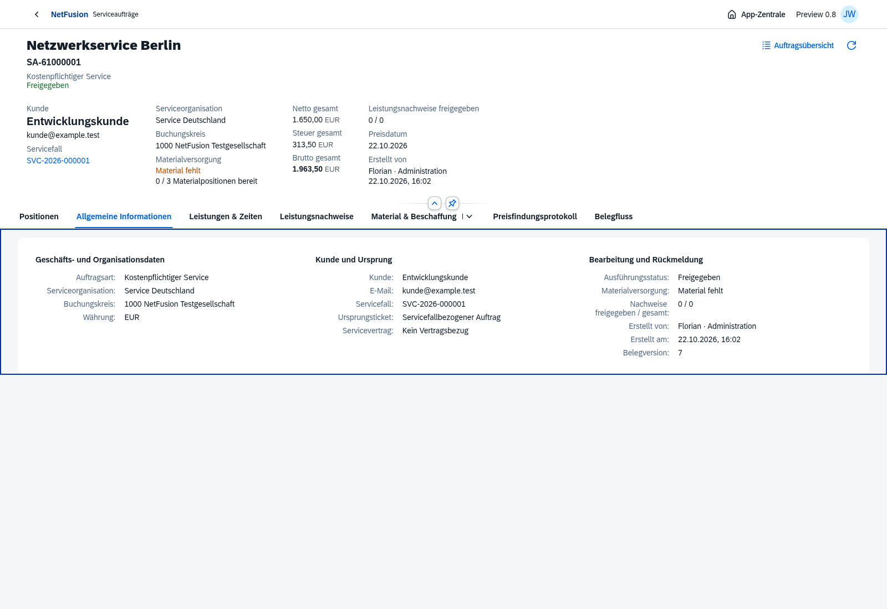
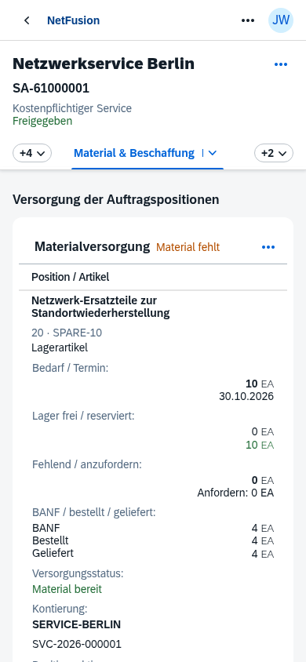
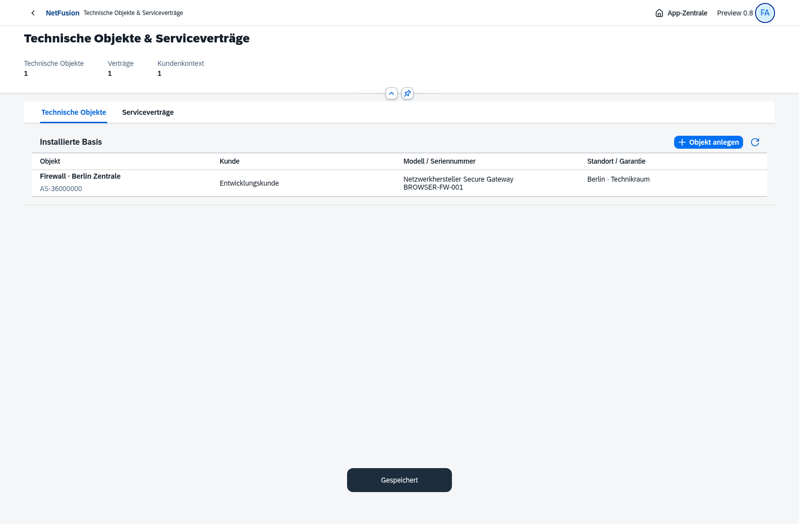
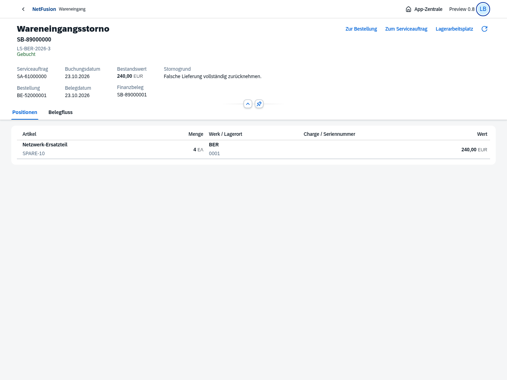
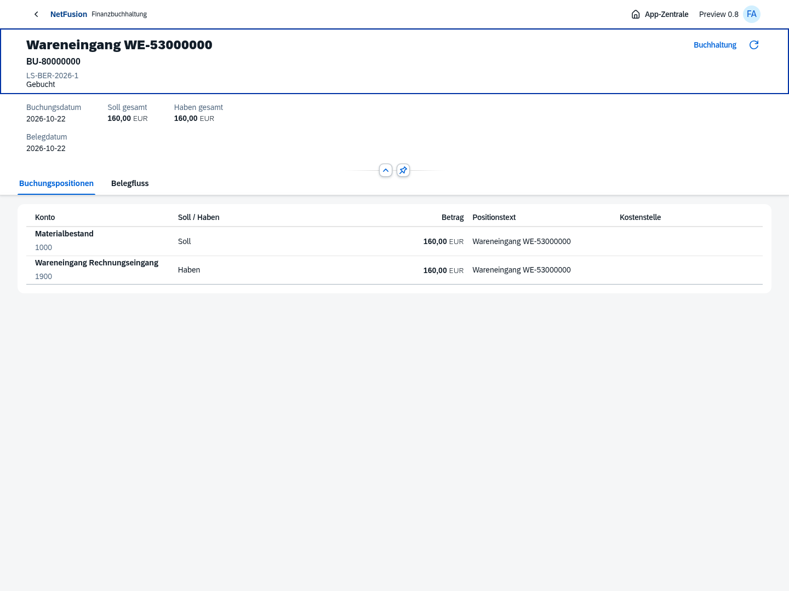

# Preview 0.8 · Geschäftsnummern und dichtere Fachmasken

Chromium-Aufnahmen vom 22.10.2026 mit OpenUI5 1.153.0 und isolierten PostgreSQL-Testbelegen. 109 automatisierte Prüfungen sowie zehn Browserprozesse bestanden; nach der Nummernzuordnung wurden 29 betroffene Fachprüfungen zusätzlich bestanden. [Versionsumfang und offene Prozesse](../../releases/v0.8.0-preview.1.md).

Die 66 Nummernkreisdefinitionen sind Konfiguration aus der Nutzervorgabe. Zählerstände, Benutzerzahlen, Summen und Status stammen aus den tatsächlich erzeugten und autorisierten Testbelegen. Reservierte Bereiche für zukünftige Fachmodule sind keine simulierten Rechnungen oder Projekte.

## Auftragsarbeitsliste mit Fall, Werten und Versorgung

## Artikelkatalog mit Geschäftsnummer und SKU

## Nummernkreisverwaltung mit tatsächlichen Zählerständen

## Begründete Vorwärtssetzung im nativen Dialog

## Auftrag mit Geschäftskontext

## Materialversorgung auf dem Smartphone

## Servicebasis mit Kontext

## Wareneingangsstorno mit neuer Geschäftsnummer

## Quellenjournal zum Wareneingang

