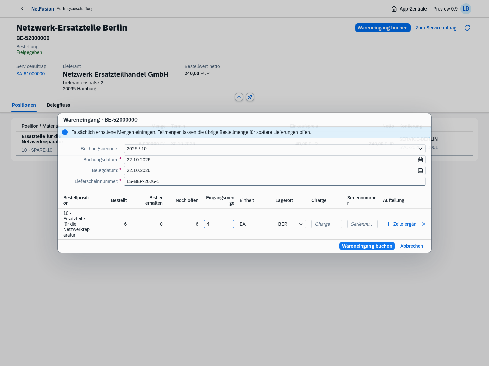
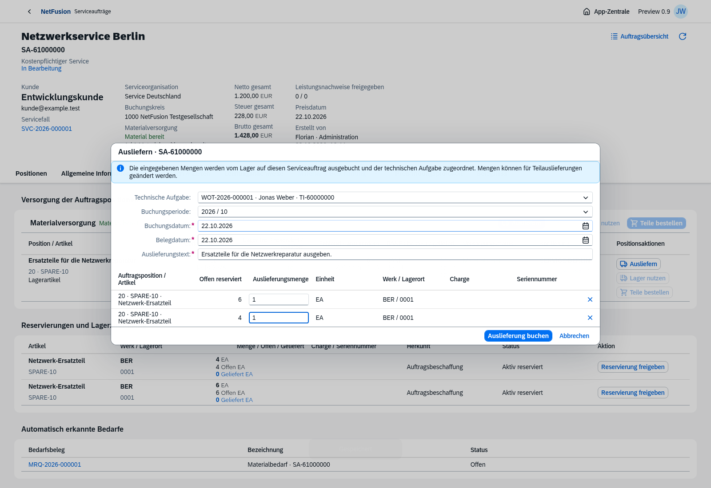
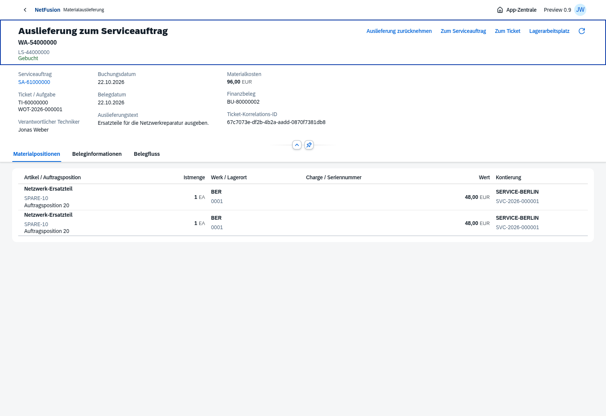
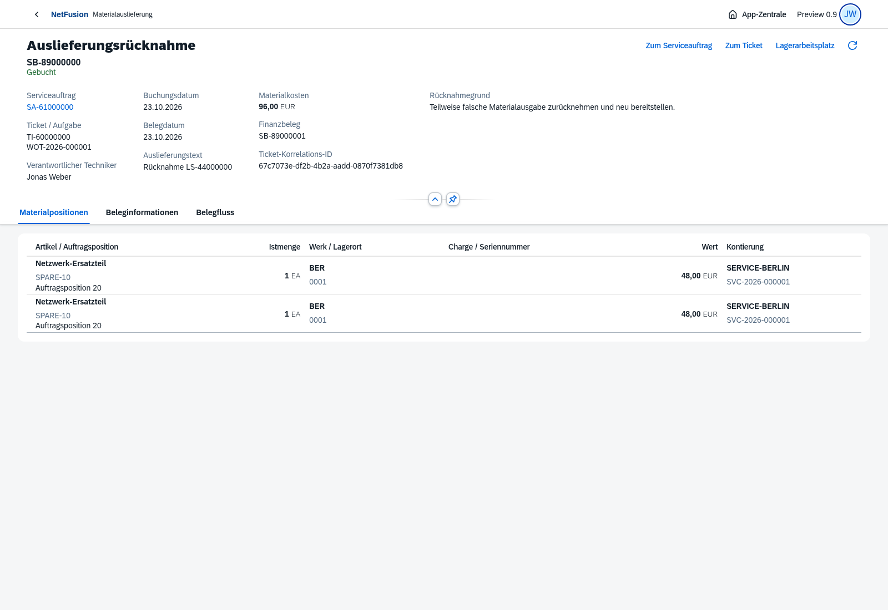
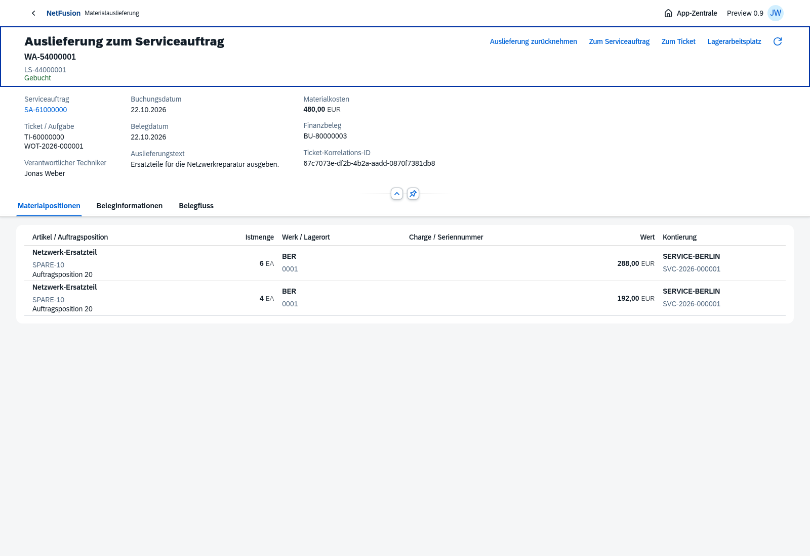
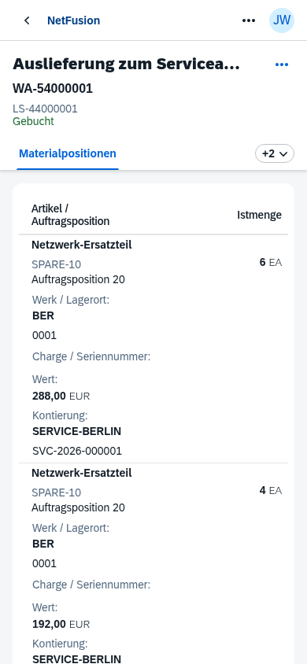
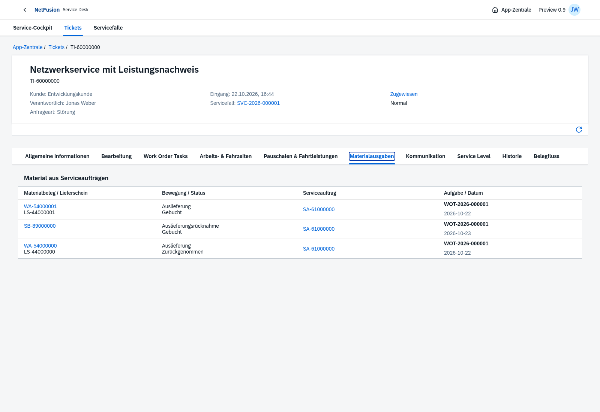
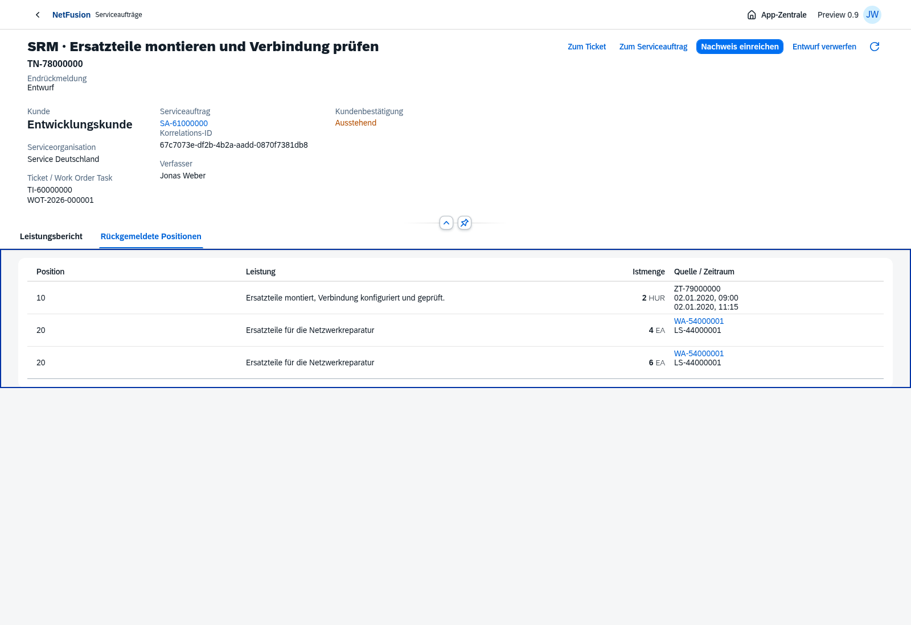
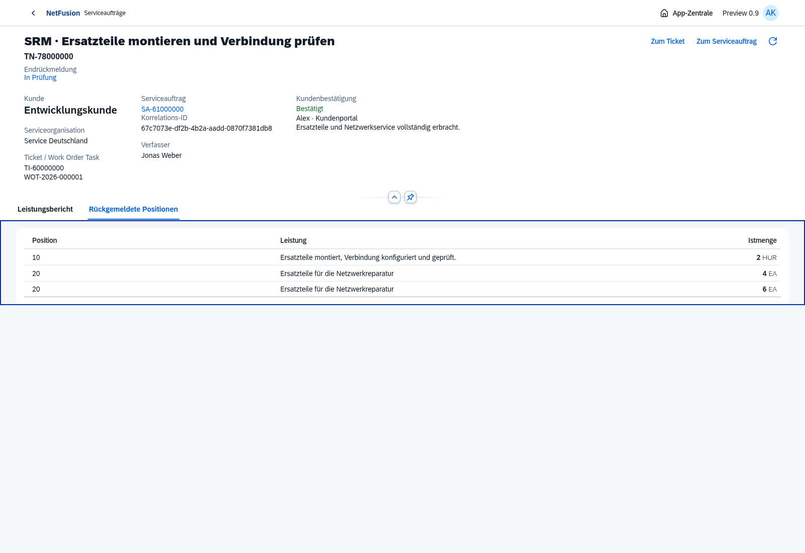
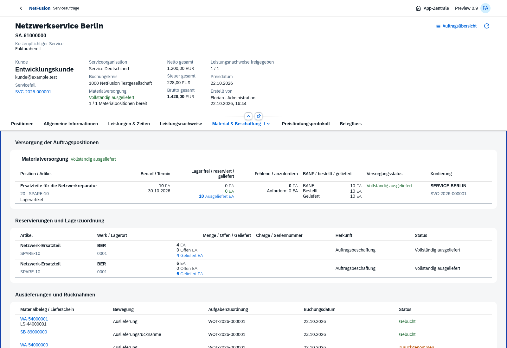

# Preview 0.9 · Auslieferung, Verbrauch und korrelierte SRM

Echte Chromium-Aufnahmen vom 22.10.2026 mit OpenUI5 1.153.0 und isolierten PostgreSQL-Testbelegen. 117 automatisierte Prüfungen und elf Browserabläufe bestanden. [Versionsumfang und Grenzen](../../releases/v0.9.0-preview.1.md).

Bestand10/Wert480 → Teil-Ausgabe2/Wert96 → Gegenbewegung → vollständige Ausgabe10/Wert480. Der WOT-Abschluss erzeugt eine End-SRM mit tatsächlich erfasster Ticketzeit und Materialquellen unter derselben Ticket-Korrelation. Kunde und unabhängige Serviceleitung bestätigen; danach wird der Auftrag technisch abgeschlossen und fakturabereit. Es gibt noch keine Rechnung oder PDF-Lieferscheinausgabe in diesem Tag.

## Tatsächliche Eingangsmenge und offene Teilbestellung

## Editierbare Teilauslieferung auf technische Aufgabe

## Teil-Auslieferung mit Ticket/WOT und Istkosten

## Originalgegenbewegung mit Grund und Quellen-FI

## Vollständige Materialausgabe mit WA/LS

## Auslieferung auf dem Smartphone

## Materialbelege im technischen Ticket

## Automatische SRM aus Ticketzeit und Materialausgaben

## Kundensicht ohne interne Materialkosten

## Ausgelieferte Mengen und Nachweise im abgeschlossenen Auftrag

